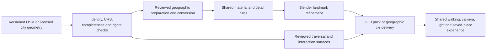

# Real-place 3D production and geographic engine research

Reviewed 2026-10-21 against repository baseline `3836ee3` and current primary documentation. The user's engine-research request established a research gate before production. The delivered [geographic site workbench](../content-tools/README.md) now prepares the two international extracts, exports editable Blender scenes and supports browser review; [iteration evidence](../evidence/global-sites-20261021/README.md) records source, geometry, interaction and art checks. Delft and Helsinki retain unreviewed architecture/navigation and remain internal geographic contexts. Ginza receives independently reviewed surrounding context. Engine migration and new geographic providers remain proposals.

## Recommended production design

Use a source-driven geographic scene pipeline with shared materials, lighting and controls. Keep reviewed landmark geometry, traversal surfaces and factual content as separately versioned additions. **OSM2World remains a research candidate** for reusable OSM-to-scene conversion: the actual Delft/Helsinki experiment produced assets with geometry errors, so it has not passed production acceptance. Its existing roof, road and material handling merits further evaluation with explicit source/error checks. Preserve the source audit and authored-parameter record around any converter.

The resulting flow is:

The shared rules should govern material families, scale, geometry budgets, instancing, pavement contrast, authored ambient movement and light response. A place's supplied footprint, roof geometry, street relation, signs and landmark silhouette determine its identity. Missing features remain explicit unknowns or authored presentation. A country name is insufficient evidence for a particular roof, tree, shop, lamp or facade style.

Keep the current browser experience as the comparison baseline. A different engine becomes justified by a measured improvement in interaction, visual quality or production speed on the **same real datasets and same walking/inspection task**. Geographic streaming can also be adopted independently of a full game-engine migration.

## Methods and what they produce

Effort and operating-cost comparisons in this table are engineering estimates. This review did not measure artist hours, scan-training time, GPU hosting costs or native-engine performance.

| Method | Coverage and real-place detail | Editing, light and interaction | Production/update and delivery implications | Rights and service boundary |
| --- | --- | --- | --- | --- |
| OSM/Overture geometry with shared procedural materials | Broad footprint and street coverage; heights, parts, roofs and paths vary by location. Missing facade data remains missing. | Editable meshes and PBR materials suit day/night, collision proxies and original gameplay. Walking surfaces still need review. | Low repeated geometry-authoring effort where tags are complete; source validation and landmark review remain per-area. Download bounded/versioned data and regenerate changed IDs. | OSM and Overture **buildings** use ODbL. Preserve attribution and applicable database obligations. Overture's other themes can have different licenses. [OSM](https://www.openstreetmap.org/copyright), [Overture buildings](https://docs.overturemaps.org/guides/buildings/) |
| OSM2World scene conversion plus Blender refinement | Converts actual OSM features into meshes; output richness depends on tags and selected LOD. Procedural defaults add presentation detail. | GLB/PBR output is editable in Blender and usable by our renderer. Source IDs can connect refined meshes to facts. Generated roads do not establish legal or accessible walking routes. | Existing conversion/material logic reduces custom generation work. Pin executable, style and config; compare CPU time, payload, geometry omissions and editing effort on both samples. Browser ESM conversion is documented for smaller datasets. | Current source license is MIT; default-style config/textures are declared public domain/CC0. OSM data remains ODbL; audit bundled third-party models/dependencies separately. [JVM](https://osm2world.org/docs/library-jvm/), [Web](https://osm2world.org/docs/library-web/), [license](https://raw.githubusercontent.com/tordanik/OSM2World/master/LICENSE.txt), [style](https://raw.githubusercontent.com/tordanik/OSM2World-default-style/master/README.md) |
| Official semantic city models | Stronger measured roof/body geometry within specific jurisdictions. Netherlands 3DBAG offers LoD1.2/1.3/2.2; Helsinki provides semantic CityGML LoD1/2. Street-level facade completeness varies. | Semantic meshes support rematerialing, relighting and per-building selection; ground access and detailed interiors require separate data. | More CRS/format/vertical-datum work, less roof invention. Updates should preserve official building IDs. Download only selected buildings/tiles. | 3DBAG CC BY 4.0, credit “© 3DBAG by tudelft3d and 3DGI”; Helsinki models CC BY 4.0. Provider terms remain dataset-specific. [3DBAG](https://docs.3dbag.nl/en/), [rights](https://docs.3dbag.nl/en/copyright/), [Helsinki](https://www.hel.fi/en/decision-making/information-on-helsinki/maps-and-geospatial-data/helsinki-3d) |
| Owned or appropriately licensed photo/panorama references | Exact visible appearance at a capture date; occluded/back surfaces and depth are incomplete. | Useful for original facade modeling and optional reference views. Image viewers have limited free movement; photo lighting cannot be freely changed as PBR surface lighting. | Relatively small media payloads; license, orientation, date and visual review remain per item. Material reuse and geometry derivation require appropriate rights. | Record each item's author, license, URL, capture date and allowed use. The existing Kyoto/Ginza licensed-reference process is reusable. An engine's media loader grants no content rights. |
| Photogrammetry / COLMAP from permitted capture | Detailed visible surface geometry for the photographed area. Reflective glass, textureless walls, motion, occlusion and inconsistent illumination cause gaps. | Cleaned mesh can support collision and relighting after material/lighting cleanup. Raw scan textures contain capture illumination and temporary objects. | Capture planning, registration, reconstruction, cleanup, simplification, UVs and semantic labeling add per-site work. Recapture is required for changed appearance. | COLMAP software is BSD; images and resulting assets require their own rights. [capture/reconstruction guide](https://colmap.github.io/tutorial.html), [license](https://colmap.github.io/license.html) |
| Gaussian-splat capture | Strong view-dependent appearance around captured camera coverage; unseen space and traversable surfaces are not supplied automatically. | Standard splats use display-referred colors; ordinary scene light/exposure generally does not relight them. A separate mesh/collision and interaction representation is needed. | Requires permitted multi-view capture, training and a tested splat renderer; sorting, overdraw, payload and mobile memory require measurement. | Current `KHR_gaussian_splatting` is ratified. Software licenses vary: original Graphdeco implementation restricts commercial use; gsplat is Apache 2.0. [specification](https://raw.githubusercontent.com/KhronosGroup/glTF/main/extensions/2.0/Khronos/KHR_gaussian_splatting/README.md), [Graphdeco](https://raw.githubusercontent.com/graphdeco-inria/gaussian-splatting/main/LICENSE.md), [gsplat](https://raw.githubusercontent.com/nerfstudio-project/gsplat/main/LICENSE) |

Overture's building guide describes merged OSM and other building sources, including machine-learned outlines that may represent roofprints. Buildings have stable GERS IDs; building parts use parent relationships and do not all have GERS IDs. Retain per-feature provenance and dataset release. This source is useful for broad coverage, with a reviewed adapter for the particular building representation.

3DBAG's [service documentation](https://docs.3dbag.nl/en/delivery/webservices/) permits querying one BAG identifier or a bounded area in CityJSONFeature form. Its 3D API uses EPSG:7415 (RD New plus NAP height); its published 3D Tiles use EPSG:4978. Helsinki's semantic model uses ETRS-GK25 and N2000 heights. These vertical datums must be explicitly transformed or retained. Replacing them with an unexplained ground-zero offset would lose useful information.

## Sandbox and geographic engine techniques

An engine's terrain, world partitioning and procedural generation systems manage or create scene content. Real-place identity enters through georeferenced datasets, stable source IDs and reviewed additions. Synthetic terrain or asset scattering can support clearly authored ambiance; it cannot verify an unknown street layout or building facade.

| Candidate | Useful capabilities | Compatibility and unresolved work |
| --- | --- | --- |
| Current Three.js/MapLibre plus prepared GLB packs | Existing browser controls, private returns, inspection, locales and public hosting are already exercised. Data-driven GLBs and common materials fit the current authoring path. | Needs a robust geographic content pipeline and controlled detail levels. Larger coverage requires measured tile/asset scheduling and persistent navigation surfaces. |
| CesiumJS / 3D Tiles with a shared interaction layer | Geographic coordinates, hierarchy, view-dependent streaming and open glTF content support wider-area visualization. [3D Tiles 1.1](https://raw.githubusercontent.com/CesiumGS/3d-tiles/main/README.md) supports direct glTF, metadata, implicit tiling and multiple contents. | Tile delivery does not establish sidewalks, collisions or interactions. Evaluate data availability and selection/LOD behavior before replacing the current map or walking renderer. |
| Cesium for Unreal with World Partition and PCG | Georeferenced terrain/buildings plus game-engine physics and characters. World Partition streams authored cells; PCG distributes supplied meshes at configurable scales and can generate around the player. | Native application or a separately operated browser-streaming deployment. Coordinate/origin handling, semantic overlays, traversal, UI and saved-place behavior need implementation and measurement. |
| Cesium for Unity with Unity terrain/scene systems | Geographic content with Unity objects, collisions and characters. Unity heightmaps can ingest real elevation. Current Cesium for Unity supports browser WebGL/WebGPU as well as native platforms. | Unity 6+ web builds require native multithreading and suitable response headers; mobile startup/memory and source-service compatibility are unmeasured here. Migrating the existing app would require preserving its behavior and data semantics. |

[Unreal World Partition](https://dev.epicgames.com/documentation/en-us/unreal-engine/world-partition-in-unreal-engine) loads grid cells by streaming-source distance, supports HLODs and can preload a destination before teleporting. [PCG generation modes](https://dev.epicgames.com/documentation/en-us/unreal-engine/using-pcg-generation-modes-in-unreal-engine) provide partitioned, hierarchical and runtime generation with scheduling/cleanup radii. These are reusable techniques for detail placement and loading. They supply no worldwide source dataset. Unity's [heightmap tools](https://docs.unity.com/en-us/engine/6000.6/manual/creating-environments/script-terrain/terrain-heightmaps) similarly accept real elevation or authored terrain; source and scale determine which interpretation applies.

Cesium's [Unreal integration](https://raw.githubusercontent.com/CesiumGS/cesium-unreal/main/README.md) and [Unity integration](https://raw.githubusercontent.com/CesiumGS/cesium-unity/main/README.md) support external/cloud/private sources. Both plugins are Apache 2.0 and free for commercial use. Data subscriptions and engine licenses are separate. Geographic content can come from our permitted prepared assets or licensed services.

There is a concrete traversal concern in [Cesium's object-placement documentation](https://cesium.com/learn/unreal/unreal-placing-objects/): culled tiles cease participating in physics and shadows. A walking scene therefore needs a retained collision neighborhood or another tested loading policy. The same documentation describes globe anchors, local origins and gravity limitations. Our existing local-metre pack frame can remain a stable interaction frame inside a georeferenced scene.

Current [Cesium for Unity platform documentation](https://cesium.com/learn/cesium-unity/ref-doc/supported-platforms.html) explicitly supports WebGL/WebGPU on Unity 6+. Its [web deployment guide](https://cesium.com/learn/unity/building-an-app-for-the-web/) requires native C/C++ multithreading, COOP/COEP/CORP headers and appropriate compressed-file serving. The current Pages deployment has not been validated for these requirements. Unreal's documented [Pixel Streaming architecture](https://dev.epicgames.com/documentation/unreal-engine/overview-of-pixel-streaming-in-unreal-engine) renders on a remote GPU machine and sends media/input over WebRTC, with signaling and often STUN/TURN. That changes the operating-cost model from static asset delivery to running rendering sessions. No streaming server or account was created for this research.

### Verified pricing boundaries, checked 2026-10-21

| Item | Published boundary | Implication for this project |
| --- | --- | --- |
| Cesium ion | Community is personal/noncommercial/evaluation with quotas. Published Commercial individual price is $149/month, team $524/month; the page asks customers to contact Cesium about integration into solutions used outside their organization. [Pricing and FAQ](https://cesium.com/platform/cesium-ion/pricing/) | These are service-plan figures, not a quote for this public travel application. Self-hosting permitted assets avoids buying that service, while hosting/egress still have costs. |
| Unreal Engine | Published royalty model charges 5% on directly attributable lifetime gross product revenue above $1M; qualifying non-runtime-distributed commercial work above the company threshold uses $1,850/seat/year. [Licensing](https://www.unrealengine.com/license) | Product distribution and revenue determine the applicable license; no fee or eligibility claim is made for the current project. |
| Unity | Published 2026 Personal threshold is up to $200K annual revenue/funding; Pro is $2,310/seat/year prepaid or $210/month; higher tiers have further conditions. Runtime Fee is canceled. [2026 pricing](https://unity.com/products/pricing-updates) | The subscription cost is separate from data services, hosting, asset licenses and migration work. |

The reviewed sources support wide geographic visualization where data exists. They do not support a promise of arbitrary-country, street-level facade accuracy, current access or enterable interiors. Country-wide terrain can coexist with selected detailed cities and sparse buildings elsewhere; the UI must state the actual coverage represented.

## OSM2World evaluation requirements

The official [JVM guide](https://osm2world.org/docs/library-jvm/) documents Java 17+, XML/PBF readers and binary glTF output. The [web guide](https://osm2world.org/docs/library-web/) documents ESM output as material-bearing triangle meshes compatible with Three.js/Babylon.js, LOD0–4, and asks production users to host their own style resources. Its sample references a snapshot build, so documentation availability alone does not establish release stability.

Current source inspection of `GltfOutput.java` and `O2WConfig.java` confirms:

- `keepOsmElements=true` retains object boundaries. `exportMetadata=ID;TAGS` can include `osmId` and `osmTags`; the default exports IDs only. Original versions/timestamps and reviewed field classification should remain in our sidecar source ledger.
- GLB scene/root extras include the origin. The current default projection is `TangentPlaneMapProjection`; it must be converted explicitly to a chosen local frame. The existing Wako frame remains fixed.
- The default terrain interpolator is `ZeroInterpolator`. Flat output without elevation data is an authored approximation. Helsinki's mapped stairs require explicit grade review before traversal.
- GLB materials include base color, normal and ORM maps. Blender can import/refine them; landmark replacement should use source IDs and preserve the geographic transform.
- Mesh merging and LOD choices affect object selection and payload. Measure both, retaining an identity mapping where objects are merged. Source code and config hashes are recorded in the [evidence ledger](../evidence/global-sites-20261021/research/source-notes.md).

The bounded comparison should use the same retained inputs, requested bounds, source-feature checks and material palette. Record converter/version/style hashes, elapsed conversion time, warnings, omitted source IDs, triangle/material counts, GLB/resource bytes, browser decoding/startup, visible landmark recognition and Blender editing steps. Validate actual courtyard holes and grade treatment. Generated windows, road widths and inferred heights remain authored even when the converter produces attractive detail.

The root agent ran the Aug28 `0.5.0-SNAPSHOT` archive, SHA256 `185d3ec08b703b04ae84f583955e6638bd2d76382425f4d2afe74d09c0a1fc0c`, against both retained sources. The actual logs report roof-generation exceptions for Delft ways775746411/775746403/775746404 and a degenerate-triangle error for Helsinki way29478214. Helsinki also reports incomplete relations14659098/14659097 and wall-boundary warnings. The processes returned0 and produced approximately3.1/3.8MiB GLBs. **File creation and process success do not satisfy geometry acceptance.** These outputs remain research artifacts. See the [engine experiment report](sandbox-engine-research-20261021.md) for the measured execution record; source-reviewed Ginza context has independent validation.

## Two retained international intake samples

Both source responses were fetched successfully over the inherited TLS-verified proxy with an identifying research user agent. Full XML, hashes, timestamps and source tags are retained under [research evidence](../evidence/global-sites-20261021/research/README.md). These are bounded production-tool inputs; they currently have no reviewed playable navigation surface.

| Sample | Actual source and identity | Geometry/data observations | Useful validation |
| --- | --- | --- | --- |
| Delft Markt / City Hall, Netherlands | bbox `[4.3570,52.0108,4.3595,52.0121]`; way209351406 v28; BAG0503100000014169; RCE11901. Official [monument register](https://monumentenregister.cultureelerfgoed.nl/monumenten/11901) places the City Hall at Markt87. | 703,490-byte response. Selected City Hall ring has 41 nodes including closure, all present, valid; height tag 20m, no levels/roof-shape/material/access tags. Derived interior reference 52.01145130,4.35843378 has no entrance meaning. | Landmark identity, missing-field handling, pedestrian-area context and a future BAG-to-3DBAG join. Roof/tower form requires additional geometry/reference before a detailed landmark claim. |
| Helsinki Senate Square / Cathedral, Finland | bbox `[24.9518,60.1681,24.9548,60.1704]`; cathedral way1542850662 v3. Official [cathedral visitor page](https://helsingintuomiokirkko.fi/en/index/uusipaataso.html) establishes operator identity and variable access arrangements. | 654,698-byte response. Cathedral ring has 40 nodes including closure, all present, valid; height 59m/material plaster, no levels/roof-shape/roof-height. Five retained building relations have actual inner rings. Response includes 37 steps ways. | Real courtyard holes, building parts, and explicit grade/access uncertainty. A single 59m extrusion cannot represent the cathedral's domes and body correctly. |

Counts describe full API responses, including complete intersecting ways beyond each query box. The complete cathedral footprint extends north of the Helsinki query boundary; preserve it and report the actual output coverage. Its derived interior reference is 60.17042175,24.95217987. Building reference points establish identity only.

Real Helsinki courtyard relations include 1331997,1331998 (Government Palace),1688738,2105743 and7193165; their outer/inner member ways and nodes are present in the retained response. Relations1331997 and7193165 share an outer ring at different level descriptions: a converter must retain the relationship rather than double-counting an ordinary footprint. Broader route/boundary relations in a bounded OSM response may be incomplete; the preparation tool must report and reject unsupported geometry instead of silently making closed polygons.

The [OSM API policy](https://operations.osmfoundation.org/policies/api/) governs these one-off research extracts. The main API serves editing use; repeated production-area generation should use appropriate extracts/services and caching. No plan here depends on making one core-API download per traveler.

## Ginza context prepared before the research pause

[Canonical context](../content/ginza-wako/context.json) retains two neighboring footprints (ways103509466 and449618283, both with eight-level tags and unknown source height), Harumi/Chūō carriageway portions, three crossing segments and two sidewalk branches from the existing Oct19 raw source. It uses the unchanged Wako origin/frame.

The display rectangle is authored x[-65,80],y[-30,70] metres. Display widths 9.6m/7.2m for the selected roads and 3.2m for branch sidewalks are authored; lane counts inform hierarchy only. GEOS-derived polygons exclude the frozen Wako body, existing walkway, facade apron and neighboring footprints. The three layers contain 21/22/95 triangles, with complete polygon coverage, retained holes and only floating-point-scale overlap. Render heights are authored road −0.12m and land/branch-sidewalk −0.003m. The existing 55.281851m playable chain, navigation width and inspection anchors are unchanged.

The short Harumi crossing way522046473 ends at a carriageway node. Its mapped segment supports a visible partial crossing marking; it does not establish a complete street crossing. No streetlight pole, drain or tree position was verified. Surface-source SHA, canonical Wako SHA, parameters and validation are embedded; [replay script](../evidence/global-sites-20261021/research/prepare_ginza_context.py) reproduces the canonical bytes.

## Promotion into a reviewed interactive area

Every prepared feature needs dataset/release/capture time, source URL/license/attribution/hash, stable ID/version, original tags, geometry CRS and vertical datum, chosen local transform, and per-field `source`/`derived`/`authored`/`unknown` meaning. Keep query bounds separate from complete feature bounds. Store authored defaults, generator version and seed with output hashes.

An approximate preview can use complete, valid footprints with disclosed default heights and materials. A reviewed walking area additionally needs connected traversal geometry, collision clearances, grade/step treatment, bounded spawn/return positions, source-access limitations, and recognizable reference-supported features. Shared camera, touch, day/night, inspection and private-place behavior must pass on the exact exported package. Source or navigation changes require revision-aware saved-view handling.

Blender's [Geometry Nodes](https://docs.blender.org/manual/en/latest/modeling/geometry_nodes/introduction.html) and its Python API can repeat material/mesh rules; [BlenderGIS](https://raw.githubusercontent.com/domlysz/BlenderGIS/master/README.md) can assist GIS import. The latter is an optional authoring tool whose version compatibility needs testing; its OpenTopography path requires a separate API key. Our current research configures no such service. Blender's [glTF exporter](https://docs.blender.org/manual/en/latest/addons/scene_gltf2.html) supports PBR meshes, custom properties and punctual lights, while World/Area lighting is omitted. Keep shared runtime environment lighting explicit in pack metadata.

Measured inputs here total 1,358,188 bytes. The prior reviewed Ginza package records a 7,970,296-byte GLB, 84,624 triangles and 48 batches; these are repository baseline measurements, not projected figures for generated neighborhoods. A richer converter or streamed dataset must be measured under the same browser budget. No paid endpoint, city-scale scan download, engine installation, photogrammetry run or splat training was performed by this research lane.
