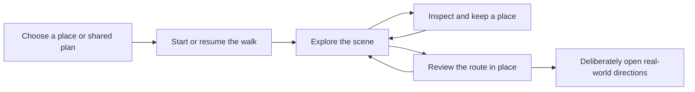

# Realism and immersion · proposed direction

27 October 2026. Research and planning only, following the user's instruction to
pause construction. The public candidate-13 preview remains unchanged. This
document proposes the next direction; it does not authorize a new implementation,
paid service, capture commission or replacement of continuous 3D walking.

## Priority and observed problem

Use the proposed weighting **45% realism and independent recognition, 35%
immersion, 10% travel usefulness, 10% cost and scaling**. These weights express the
user's priority; they are not measured vendor scores. Rights, source availability,
continuous walking and the existing performance targets remain eligibility gates.

The user's colleagues found rigid, unconvincing buildings and roads, could not
recognize the six places independently, and lost immersion through the site's
many links. Perceived art quality, recognition and journey acceptance are open.
The existing route's length and technical checks do not resolve those findings.

The current intake derives footprints and heights from municipal LOD1 solids,
then places them on an authored flat display surface. Repeated facade assemblies
and small generated material patterns supply much of the visible appearance.
Source identifiers and valid traversal remain useful; observed openings, street
surfaces and local facade textures are missing from much of that representation.
See [geographic intake](../content-tools/prepare-shijo-east.py),
[facade assembly](../art/neighborhood_mesh.py) and
[material generation](../art/neighborhood_materials.py).

## Recommended next source and representation

Evaluate a **150–250 m continuous Pontochō street using original textured LOD3
data**, retaining real source geometry, UVs, openings, signs, furniture and ground
features. Confirm actual coverage before choosing endpoints. Keep a separately
reviewed pedestrian surface for movement and future shared positions. Blender's
role would be source-preserving cleanup and preparation for streaming.

There is a specific source lead: MLIT documents detailed textured Pontochō and
Gion Shinbashi models, including doors/windows, signs, lanterns and riverside
fences. Its example also adds assets and authors night appearance separately;
the finished film does not demonstrate raw-data quality or browser performance.
[MLIT workflow](https://www.mlit.go.jp/plateau/learning/tpc32-1/)

The team's metadata-only check finds 138 LOD3 buildings among 4,444 buildings in
mesh `52354601`. The 2025 package's metadata identifies FY2023 vehicle-mounted
photographic laser surveying and CC BY 4.0. Its 2026 metadata date is separate from
the capture date. This is evidence that richer source material exists;
object-level texture quality and a continuous suitable walking corridor remain
unverified. The candidate alley extends north of the present route, which reaches
Pontochō's southern entrance. It does not establish detailed coverage of the
current 1.35 km or all six stops. The existing preview is a contextual baseline;
controlled representation comparisons require the same actual scene and views.
The [source review and retained metadata](../evidence/neighborhood-20261027/world/provider-research.md)
bind these findings. The [technical comparison](scene-technology-research-20261027.md)
records format, streaming, relighting, multiplayer-state and provider-cost details.

| Method | Expected contribution to realism and immersion | Decision for the proposed experiment |
| --- | --- | --- |
| Original textured municipal/scan mesh | Preserves supplied architectural identity and supports ordinary 3D movement, occlusion and editable geometry | First specific data candidate; verify walking-height texture/detail, ground contacts and source dates before adaptation |
| Licensed terrestrial capture, as textured mesh or Gaussian splats | Can retain dense street-level appearance and local detail absent from generic reconstruction | Compare where matching licensed capture exists; account for acquisition, holes, frozen people, reflection artifacts, collision and lighting work |
| City-scale photorealistic 3D tiles | Supplies geographic context and broad urban appearance | Examine actual ground-level coverage; the provider documentation does not establish this corridor's near-facade or covered-arcade quality |
| Street panoramas | Supplies captured appearance at known viewpoints | Useful visual reference and a separate travel alternative; node-to-node travel changes the currently requested free-walking experience |
| Generative world models | Can produce visually rich, explorable scenes from sparse input | Keep factual correspondence as a requirement: generated missing regions cannot establish what exists at a real destination |

Google documents [city-scale 3D delivery](https://developers.google.com/maps/documentation/tile/3d-tiles-overview)
and [Street View panoramas](https://developers.google.com/maps/documentation/javascript/streetview).
The distinction between camera movement through geometry and movement among
captured panorama positions matters to this product's agency and continuity.

Current browser tools make a captured-3D comparison technically plausible:
[Spark](https://sparkjs.dev/docs/lod-getting-started/) supports precomputed paged
splat detail, and [PlayCanvas](https://developer.playcanvas.com/user-manual/gaussian-splatting/building/lod-streaming/)
documents streamed splat regions. These are capabilities, not measured speedups
for our content. PlayCanvas's [relighting method](https://developer.playcanvas.com/user-manual/gaussian-splatting/building/relighting/)
uses a matching proxy mesh and an additional rendering pass; original captured
illumination remains part of the source appearance. Realistic day/night needs its
own reference and quality comparison. Preserve existing day/night in the current
preview while this future representation is evaluated.

World Labs' [Atlas announcement](https://www.worldlabs.ai/blog/atlas) describes
reconstruction and explicit 3D output, and also states that unseen regions are
imagined. It currently advertises an early-access request. That gives a research
direction, with neither project access nor truthful street reconstruction proven.

## A coherent experience around the place

One website entry offers Explore and Together. Entering or resuming a walk gives
the scene the main viewport. Route, Place and Saved open contextual panels while
retaining the visit. Sources and external Maps handoff appear with their relevant
action. Historic pages remain reachable from a secondary collection. Each person
can understand where they are, continue walking, inspect, keep a moment and return.

Test eye-height views around 1.6–1.8 m and retained third-person controls on the
same scene. Close frontage detail, parallax, under-eave views, ground contacts,
stable speed and looking back must remain convincing during actual motion.
Natural-world signs stay in the scene; floating app labels cannot substitute for
recognizable architecture. Optional ambient audio and small observed motions can
support the place after its visual identity and continuous movement are credible.
The [journey research brief](journey-review-20261027.md) defines the proposed
panels, focus, pause/resume, EN/ZH and private-return behavior.

## Proposed work after the direction decision

| Sprint | Deliverable | Exit evidence |
| --- | --- | --- |
| R1 · Qualify a real street | Bound the actual LOD3 corridor; inventory textures, furniture, roads, capture dates, licenses and missing surfaces; select independent photographs | A continuous source-supported specimen and a stated source gap list; no claim that district bounds equal detailed coverage |
| R2 · Prove appearance and movement | Prepare one interactive specimen preserving source detail; use a common minimal interface to compare eligible representations and camera heights | Actual close-up/forward/reverse/corner views, recognition observations, continuity defects and named-device performance; any comparative scene must be geographically matched |
| R3 · Prove the user journey | Apply the selected representation to the one-entry, contextual-panel flow; verify save/return and intentional Maps handoff | People can enter, explore, recognize, keep and resume without explanatory links or facilitator assistance |
| R4 · Extend reviewed coverage | Extend only the accepted source/production method into additional connected areas | Each added stretch passes the same scene, movement and recognition criteria; the city/country planning map retains wider geographic coverage |

R2 and R3 are sequential evaluations so changes in visual representation and
interface do not confound each other. Additional source capture is a costed
decision if supplied data cannot meet the ground-level requirements. The full
route remains a product objective; new distance is not the next acceptance metric.

Proposed screening criteria, to fix with the selected specimen before recruitment:

- Observe unfamiliar participants matching the environment to held-out real
  photographs with app labels hidden; record familiarity separately and report
  each feature/language's actual denominator. Target at least 80% correct matches
  per evaluated feature. Familiar observers additionally describe/name the place.
- Target median realism and immersion ratings of at least 5/7, retaining the
  reasons, interruptions and adverse observations. Report exploratory participant
  counts and uncertainty; authors cannot substitute their own ratings.
- Target at least 85% unassisted entry, movement, inspection, save and return in
  both languages. Record wrong destinations, unwanted navigation and backtracking.
- Retain the existing physical-GPU targets: cold entry ≤8 s, each of three warm
  entries ≤3 s at 10 Mbps/80 ms; event response p95 ≤100 ms; frame p95 ≤33.3 ms;
  every unchanged Q03 warm action <500 ms. Include transfers, decode costs,
  resident resources and visible detail transitions. Software-rendered results
  remain separately identified.

## Costs and dependencies

Detailed public data removes a source-license fee where its terms permit reuse;
data preparation, review, source refresh, serving bytes and capture gaps still have
costs. An 8192² RGBA8 texture occupies 256 MiB before mipmaps, so original texture
resolution requires measured regional residency and compression. The current
96 MiB texture gate cannot be presumed to fit a direct import.

Scaniverse is one possible acquisition tool. Its current published monthly Pro
tier is US$50 and lists commercial rights; acquisition still requires physical
access, capture labor and sufficient processing credits. This is a vendor price,
not a quote for our street or a purchase recommendation.
[Pricing](https://nianticspatial.com/pricing),
[capture prerequisites](https://nianticspatial.com/docs/scaniverse/quickstart/).

Google requires a separate regional/provider decision. Its standard terms restrict
distribution/marketing of applications using Core Services in listed territories,
including China, one of this product's target markets. Its content also has
restrictions on extraction, caching and derived content. Google imagery therefore
cannot be assumed to be a universally usable input for our owned scene pipeline.
[Terms](https://cloud.google.com/maps-platform/terms),
[territories](https://cloud.google.com/maps-platform/terms/maps-prohibited-territories).

No new representation has been rendered or benchmarked in this research turn.
The available workspace still has no established physical-GPU test environment.
Source qualification and a measured prototype remain necessary before declaring
any proposed method realistic, immersive or ready for geographic expansion.
