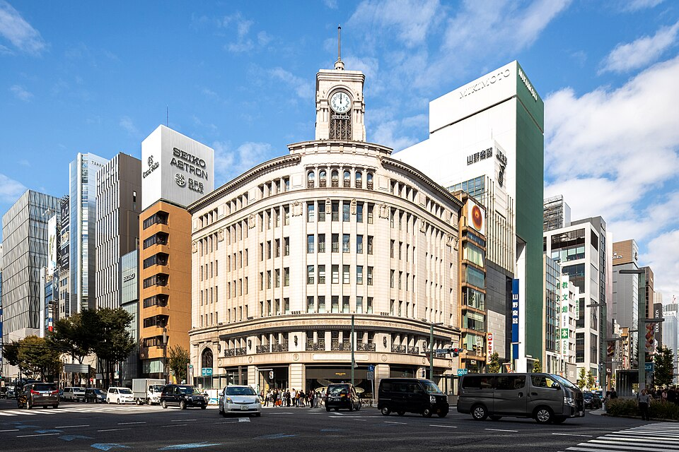

# Recognition study · Ginza 4-chōme

2026-10-19 · Owner: lead · Ginza interactive pack approved; source data frozen and production in progress. Browser and human recognition review remain pending.

## Selected place and purpose

Use **Tokyo's Ginza 4-chōme crossing, centered on the Wako clock-tower building
(SEIKO HOUSE)**. The user requested another famous street view to test whether
the depicted building feels like its real counterpart. This is the selected
reference for that test, complementing the existing Kyoto scene.

Ginza gives us a narrow, recognizable architectural target: a tower above a curved
corner, two adjoining façades and the surrounding street relationship. Asakusa's
[Nakamise](https://www.gotokyo.org/en/spot/73/index.html) is a credible alternative, but its identity depends more on a sequence
of shops, gates and street activity. Wako is the more focused test of the building
features the user identified. The approved pack covers the Wako corner and a
selected same-side sidewalk chain; wider Tokyo traversal remains outside its scope.

Reference: **“Ginza Wako 20241021.jpg”**, Supanut Arunoprayote, 21 October 2024,
[Wikimedia Commons](https://commons.wikimedia.org/wiki/File:Ginza_Wako_20241021.jpg),
[CC BY 4.0](https://creativecommons.org/licenses/by/4.0/).
This is Wikimedia's uncropped 960px thumbnail, with no additional alterations.
The lead and art reviewer inspected the original photograph; the retained image
is a research reference, not a render from our app. [File identity and limits](../evidence/recognition-selection-20261007/reference.json).

## Reference-supported anchors

| Feature visible in the photograph | What the live model must make recognizable | What remains unverified |
|---|---|---|
| Narrow clock tower above the corner | Round clock, dark grille, stepped rectangular crown and rod; tower position and proportion relative to the body | Tower footprint, mounting details and unseen faces; vertical dimensions are supplied by the operator below |
| Convex rounded corner joining two wings | Curved façade, continuous cornice and lower bands; believable relation to both streets | Exact radius and dimensions; a rectangular block is not an adequate replacement |
| Window hierarchy | Six central upper arches confirmed by the reviewed 2022 reference, different wing openings, narrow rectangular windows below and substantial pale piers | Exact spacing, depth and obscured bays remain authored |
| Horizontal architectural divisions | Projecting cornices, decorated lower band, patterned railings and circular reliefs interrupt the vertical rhythm | Carving dimensions and material boundary elevations remain authored; stone types and finishes are supplied by the operator |
| Recessed ground interface | Dark glazing and solid piers have depth; the left-side arched portal remains distinct | Vehicles and people obscure details; tenant/door assignments, interiors and access are not established |

The photograph's warm pale appearance is affected by exposure and daylight. It is
not a calibrated material colour. Temporary signs, displays, people and traffic
document a 2024 view, not verified current conditions. Lighting should reveal
the architectural anchors without baking the photograph's shadows into materials.

## Source lock and remaining gaps

- [Official SEIKO HOUSE](https://www.seiko.co.jp/en/seiko_house_ginza/) identifies
  the building. Its [Building Specifications](https://www.seiko.co.jp/en/seiko_house_ginza/history/)
  report 30.30m from ground to rooftop, a 9.09m clock-tower rise, 39.39m from ground
  to tower top, an 8m lightning rod and a 2.4m clock dial. These quantities retain
  their distinct meanings. The operator identifies polished Mannari stone on
  floors 1–2 and tapped Mikage granite above, and dates inauguration to 1932-06-10.
- [Wako OSM way 103509469](https://www.openstreetmap.org/way/103509469), version 15,
  modified 2026-01-28, reports seven levels and a height tag of 28. Its closed
  footprint has twelve distinct vertices, including the sampled curved corner.
  The raw 28m tag remains in the source record with its meaning unresolved;
  vertical authoring uses the distinct operator specifications.
- The geometry is retained from the [official OSM map API](https://api.openstreetmap.org/api/0.6/map?bbox=139.7647,35.6714,139.7653,35.67185)
  in the [Ginza source ledger](ginza-wako-sources.md) and
  [canonical source data](../content/ginza-wako/source.json). The closed footprint
  and five-node sidewalk chain use one explicit metre projection. The chain's
  derived length is 55.281851m. Its 4m simulation corridor and level ground are
  authored; source widths, grade and current obstruction clearance are unknown.
  Attribute © OpenStreetMap contributors under
  [ODbL](https://www.openstreetmap.org/copyright).
- Mitsukoshi is orientation context only. The available
  [2018 photograph](https://commons.wikimedia.org/wiki/File:Ginza_Mitsukoshi_2018.jpg)
  predates its [2020 Ginza Chandelier façade treatment](https://www.mistore.jp/store/ginza/event_calendar/ginzachandelier.html).
  Do not use it to claim current neighbouring-façade accuracy.
- Art inspected the original [“SEIKO HOUSE GINZA 20221216.jpg”](https://commons.wikimedia.org/wiki/File:SEIKO_HOUSE_GINZA_20221216.jpg)
  by 先従隗始, photographed 2022-12-16 and released under
  [CC0 1.0](https://creativecommons.org/publicdomain/zero/1.0/). This similar elevated
  corner angle clarifies six central upper arches, tower pilasters, cornice brackets
  and the grille below the clock. Ground details remain partly obscured.
  An independent unseen angle and unobstructed lower-frontage reference are still
  required for recognition transfer or further access claims.

No Google Street View pixels or extracted geometry are used. External source
pages support identity and research; permission to copy their photographs must
be checked separately. The retained Wako photograph has the explicit licence above.

## Approved interactive pack

The [2026-10-19 milestone](sprint-packs-20261019.md) adds a second detailed,
interactive 3D area using the shared Blender and browser pipeline. Ginza walking
follows the selected same-side sidewalk chain around Wako's corner, with finite
end caps and an authored collision corridor. Roads, station access, interiors and
unselected sidewalk continuations remain outside traversal coverage.

The pack preserves walking, camera controls, day/night lighting, source-linked
feature inspection and private saved viewpoints. Its stable ID `ginza-wako`,
revision, metre frame, navigation and assets are separate from `kyoto-shijo`.
Pack-specific saved positions must reopen in the matching scene; Kyoto's existing
interaction and saved-state behavior remains part of regression review.

Four inspection subjects cover the clock tower, curved corner, upper-window
hierarchy and stone/cornice treatment. The model uses the frozen footprint and
operator dimensions, with authored bay dimensions, intermediate floor elevations,
hidden surfaces and lighting. Production and integrated browser verification are
in progress; architectural recognition requires the human review below.

## Review that can fail

1. **Architectural agreement:** compare actual browser frames and camera motion
   with the source. Wrong tower placement, wrong corner form, missing window
   hierarchy or unreadable anchors due to glare/shade require revision.
2. **Recognition beyond a logo:** first remove the location title. Have someone
   familiar with the place identify it and point to the visible supporting cues.
   Separately inspect the façade body with clock/name cues concealed; a recognisable
   clock on generic architecture is insufficient. This is a proposed review setup,
   not an image transformation already performed on the source photograph.
3. **Transfer:** after an unfamiliar participant explores the scene, use an unseen
   real-reference angle to test what they recognise. Do not teach the answer with
   that test photo beforehand. Until an independent unseen-angle reference and
   participant are available, this gate remains pending.
4. **State and usability:** exercise the new view, return to a seeded Kyoto walk,
   and verify unchanged position, choices and notes. Check EN/ZH camera controls,
   actor/scale cues where present, ordinary-device interaction and missing-asset
   recovery. Automated state checks do not prove visual recognition.

Record prior familiarity, reference dates, build, device, language, explanations
and assistance. Keep recognition, attractiveness, factual accuracy, fluency and
product usefulness separate. The reported “60% positive” realism feedback has
no known denominator or method and supplies no automatic pass threshold.

The [positioning proposal](positioning.md) keeps this architectural study parallel
to the proposed discovery, personal-moment and recipient-experience prototype.
Recognizable architecture supports that experiment; it cannot establish its
enjoyment, social value or real-world effects. Source preparation is complete;
interactive pack production and browser verification are in progress, and human
recognition results remain pending.
