# Lively streets and repeatable site production

The user authorizes continuing streetscape/lighting quality, Q03 language-switch
latency and workflows for producing 3D sites across countries. This iteration
preserves the Shijō/Ginza interaction and private-return experience. Its baseline
is source `3836ee3`, runtime `379e9d3`, Pages `3362d6c`, package
`5a8e0f67506cd164e7422e8aaf22c6a77685c4a7996168aac16703a6b0d0deb7`.
Existing local, CI and actual HTTPS evidence is retained under
`evidence/area-packs-20261019/`. The plan date follows UTC evidence naming.

## Deliverables and responsibilities

The user adds a research-first review of sandbox game engines. The
[engine research decision](sandbox-engine-research-20261021.md) precedes further
production edits. Apply reusable world/content patterns and evaluate OSM2World
with actual geographic inputs; preserve the current runtime while comparative
engine benefits remain unmeasured. A converter experiment is part of L02/L04.
Production edits and performance runs were paused during this research gate.

| Sprint / ticket | Owner and review | Delivered outcome and acceptance |
| --- | --- | --- |
| 1 · L01 Language response | Engineering → lead/QA | Diagnose the actual rendering/input interval and remove demonstrated redundant work. Preserve the exact Q03 protocol, browser and three separate warm actions below 500 ms; report each result and any remaining gap. Preserve colors, labels, provider identity, camera, room and saved selection. |
| 1 · L02 Source and production definition | World + product → lead/art | Review primary-source workflows, costs, rights and geographic/data-quality limits. Capture bounded actual Delft/Helsinki source data with identity, dates, hashes and missing fields. Specify what qualifies as geographic context, reviewed architecture and a reviewed walk. |
| 2 · L03 Ginza streetscape and lighting | Art + world → lead/QA | Improve source-supported surrounding street composition, road/material response, glazing and coherent night pools. Preserve Wako footprint, navigation, actor/camera interpretation and all Kyoto assets. Match day/night openings, lateral walking and both frontages on desktop/phone. |
| 2 · L04 Reusable site workbench | Lead → world/QA/art | Implement a reproducible source-to-context pipeline using mature geometry/projection/conversion libraries and Blender. Produce actual context models for two bounded sites in different countries; preserve observed/derived/authored values, exclusions, holes, source IDs, units and origin. Export manifests/provenance and provide browser review. Promotion to a walk requires independently reviewed navigation and interaction data. |
| 3 · L05 Integrated validation | QA + engineering + art → lead | Actual keyboard/touch, EN/ZH, day/night, normal/reduced motion, save/reload/return, Maps identity, failure/retry, hidden work and bounded resource lifetime. Validate procedural output against captured source geometry and actual GLB/browser rendering. |
| 3 · L06 Release and handoff | Lead → QA/product | Commit coherent changes, run appropriate full regressions, publish tested runtime bytes, verify actual HTTPS journeys, synchronize source/Pages/evidence/checkpoint and record open quality gates. |

Lead owns homepage integration, workbench CLI/exporter/viewer, plan and release.
Engineering owns `src/home/world-map.js`, `map-style.js` and focused tests. Art owns
`art/build_ginza.py` and its generated Ginza assets. World owns source/context
records and workflow research. QA owns independent browser/pipeline validation.
Browser/GPU windows are exclusive. Lead alone builds the final application package,
commits and publishes; scratch files stay inside ignored `artifacts/`.

## Production workflow

```mermaid
flowchart LR
  A[Site identity and bounded source area] --> B[Source and rights review]
  B --> C[Normalize coordinates and geometry]
  C --> D[Classify observed, derived and authored values]
  D --> E[Blender context and architectural modules]
  E --> F[Materials, daylight and night]
  F --> G[Export GLB, provenance and budgets]
  G --> H[Actual browser and reference review]
  H --> I[Reviewed navigation and interaction]
  I --> J[Versioned place pack publication]
```

The common workbench accepts a bounded site definition, real geographic features
and explicit authored art policy. Its output is an editable approximation suitable
for production review. Source-rich city models and owned/licensed capture can enter
the same review/export process with their own conversion and quality requirements.
Every place retains its local geometry, documented features and uncertainty;
country names alone do not determine architecture, materials, access or lighting.

Raw map heights, floor counts, roofs, paths and access tags may be absent. Missing
values require a declared authored policy or an explicit exclusion. Invalid rings,
incomplete relations, unsupported geometry, bad coordinates and failed source
loads cannot silently become successful place output. Courtyards and multipolygons
must retain their meaning. Source dates and real-place identity remain distinct
from camera/spawn coordinates. A visual road or doorway establishes no access claim.

Delft Markt and Helsinki Senate Square are bounded workflow demonstrators. They
exercise actual source intake, geometry and browser output. This iteration does
not automatically register them as reviewed walkable packs. Existing global map
exploration continues to provide broader coverage with its explicit approximation.

## Art and interaction gates

Ginza keeps its 55.28 m route, building footprint, simulation surfaces and saved-pose
meaning. Surrounding road/footprint source records inform context; missing widths,
heights, finishes and fixture behavior remain authored. Preserve the clock tower,
curved corner, window hierarchy, actor and pavement legibility. Ground contact,
glazing response and night shadows must remain coherent while the player moves.
Record matched camera/viewport/model/rig hashes and actual source references.

The Ginza export remains within **8 MiB model plus place-specific maps**, **100,000
triangles** and **64 mesh/material batches**. Record encoded and decoded resources
and repeated-switch lifetime. Static surroundings must not add continuous hidden
work. Ambient effects, if justified by the selected scene, must respect reduced
motion and pause/visibility; simulated activity must not imply current real events.
New workbench outputs report their own budgets and never inherit Ginza acceptance.

Keep walking, orbit, tilt, pan, zoom, optional visible-surface inspection, EN/ZH,
day/night and private exact-view return in both existing packs. Keep normal-motion
and reduced-motion recovery separately covered. Source-backed Maps links retain
selected coordinates/order. Private words stay independent from shared rooms.

## Measurement and completion

The fresh unchanged Q03 baseline records **1206.2 / 1115.1 / 1131.6 ms**; all exceed
500 ms. Its separately profiled action is 1188.8 ms. Browser is Chromium
`151.0.7922.173`, retained driver SHA `b54abb7eaf169ec6496602605f39cb2528aef193e28bddacd7c669d21f8ab5b3`.
Each measured interval includes the same Playwright click/observation scheduling,
real providers and warm-navigation conditions. Profiling remains separate from
the three acceptance observations. A successful process exit alone never closes
Q03. A changed device/protocol is a separate experiment.

Record actual source/export timings, encoded bytes, triangles, batches, decoded
images, rendering readiness and failures. Estimate recurring authoring/maintenance
cost separately from measured machine time and supplier pricing. No paid service,
new account or hosted backend is required by this iteration.

Release blockers include lost/corrupted saves, wrong geographic identity, unusable
controls, invalid walking surfaces, failed cancellation/disposal, missing art
anchors and unreviewed source/rights. Q03 remains an explicit open P1 until its
unchanged gate passes. Human recognition, enjoyment and emotional value require
participant evidence; agent art review and automated checks retain their scope.

## Iteration checkpoint

Research is committed as `9118573` with diagnostic logs in `d8a33a4`;
implementation is committed as `3214398`, with final internal-viewer shadow and
HTTP verification work in `218fd16` and provider retry recovery in `9f5725d`.
L02 source/research, L03 Ginza art and
L04 workbench implementation pass their local acceptance checks. L05 has 81 local
interaction checks, 12 final material/pose checks, 18 source checks and 36 workbench
browser checks, with scopes bound to their actual packages in the
[evidence record](../evidence/global-sites-20261021/README.md). Final CI
`39552515626` passes all seven complete browser suites on the exact 95-file package;
L05 is complete. Pages runtime `17b8f37` passes **95/95** actual HTTPS file checks
and **16/16** hosted journey checks with zero page exceptions. Metadata-only
`09fec3a` records the result; L06 is complete. Final-package style/tile retry
checks pass 18/18. L01 remains open P1 under the
unchanged response threshold; the accepted map implementation keeps antialiasing.

The next production sprint should promote one geographic context through a
source-matched architecture review: establish roof/body proportions and facade
modules, preserve the common material palette, review one usable walking graph,
and verify the same movement/inspection/private-return journey on desktop and
phone. The pipeline's global applicability depends on available source coverage
and rights; each published location retains its own review. Spatial loading and
distance-based detail need representative multi-neighborhood measurements before
becoming required runtime work. A renderer comparison requires a demonstrated
capability or authoring limitation in that measured scene.
