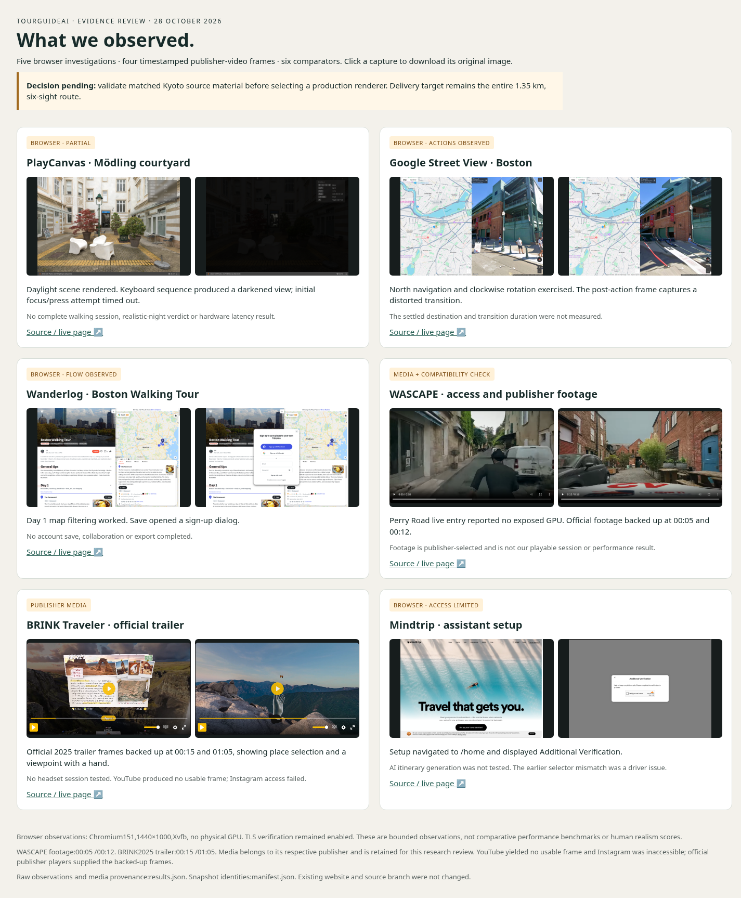

# Realism 01 · reviewed evidence

[Sprint workspace](../../sprints/realism-01/README.md) · [Competitor comparison](../../sprints/realism-01/research/competitors.md) · [File identities and provenance](competitors/manifest.json)

[Organizational validation and reproduction](validation.md)

[Benchmark implementation validation](implementation-validation.md)

| Current implementation evidence | What it establishes |
| --- | --- |
| [Calibration scorecard](benchmark/scorecard.md) | Original candidate-13 loading, queue, frame gaps and separate native visibility observations |
| [Submitted-frame diagnostic](measurement/README.md) | Actual camera/draw and final resident-detail boundaries; all 11 failing checks retained |
| [Source acquisition board](sources/README.md) | Candidate bounds across 54 edges and five inspected original samples; appearance qualification remains open |
| [73-tile source qualification and 18-view board](qualification/README.md) | Actual geometry, source hierarchy selection, one exact sight ID and road/terrain review; original failed visibility check retained |

The [Benchmark V1 protocol](../../sprints/realism-01/benchmark.md) and
[lesson register](../../sprints/realism-01/lessons.md) define the remaining acceptance.
Current evidence does not select a production renderer or close the full-route milestone.

## Competitor snapshots · 28 October 2026

The [original observations](competitors/results.json) preserve the browser actions,
failed attempts and media provenance. The 17-file tracked selection contains the
board, 12 comparison images, two publisher covers and two original JSON records.
All selected files retain their original bytes. The original board describes the
Street View image as a transition; the measured observation is a post-action frame
with distortion. Its duration and settled destination remain unmeasured.

| Evidence class | Included | Permitted conclusion |
| --- | --- | --- |
| Browser observations | PlayCanvas, Street View, Wanderlog, Mindtrip | Specific displayed states and recorded actions |
| Compatibility observation | WASCAPE entry, recorded in results | This environment exposed no usable GPU adapter |
| Publisher footage | WASCAPE 00:05 / 00:12; BRINK 00:15 / 01:05 | Appearance and interactions shown in selected footage |
| Publisher covers | WASCAPE and BRINK originals | Promotional visual reference |

The session used Chromium 151, a 1440 × 1000 viewport and Xvfb without a physical
GPU. No competitor performance ranking, complete playthrough or human realism
score is established. YouTube produced no usable frame and Instagram access
failed; the retained footage comes from official publisher players.

Media belongs to the identified publishers. It is retained as attributed research
evidence; permission to reuse it as product scenery or promotional art has not
been established.

## Retention

The curated files and provenance survive a clean checkout. The larger local
backup remains at `artifacts/competitor-review-20261028/competitor-evidence-20261028.zip`;
its byte count and SHA-256 are recorded in `competitors/manifest.json`. That archive
is an ignored workspace artifact and has no promised remote download location.
Browser profiles, certificate setup captures and raw caches stay outside tracked
evidence.

Future trial measurements and release evidence must record source revision,
device, method, limitations, asset hashes and acceptance results. Their absence
keeps the corresponding sprint gate open.
