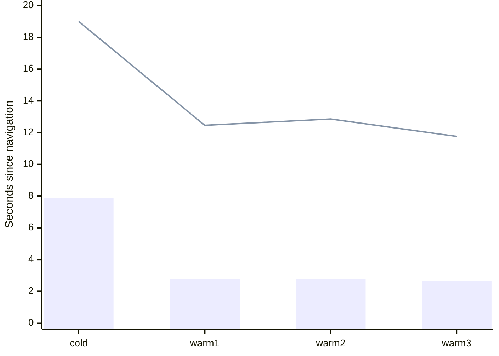

# Benchmark calibration · retained candidate 13

Historical software-host observations, 24 October 2026. Recomputed from hash-verified original reports. Current Benchmark V1 acceptance remains **unverified**.

| Observation | Actual result | Status and scope |
| --- | --- | --- |
| First usable, cold / warm | 7885.6 / 2767.7 / 2766.7 / 2647.7 ms | pass under original entry definition |
| Resident detail, cold / warm | 19001.2 / 12459.2 / 12857.7 / 11760.8 ms | Full-quality draw unverified |
| Input timestamp → observed response p95 | 892.0 ms; target ≤100 ms | fail; original camera boundary retained |
| Handler response / queue p95 | 18.1 / 887.8 ms | Diagnostics; queue remains included in latency |
| Observed frame interval p95 | 972.3 ms; target ≤33.3 ms | fail; 8 counter gaps |
| Orbit cadence | 0 intervals | unverified |
| Original warm Together language action | 1090.0 / 1102.5 / 1100.2 ms; target <500 ms each | fail |
| Headless hidden transition | Transition unobserved | Original check failed; visibility behavior unverified in that run |
| Separate native hidden / resume | 13/13; 2019.6 ms, draws 0, updates 0 | pass, recorded native-window scope |
| Full-route realism, unaided discovery, physical GPU | No qualifying observations | unverified |

## Entry loading timeline

Times below show first usable and later resident-detail observation on the original page clock. The original trace does not bind detail to a subsequent submitted draw.

Bars: first usable. Line: resident detail observed.

## Reproduce and inspect

- [Original performance receipt](../../neighborhood-20261024/performance/candidate-13/binding.json)
- [Original Q03 receipt](../../neighborhood-20261024/performance/candidate-13-q03/binding.json)
- [Original native visibility receipt](../../neighborhood-20261024/performance/candidate-13-native-visibility/binding.json)
- [Machine-readable calibration](calibration.json)

Run `node experience/tools/realism-calibration.mjs artifacts/realism-01/runs/calibration` from the repository root. Outputs are deterministic and retain original report identities.

## Current comparison prerequisites

| Required evidence | Current status |
| --- | --- |
| Physical reference devices unavailable | unverified |
| Complete route under frozen protocol unmeasured | unverified |
| Fresh participant cohorts untested | unverified |
| Matched captured sources and held-out references unqualified | unverified |
| Complete lifecycle cost estimates absent | unverified |

The full-route comparison scorecard adds matched views, per-edge defects, per-cohort outcomes and cost ranges when those observations exist. No weighted winner is assigned by this calibration.
