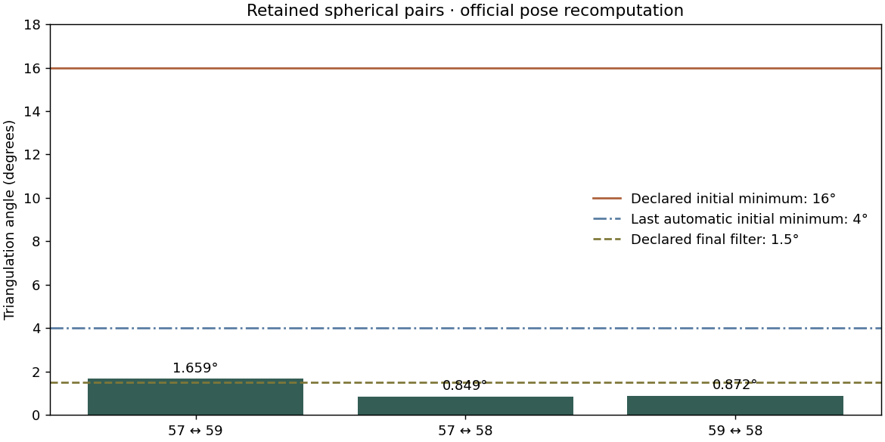

# Retained Kyoto pair geometry · 15 November 2026

The three retained spherical pairs recover the same poses as the original trial. Their native median triangulation angles are 0.85–1.66°. All retained inliers have positive bearing-ray depths under independent midpoint triangulation. These measurements describe the selected upper-hemisphere matches at Shijō–Karasuma.



| Source ranks | Original inliers | Native median | Positive depths | Midpoint points ≥4° | Midpoint points ≥1.5° |
|---|---:|---:|---:|---:|---:|
| 57 ↔ 59 | 83 | 1.6591° | 83 / 83 | 1 | 56 |
| 57 ↔ 58 | 224 | 0.8486° | 224 / 224 | 1 | 3 |
| 59 ↔ 58 | 308 | 0.8720° | 308 / 308 | 1 | 1 |

Each pose matches the retained original matrix exactly. Individual midpoint angles include isolated high-angle correspondences; these counts do not qualify points as reconstruction inliers. The [report](report.json) preserves every original match identifier, recovered point in arbitrary unit-baseline scale, bearing-ray depths, official triangulation angle and angular residual. [Inputs](inputs/pairs.json) retain the unchanged coordinates, original inlier order and E/F/H matrices.

COLMAP 4.2.1 starts with 100 inliers and 16° minimum initialization angle. Its automatic stages are `(100,16°) → (50,16°) → (50,8°) → (25,8°) → (25,4°)`. Initial point creation uses the current initialization angle; later point filtering uses 1.5°. The complete [controller](upstream/incremental_pipeline.cc), [mapper](upstream/incremental_mapper.cc) and [triangulator](upstream/incremental_triangulator.cc) are retained from commit `bd1fcf654d2dd8fefa1466999c190a246f83f4b9`, with original BSD notices. The controller audit records exact source locations. Database-loaded `tri_angle=-1` is an unmeasured sentinel, represented as `null` by the original evidence.

The audit uses official `estimate_two_view_geometry_pose`, `triangulate_mid_point`, `cam_ray_from_img` and `calculate_triangulation_angle` APIs. For spherical cameras, positive depth follows the observed bearing ray. The native pose estimator and midpoint diagnostic can apply different cheirality filtering. The [original execution log](inputs/original-execution.txt) remains available for comparison.

Recompute the audit from retained inputs with the existing pinned dependency installation:

```sh
PYTHONPATH=artifacts/realism-01/connector-reconstruction/python python experience/tools/connector-reconstruction/pair-geometry.py --verify experience/evidence/realism-01/connector-parallax
```

This verifies all manifest hashes and byte counts, checks input hashes against the original spherical evidence, and exactly recomputes the recorded geometry with `pycolmap==4.2.1` and `numpy==2.5.4`. The [executed producer](executed-pair-geometry.py) is preserved. Reproducing the chart additionally uses `matplotlib==3.10.8`; generated caches belong under ignored `artifacts/realism-01/connector-parallax/`.

Source imagery: Irvin Chen / Panoramax Taiwan, capture date 19 February 2026, CC BY-SA 4.0. [Source metadata](inputs/selected.json) and the [manifest](manifest.json) retain attribution, rights, location, method, limits, dates and file hashes. The original image files remain in the ignored acquisition workspace.

No database, matching threshold or reconstruction output is modified by this audit. These pair measurements do not isolate every initialization rejection criterion or determine the sufficiency of the complete capture collection. The upper-half mask excludes ground; metric scale, continuous walking surface, eastbound source coverage, lighting, independent landmark discovery and the full 1.35 km route remain separate acceptance requirements.
