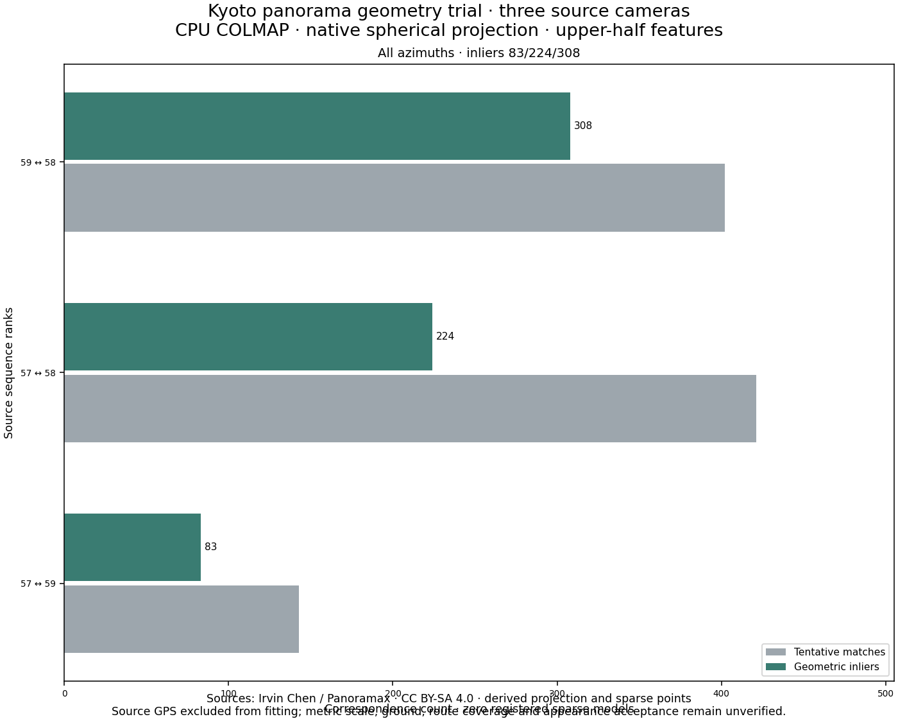
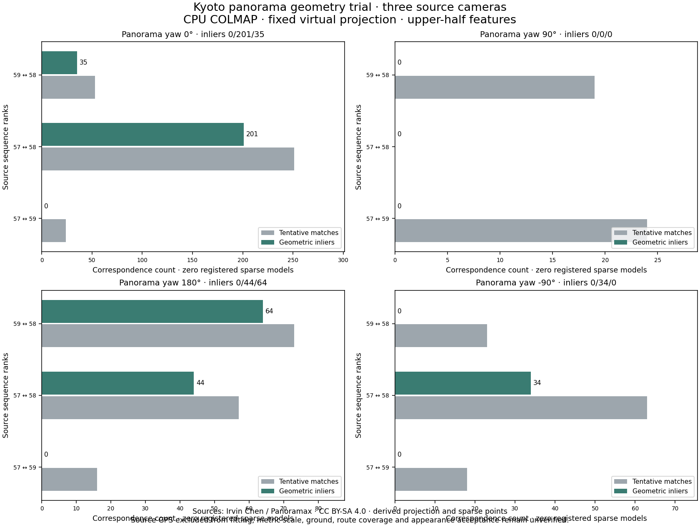

# Kyoto panorama geometry trials · 14 November 2026

Three freely licensed panoramas at Shijō–Karasuma now have completed CPU geometry
trials. Native spherical matching finds geometrically verified correspondences
across all three camera pairs. Both methods produce **zero registered sparse
models** in these retained runs; a walkable connector remains unqualified.

| Method | Source views | Pair observations | Registered model |
| --- | --- | --- | --- |
| [Independent perspective groups](perspective/result.json) | Four azimuth groups × three 90° views; upper-half features | 5 of 12 pairs retain 34–201 inliers; one pair classified `CALIBRATED` | 0 |
| [Native spherical camera](spherical/result.json) | Three complete panoramas; upper-hemisphere features | All three pairs classified `CALIBRATED`: 83, 224 and 308 inliers | 0 |

`CALIBRATED` is COLMAP's geometric classification under the declared projection.
It supplies no physical lens-calibration certificate, surveyed coordinates or
qualified pedestrian surface. The figures show actual correspondence counts.
The images themselves are available in the
[source review board](../free-connector-next/board.html).

## Sources and conditions

The exact [three-source selection](spherical/selected.json) identifies Irvin
Chen's sequence `8f84abce-001a-4cb7-97f1-2b99b0aa27f1`, ranks 57–59, captured
19 February 2026 at 00:26:47–00:26:57 UTC. All are 6080 × 3040 Insta360 ONE RS
equirectangular panoramas licensed CC BY-SA 4.0. The source records, rights and
unchanged JPEG hashes are retained by the
[source intake](../free-connector-next/README.md) and these exact reports.

Declared camera positions lie west of the first approved route edge,
25.36–41.37 m from its start, with approximately 20–30 m spacing between neighboring
frames. Position and heading are excluded from reconstruction fitting. The source provider declares
4 m horizontal accuracy; metric scale and independent control remain absent.

Perspective trials use `py360convert` 1.0.4, four horizontal 90° views at
1024 × 1024 and fixed virtual intrinsics. Each three-view group is independent.
The spherical trial uses COLMAP's native `EQUIRECTANGULAR` camera across all
azimuths, with feature extraction limited to 3040 pixels on the longest side.
Both use pycolmap 4.2.1, CPU SIFT, two threads, exhaustive matching and a shared
upper-half mask. The mask excludes reflected car roof and ground; moving objects
above the horizon remain a source-review concern.

The [perspective log](perspective/execution.txt) and
[spherical log](spherical/execution.txt) retain the library's actual initialization
attempts, automatic constraint adjustments and no-model outcomes. The geometric
initialization settings use library defaults; the minimum output model size is
three images. No source GPS fitting, manufactured scale or ground plane was used.

## Interpretation and next workflow

The native spherical result shows why isolated perspective groups cannot settle
the capture question: combining azimuths yields more geometric support. These
bounded runs establish no conclusion about the sufficiency of the complete
source collection. They leave camera recovery, metric control, continuous ground,
occluded surfaces and the actual eastward Kyoto route open.

The retained [official panorama workflow](spherical/producers/upstream-panorama.py)
also provides a fixed shared rig of virtual perspective cameras. A subsequent
trial can use its cross-view constraints and known projection rotations, retaining
the same sources, masking, separate evidence and fixed rig calibration. Qualify
denser free inputs and independently checked views along the actual eastward
connector in parallel. Successful sparse recovery would precede dense surface,
texture/splat and measured-floor trials.

## Retention and verification

The perspective manifest contains **22 files**; the spherical manifest contains
**13 files**. Each file has source, date, rights, location, method, limitations,
size and SHA-256. Both original run reports and executed producers are unchanged.
Compact pair observations preserve actual matched coordinates, match indices,
inlier membership and geometric matrices from the COLMAP database.
Raw JPEGs, crops, databases and caches stay in ignored artifacts.

The [reproduction tools](../../../tools/connector-reconstruction/README.md) verify
all retained hashes and numerical pair relationships from a clean checkout.
There are no model files to validate in these two runs. No runtime assets changed,
and no full-route, physical-device or participant gate is closed by this evidence.
