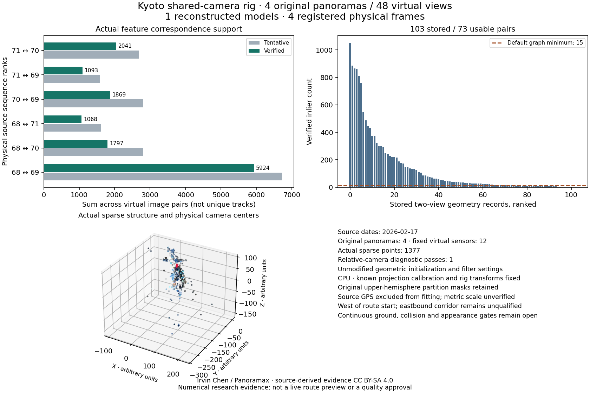

# Kyoto camera and source comparison · 15 November 2026

The [reviewed board package](package/index.html) compares four completed trials at the existing `previews/kyoto-source-review/` address. The package preserves the preceding source and geometry URLs. Its [manifest](package/package-manifest.json) binds 156 content files to retained source evidence and authoring files.

| Trial | Physical source positions | Generated views | Recovered models |
|---|---:|---:|---:|
| Independent perspective crops · 19 February | 3 | 12, tested in four independent groups | 0 |
| Native spherical cameras · 19 February | 3 | 3 native panoramas | 0 |
| Shared rig · 19 February | 3 | 36 | 0 |
| Shared rig · denser 17 February sequence | 4 | 48 | 1, connecting all four physical positions |

The denser model contains **1,377 sparse points**, with **1.49 px** 95th-percentile observation error and **5.05°** median physical-camera parallax. The [independent native-model review](package/independent/README.md) reproduces the camera and point counts, physical-frame connectivity and positive-depth observations. These measurements qualify a relative-geometry diagnostic. Metric scale, surfaces, lighting and walking remain separate requirements.

The [source audit](package/coverage/README.md) covers **9 complete local collections / 3,076 records**. It finds **zero additional cameras within 50 m of the route** beyond the earlier bounded query. The four denser images were newly acquired from already-known metadata; both tested source sequences remain west of the first route edge. Photographs and derived imagery retain attribution to **Irvin Chen / Panoramax Taiwan, CC BY-SA 4.0**.

The [local browser report](qa/1-local/result.json) passes **26 checks** at desktop **1280 px** and mobile **375 px**: decoded images, attribution, measurements against actual source reports, all package hashes, preserved URL bytes, canonical entry, relative links, disclosure opening/closing and horizontal overflow. Browser profiles remain in ignored artifacts. The initial loopback startup attempt and its exact driver are retained in [receipts](manifest.json); it did not exercise the page.

Verification and reproduction are documented in the [tools](../../../tools/connector-rig-review/README.md). Run `node experience/tools/connector-rig-review/verify.mjs` from a clean checkout to verify retained bytes and report identities. A local report establishes local browser behavior; publication requires the exact source-commit binding, Pages receipts and public browser report retained by the release coordinator.

Next: test bounded surface reconstruction with held-out views and silhouette checks, secure eastbound overlapping imagery, and establish measured pedestrian surfaces before the full 1.35 km / six-sight walking milestone. The approved production travel experience remains separate from this research board.
