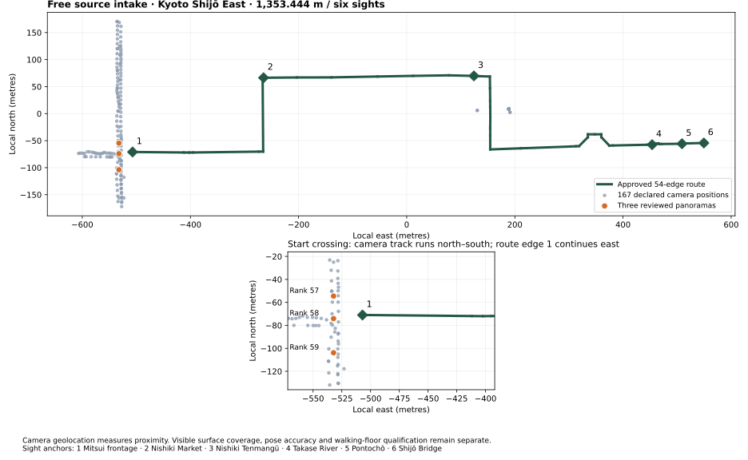

# Kyoto crossing source intake · 14 November 2026

[Open the snapshot board](board.html). The three displayed JPEGs are unchanged
Panoramax service previews of photographs by **Irvin Chen**, captured on
19 February 2026, licensed **CC BY-SA 4.0**. Source, attribution, license and
exact response hashes accompany each image in [the manifest](manifest.json).
The source license permits reuse and adaptation with attribution and ShareAlike;
retain its notices and identify subsequent modifications. Source files are
provided without warranties under the retained license.



| Actual intake | Measured result | Qualification |
| --- | --- | --- |
| Exact route bounding rectangle | 14 records; two collections; three distinct coordinate positions | Perspective photographs near edge 21; no 360° records |
| Route bounds expanded by 100 m | 167 records; eight collections | Both queries return fewer than their 1,000-record limit and no next link. These are bounded results; whole-collection and service completeness are unverified |
| Selected native Insta360 ONE RS sequence | Three 6,080 × 3,040 equirectangular HD files; ranks 57–59 | Licensed source for an actual façade-overlap reconstruction experiment |
| Selected camera proximity | 25.36–41.37 m from the start of route edge 1 | North–south camera movement around Shijō–Karasuma; eastward route coverage remains unqualified |
| Declared camera accuracy | 4 m horizontal accuracy; heading 180° | Acquisition metadata; verified metric scale, full poses and walking floor remain open |

The [findings](records/findings.json) preserve every record's source metadata,
distance to the complete route polylines, nearest edge and consecutive retained
ranks within 25/50 m. All three selected cameras project to the beginning of
edge 1. The largest nearby perspective run contains 13 retained ranks; its EXIF
identifies Mapillary Sequence Downloader v5. That imported provenance is retained
separately from the native Insta360 source used for this trial. Server-generated
descriptions and annotations supply no visual or geometry acceptance evidence.

Actual visual inspection shows recurring corner façades, arcades, crosswalk
markings, glass reflections and daylight shadows. Vehicle movement obscures
lower façades. The capture vehicle roof and its reflections occupy the lower
hemisphere. The selected photographs provide no measured sidewalk, independent
night capture, calibrated pedestrian eye height or continuous eastward connector.
Street-feature correspondence and reconstruction geometry require independent
checks. The full 1,353.444 m / six-sight milestone remains open.

## Reproduction and verification

Python 3.12, PyProj 3.8.0, Shapely 2.1.2, NumPy 2.5.4, Pillow 12.3.0 and
Matplotlib 3.10.8 reproduce the retained work. Install dependencies into an
ignored task directory and set `TMPDIR`, `PIP_CACHE_DIR` and `MPLCONFIGDIR` there.
The script reads the repository route and uses the official STAC API with
ordinary HTTPS certificate verification. No account, token or external inquiry
is needed.

```sh
PYTHONPATH=artifacts/realism-01/free-connector-next/python:artifacts/realism-01/tooling python experience/evidence/realism-01/free-connector-next/research.py acquire
PYTHONPATH=artifacts/realism-01/free-connector-next/python:artifacts/realism-01/tooling python experience/evidence/realism-01/free-connector-next/research.py audit
PYTHONPATH=artifacts/realism-01/free-connector-next/python:artifacts/realism-01/tooling python experience/evidence/realism-01/free-connector-next/research.py images
PYTHONPATH=artifacts/realism-01/free-connector-next/python:artifacts/realism-01/tooling python experience/evidence/realism-01/free-connector-next/research.py plot
PYTHONPATH=artifacts/realism-01/free-connector-next/python:artifacts/realism-01/tooling python experience/evidence/realism-01/free-connector-next/research.py verify
```

`verify` works offline from a clean checkout: it verifies all retained hashes,
losslessly compressed response bytes, query bounds/counts, all 54 edge distances,
the selected ranks and JPEG dimensions. The unchanged HD service files remain
under ignored artifacts with acquisition receipts; `images` reacquires them.
The retained SD files, metadata, receipts and map survive checkout. A later live
API response may differ from this dated snapshot.
