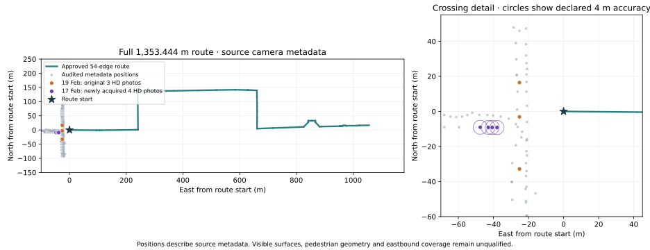
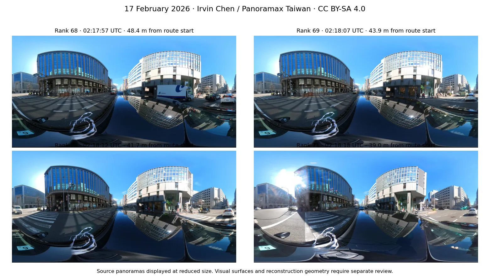

# Kyoto collection coverage · 15 November 2026



| Evidence | Result | Consequence |
| --- | --- | --- |
| Collection catalog around the approved route | 14 collections in the terminal response | Source discovery is bounded to this dated catalog query |
| Complete Kyoto-local sequences | 9 collections; 3,076 records; each returned count matches its declared item count and consecutive ranks | 2,923 metadata records extend the preceding bounded item audit |
| Cameras within 50 m of the 54 route edges | 45 records; zero newly discovered nearby positions | This audit establishes no additional eastbound camera coverage |
| Newly acquired native source images | Four 6,080 × 3,040 panoramas, captured 17 February 2026 | Inputs for the independent shared-camera reconstruction trial |
| Selected camera positions | 39.0–48.4 m from route start; projected route chainage 0 m | Positions remain west of the approved eastbound connector |
| Declared adjacent spacing | 4.565 / 2.282 / 2.739 m; total 9.586 m | Each camera declares 4 m horizontal accuracy; these positions provide no metric calibration |



Photographs: **Irvin Chen / Panoramax Taiwan**, **CC BY-SA 4.0**. The four
[retained previews and source metadata](selection/selected.json) identify ranks
68–71 of collection `cf65c61d-2a42-452d-8095-a1daee44e6a9`, captured between
02:17:57 and 02:18:18 UTC on 17 February 2026. These image records were already
present in the earlier bounded metadata audit; their HD photographs are newly
acquired for this experiment. The unchanged service previews retain their exact
response hashes. The contact sheet arranges and reduces their display size.
The [license text](references/license.html.gz) and its acquisition receipt are
retained; reuse requires attribution and ShareAlike where applicable, with changes
identified. The source material is provided without warranties under that license.

Native metadata declares Insta360 ONE RS, 360° field of view, equirectangular
projection and 6,080 × 3,040 dimensions. All eight HD/SD downloads passed byte
hash checks and JPEG decoding. Camera calibration, stable façade overlap,
pedestrian floor, metric scale, independent night capture and continuous route
surfaces require separate evidence. Source metadata supplies no visual acceptance
or reconstructed geometry. The full 1,353.444 m / six-sight milestone remains open.

The [findings](findings.json) contain the compact collection results and selected
sources. [Every audited record](all-records.json.gz) retains exact source,
capture date, declared rights, coordinates, camera metadata and distances to all
original route polylines through a reproducible calculation. The
[inventory](collection-inventory.json) records terminal pagination and counts;
[selection rules](collection-selection.json) limit complete audits to collection
bounding-box diagonals of at most 20 km. Five contributor albums have wider
extents, and their full contents are outside this audit. Global service and
catalog completeness remain unverified. The [manifest](manifest.json) records
provenance, acquisition dates, rights, methods, limitations and hashes for the
retained files.

## Reproduction

Python 3.12, PyProj 3.8.0, Shapely 2.1.2, Pillow 12.3.0 and Matplotlib 3.10.8
were used. All intermediate files remain under ignored
`artifacts/realism-01/connector-source-intake/`. Acquisition uses ordinary HTTPS
and the retained official API specification, without accounts or payments.

```sh
PYTHONPATH=artifacts/realism-01/free-connector-next/python:artifacts/realism-01/tooling python experience/tools/connector-source-intake/intake.py acquire
PYTHONPATH=artifacts/realism-01/free-connector-next/python:artifacts/realism-01/tooling python experience/tools/connector-source-intake/intake.py collections
PYTHONPATH=artifacts/realism-01/free-connector-next/python:artifacts/realism-01/tooling python experience/tools/connector-source-intake/intake.py audit
PYTHONPATH=artifacts/realism-01/free-connector-next/python:artifacts/realism-01/tooling python experience/tools/connector-source-intake/intake.py images
PYTHONPATH=artifacts/realism-01/free-connector-next/python:artifacts/realism-01/tooling:artifacts/realism-01/connector-reconstruction/python python experience/tools/connector-source-intake/intake.py retain
PYTHONPATH=artifacts/realism-01/free-connector-next/python:artifacts/realism-01/tooling python experience/tools/connector-source-intake/intake.py verify
```

`verify` works offline from retained files. It checks exact source bytes,
catalog scope, pagination, rank continuity, selected image lineage, dimensions,
all 3,076 coordinate calculations against the original 54 edges, and producer
code. HD files remain in ignored artifacts with retained acquisition receipts;
`images` downloads them again. Later live responses may differ from this snapshot.
