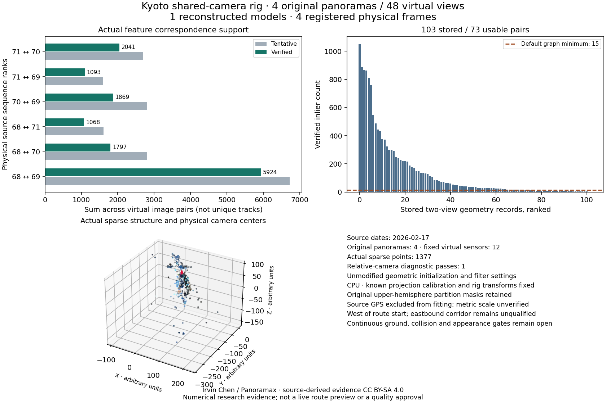

# Kyoto shared-camera reconstruction · 15 November 2026

| Actual trial | Input panorama positions | Recovered positions | Sparse points | Result |
| --- | ---: | ---: | ---: | --- |
| [19 February sources](run-01/summary.json) | 3 | 0 | 0 | Completed without a model |
| [17 February denser sources](run-02/summary.json) | 4 | 4 | 1,377 | Relative-camera diagnostic passes |

The two runs use the same official fixed-rig settings. Source sequence, date and
number of photographs differ. The [independent native-model audit](../connector-rig-geometry/README.md)
recomputes every observation. The original [failed run](run-01/geometry-board.png)
and its [database-export provenance](run-01/database-export.json) remain available.
Source-derived geometry and photography retain Irvin Chen / Panoramax Taiwan
attribution under CC BY-SA 4.0.

Both per-run manifests preserve executed producers, settings, masks, matches,
receipts and results. [Reproduction and verification instructions](../../../tools/connector-rig/README.md)
describe the exact dependency versions and original database availability.
All four recovered positions remain west of the approved route start. Metric
scale, pedestrian surfaces, appearance and full-route acceptance remain open.
