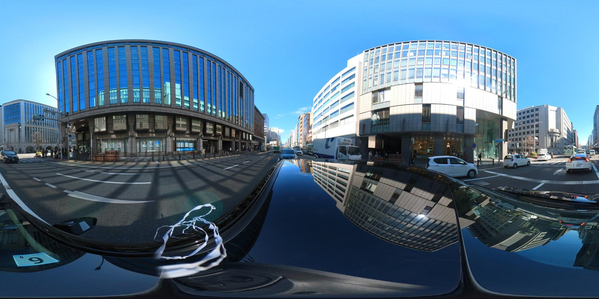
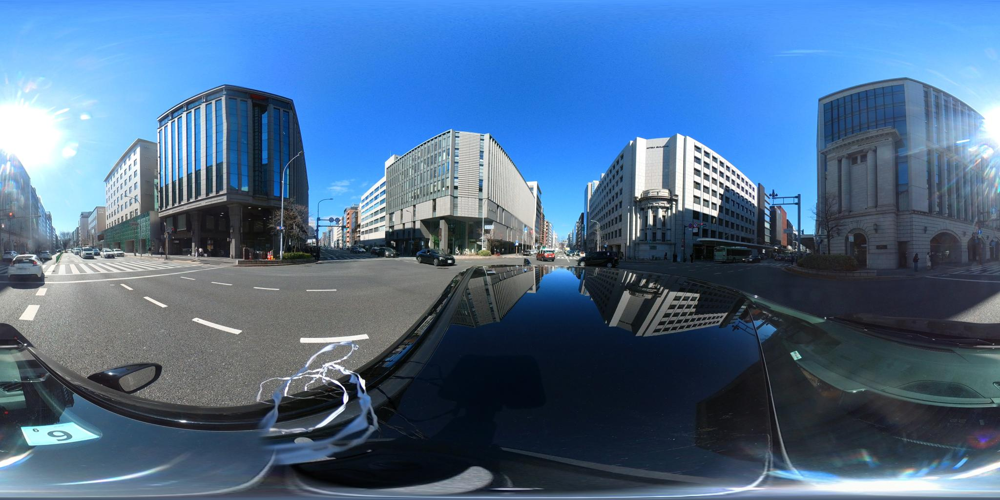

# Kyoto surface inputs · 25 November 2026

The four fitting panoramas reproduce the exact image bytes used for the recovered
camera model. Two adjacent panoramas are reserved for evaluation before surface
fitting begins. The [assignment](assignment.json) records this separation at
02:16:34 UTC on 25 November 2026 and binds the original source inventory, fitting
selection and relative camera result by SHA-256.

| Role | Sequence rank | Capture time, 17 February 2026 UTC | Declared distance from route start |
| --- | ---: | --- | ---: |
| Reserved evaluation | 67 | 02:17:41 | 60.33 m |
| Fitting | 68 | 02:17:57 | 48.39 m |
| Fitting | 69 | 02:18:07 | 43.93 m |
| Fitting | 70 | 02:18:12 | 41.70 m |
| Fitting | 71 | 02:18:18 | 39.04 m |
| Reserved evaluation | 72 | 02:18:23 | 28.25 m |

All six positions project to chainage zero of approved route edge 1 and remain
west of its start. Each source declares 4 m horizontal accuracy. These values
retain the prior complete-collection calculation; they supply no metric control
or newly qualified eastbound surface coverage.





Photographs: **Irvin Chen / Panoramax Taiwan**, **CC BY-SA 4.0**. The displayed
images are unchanged service previews. [Fitting metadata](fit/selected.json) and
[reserved-source metadata](holdout/selected.json) retain the original source URLs,
capture dates, photographer, coordinates and license declaration. The complete
[license](license.html.gz) and acquisition receipt are retained. Shared derivatives
must preserve attribution, identify changes and meet the applicable ShareAlike
terms. The material is supplied without warranties under the license.

All twelve downloaded JPEGs passed byte hashing and Pillow decoding: six HD
images at **6,080 × 3,040**, and six service previews at **2,048 × 1,024**. The
eight fitting-image hashes match the preceding intake exactly. The
[acquisition record](acquisition.json) retains every image identity and the
installed decoding version. Current metadata responses are preserved with
their original bytes and receipts; stable capture fields are checked against
the earlier collection snapshot.

Ranks 67 and 72 must remain excluded from sparse structure updates, dense depth,
mesh geometry, mesh refinement and texture fitting. Pose-only localization may
use recorded correspondences to the frozen model. Evaluation then needs separate
image pixels and explicit pose uncertainty. Both reserved views belong to the
same capture sequence and photographer, with correlated conditions. They support
a bounded unseen-view test; independent capture-family, human recognition and
full-route acceptance remain separate requirements. Source intake establishes
no successful localization, visible-surface overlap or rendering-quality result.

The [manifest](manifest.json) records source, date, rights, location, method,
limitations, byte count and hash for each retained record. HD downloads remain
under ignored `artifacts/realism-01/connector-surface-sources/`; their original
receipts remain tracked. The [producer](producer/intake.py) and
[requirements](producer/requirements.txt) support offline verification from a
clean checkout:

```sh
python experience/tools/connector-surface-sources/intake.py verify
```

Verification checks all hashes, original fitting-image lineage, reserved
membership, metadata consistency, pre-acquisition reservation times, JPEG preview
decoding and unchanged source/model bindings. It requires Pillow 12.3.0; no
network service or original artifact directory is needed.
