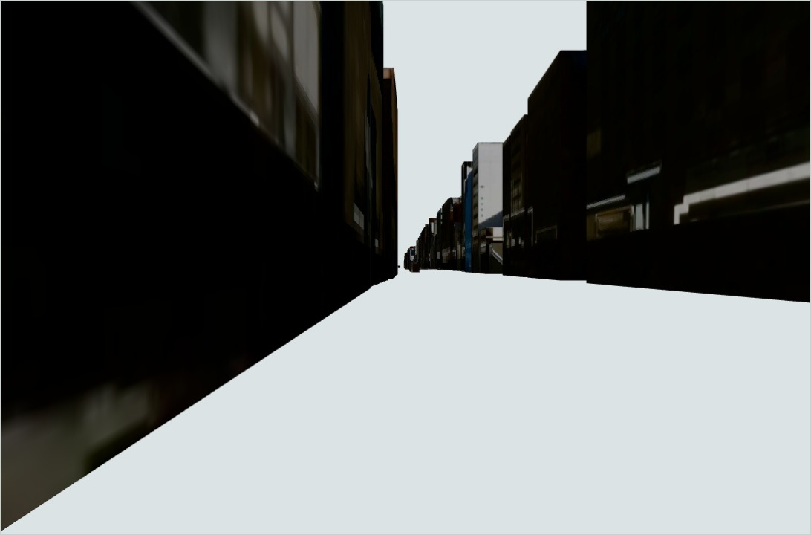
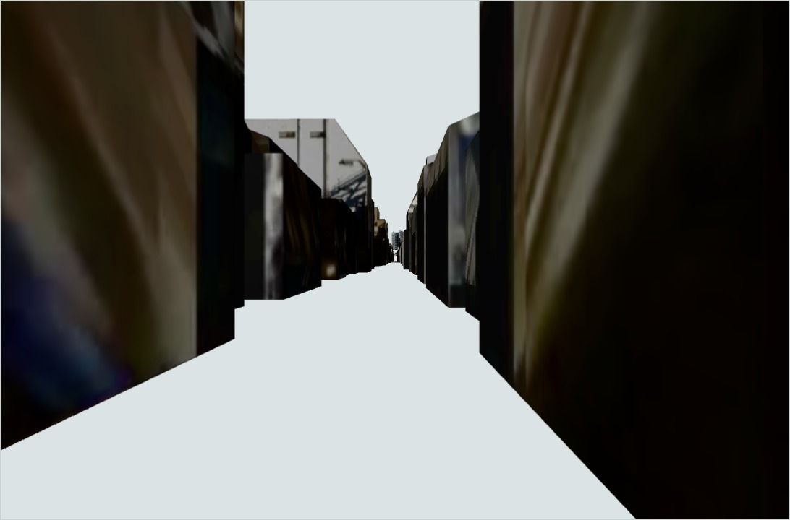
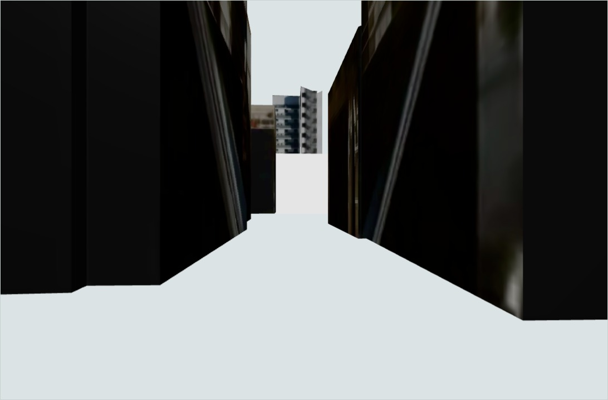
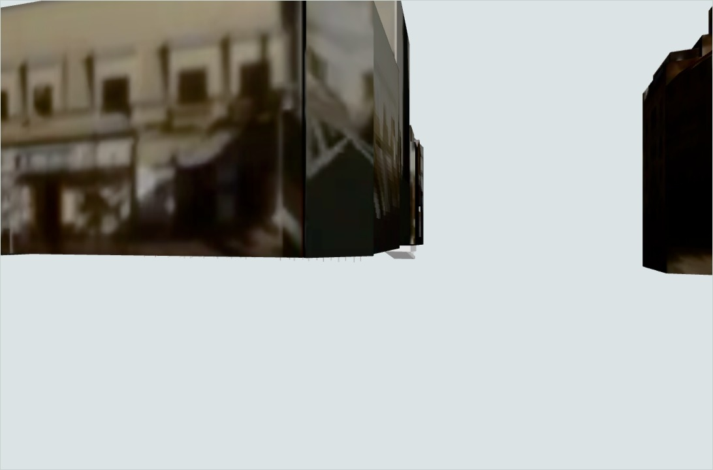
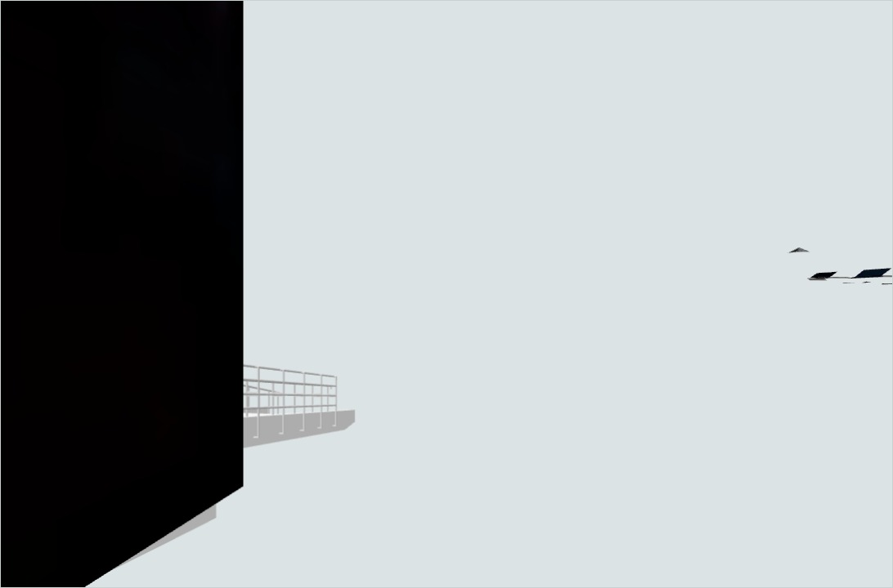
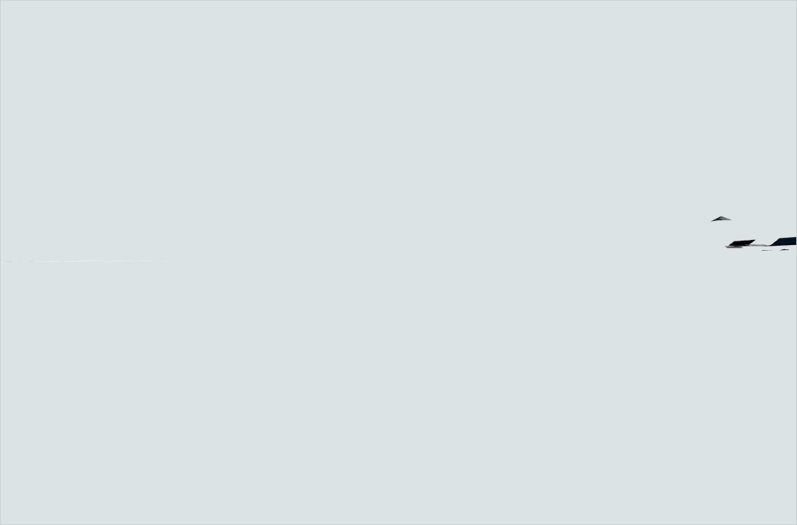

# Kyoto source qualification · 6 November 2026

[All 18 browser captures](views/board.md) · [Six-sight correspondence](landmarks/landmark-correspondence.md) · [Ground board](ground/README.md) · [Reserved photographs and prices](references/README.md)

[Parallel candidate status](../../../sprints/realism-01/experiments/candidate-status.md) · [Terrain profile](terrain/README.md) · [Height registration](datum/README.md) · [Splat compatibility views](splat-compatibility/README.md)

[Native texture density board](texture/README.md) · [Actual pedestrian coverage boards](pedestrian/README.md) · [Prepared full-route acquisition](../../../sprints/realism-01/research/acquisition-package/README.md)

[Architectural splat comparison and local preview](splat-fidelity/README.md)

[Paged streaming board](splat-streaming/README.md) · [Free Kyoto photographic intake](free-sources/README.md)

[Single encoding trade-off and same-camera views](splat-encoding/README.md)

The 73 acquired original tiles contain 2,269 object occurrences. Selecting source
replacement levels leaves **1,965 occurrences / 119,514 triangles**; all 304
excluded occurrences remain in the evidence. Actual geometry is indexed against
all **54 edges** of the approved **1,353.444 m, six-sight route**.

| Source view | Actual route-forward capture | Review observation / required evidence |
| --- | --- | --- |
| Mitsui frontage |  | Source ID matches the retained building; doorway, canopy and current material detail still need qualification |
| Nishiki west |  | Blurred frontage imagery and missing floor are visible; roof, entrance and passage continuity remain unqualified |
| Tenmangū approach |  | Close surfaces obscure architectural detail; torii identity and covered interfaces remain unqualified |
| Takase at Shijō |  | Unresolved ground and river context; no exact river-object match in the acquired categories |
| Pontochō entrance |  | A wall and railing fragment are visible; entrance identity and ground continuity remain unqualified |
| Shijō Bridge |  | Almost entirely background; this capture fails the visible-content diagnostic |

These cameras follow the route tangent. They are **source inspection poses** with
provisional height anchors; they are not an unaided-discovery trial. The complete
board includes reverse and elevated context views. Original GLTF materials use
neutral diagnostic illumination; current daytime and night appearance remain
unverified. Source credit: **Kyoto City / MLIT Project PLATEAU, CC BY 4.0**.

| Completed check | Result | Evidence boundary |
| --- | --- | --- |
| Source acquisition and decoding | 73 tiles / 41,151,256 original bytes; original material/texture and object identities retained | [Geometry receipts, method and reproduction](geometry/README.md) |
| Source replacement selection | 304 overlapping ancestor occurrences excluded; zero unresolved alternatives | Declared source hierarchy plus measured overlap; every occurrence retained in compressed GeoJSON |
| Browser diagnostic | 5 checks pass; 1 fails; zero page errors | [Original report](views/result.json): all models loaded, triangle inventory agrees, native orbit changes submitted camera, 18 captures retained |
| Landmark correspondence | One exact retained ID (Mitsui), five unverified identities | Spatial candidates do not establish a named entrance or recognizable sight |
| Ground | 110 nearby LOD1 road polygons have zero source heights; one LOD3 sidewalk section near edges 50–54 | Horizontal coverage is complete; elevation, collision and access remain unverified |
| Terrain follow-up | Complete covering DEM acquired/streamed; 6,019 route-near triangles and 1,434 covered samples | [Source profile](terrain/README.md); pedestrian floors and bridge deck remain unqualified |
| Height registration | Explicit GSIGEO2011 and JPGEO2024 experiments; 12 grid and 2,868 local-frame checks pass | [Datum evidence](datum/README.md); source-model/epoch choice and independent controls remain open |
| Splat engineering | Same-source Hall comparison through publisher PlayCanvas and Spark; native orbit/dolly and five portable-preview checks pass | [Three-image board](splat-fidelity/README.md); residual rendering differences, 28.40 MiB startup asset, hidden/resume and Kyoto qualification remain open |
| Reference/capture qualification | Three reserved licensed photographs; two providers' published price items | Partial views and published prices; no full-route capture package or supplier quote |
| Native texture sampling | 369 selected buildings; median 12.56 texels/m in the lower source-relative band; exact Mitsui 10.43 texels/m | [Measured board](texture/README.md); geometric sampling only, with photographic sharpness and visible frontage unverified |
| Detailed pedestrian coverage | 1,986 selected triangles / 18 objects; zero overlap with all 54 current route edges, six anchors or the complete actor envelope | [Coverage and navigation boards](pedestrian/README.md); an explicit 5.250 m Pontochō approach revision candidate requires separate review |
| Acquisition preparation | Exact 54-edge / six-sight scope and handover checks; supplier inquiry parked | [Reviewable package](../../../sprints/realism-01/research/acquisition-package/README.md); user requires free sources for this period; qualifying free Kyoto inputs remain needed |

The acquired PLATEAU surfaces need street-level repair/capture and ground
registration before they can support the approved realism comparison. R04 source
inspection is complete, including actual texture sampling and pedestrian-surface
intersections. The inspected municipal source alone is insufficient for close
walking. R05 acquisition and eventual candidate appearance/ground acceptance remain
open. Production representation selection follows the matched full-route gates.

Next deliverables follow the [itemized capture proposal](../../../sprints/realism-01/research/capture-requirements.md):
matched licensed source imagery/poses for T01–T03; explicit height control for
roads, covered passages and bridge; independent held-out views; and a complete
route quote with reuse rights. Physical-device and fresh-participant acceptance
remain required by [Benchmark V1](../../../sprints/realism-01/benchmark.md).

[Validation and recovery instructions](validation.md)
