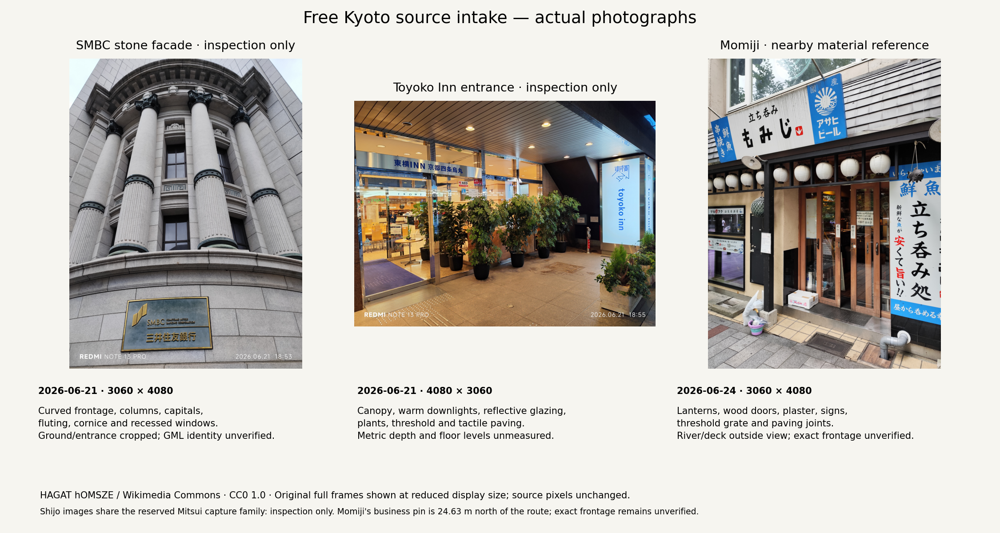
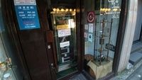
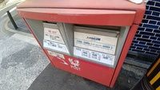

# Free Kyoto source intake

6 November 2026. [Source records](research-receipts.json), [original-photo receipts](photo-receipts.json),
[camera EXIF](camera-metadata.json), [source roles](source-roles.json) and [file identities](manifest.json).



| Acquired original | Observed subject and useful detail | Admitted use |
| --- | --- | --- |
| Shijō frame 31 · 21 June 2026 · 3060 × 4080 | SMBC-signed curved stone façade, columns, capitals, fluting, projecting cornice and recessed windows; upward view excludes ground and entrance | Inspection only. Same capture family as reserved Mitsui frame 28; exact source-building registration remains unqualified |
| Shijō frame 37 · 21 June 2026 · 4080 × 3060 | Sign explicitly identifies Toyoko Inn Kyoto Shijō Karasuma; entrance canopy, warm downlights, reflective glazing, plants, threshold and tactile paving | Inspection only. Same June 21 capture family; hotel identity is visible, while building/GML association and metric dimensions remain unqualified |
| Takase frame 212 · 24 June 2026 · 3060 × 4080 | Restaurant signed もみじ; lanterns, wooden door frames, textured plaster, signs, grate, paving joints and exposed pipe | Nearby material reference. Independently listed business pin is 24.63 m north of the route; exact route-frontage association remains unqualified. River and bridge deck are outside the image |

The three unchanged originals total **16,418,293 bytes**, attributed to HAGAT hOMSZE
under CC0 1.0. Their full frames appear at reduced display size in the board. Raw
JPEGs remain in ignored `artifacts/realism-01/free-sources/lookup/originals/`.
Pillow verifies the original JPEGs, dimensions and EXIF. Visible camera/date marks
remain in the images. Dates describe June appearances, with no November condition
claim. GPS processing is `network`, with zero recorded altitude in all three.
EXIF reports 6.14 mm focal length / 23 mm equivalent; it supplies no distortion
calibration, surveyed camera pose, feature dimensions or dependable floor levels.

## Source separation

The [reserved image registry](../references/sources.json) keeps Shijō-series
frame 28 for evaluation. Frame 31 depicts the same façade 51 seconds later;
frame 37 belongs to the same photographer/date/series. Exact filename/hash
separation cannot establish independent captures. These Shijō inputs therefore
remain inspection-only pending an explicit evaluation redesign; they cannot
enter mesh authoring, texture selection or reconstruction under the current
holdout definition. The reserved file and its role are unchanged. The source-role
check also compares the two existing photographic authoring registries. Every
newly inspected photograph is excluded from future blind holdouts.

The [adjacent-frame receipts](overlap-photo-receipts.json) cover two further
originals, frames 30 and 32, totaling 10,726,117 bytes. All five acquired originals
total **27,144,410 bytes**. Frames 30/31 extensively overlap the upward curved
façade at identical declared GPS, five seconds apart; translational baseline
and calibrated parallax remain unproven. Frame 32 shows the SMBC/PRESTIA glazed
entrance, with the upper columned façade outside its view. This supplies no
qualified connected reconstruction set. All four Shijō images remain inspection-only.
Takase 212 belongs to the same series as existing authoring image 220. The
[registry comparison](registry-comparison.json) records zero exact filename/URL/hash
matches and these capture-family relationships. Existing reserved bytes remain
unchanged.

## Location association and usable scope

The [business association](business-identity.json) records the completed public
identity check. Retty and the 1000bero feature associate Momiji with **鍋屋町225,
萩原ビル1F**. The listing pin is **24.63 m north of route edge 50**, 30.09 m from
the phone's declared camera position. An older listing gives a different street
number; neither pin defines a surveyed doorway. The photograph is admitted as
a **nearby material/detail reference**. Its feature checklist includes door/frame
boundaries, lanterns, plaster/wood boundaries, threshold grate and pavement joints.
It supplies no confirmed replacement for a specific route façade.

Toyoko Inn's official access page confirms **28 Naginataboko-cho** and the named
hotel. Its business pin is 23.00 m north of route edge 1 and 30.45 m from the phone
position. The named business association is established; exact façade/GML
registration, metric depth, dimensions and floor levels remain unqualified.
The June 21 capture-family restriction remains in force.

This intake supports annotated art review and material-feature comparisons.
A source-faithful dimensional mesh-detail experiment for an exact route frontage
requires permitted overlapping views, a verified feature registration and scale.
Those inputs are absent from this bounded intake. The three main photographs
depict different subjects and provide no matched mesh/splat comparison.

## Bounded KartaView check

The [query coverage record](query-coverage.json) retains four successful no-key
responses. West/central/east radius queries return **0 / 0 / 7** cameras. The
documented bounding rectangle covers **all 54 complete route polylines** and
returns **0 cameras**, with `hasMoreData: false`. Published documentation gives
radius range 1–500 without units; the separate 500 m circle calculation is
conditional. The bounding rectangle supports the geographic conclusion.

The seven nearby cameras lie outside the rectangle. The two nearest published
thumbnails, at 196 m and 332 m from the route, were acquired and inspected:

| Published preview | Observed detail | Qualification |
| --- | --- | --- |
|  | Glazed storefront door, signs and narrow threshold crop | No visible route/bridge association established |
|  | Red roadside box, pavement and adjacent wall crop | Broader location context unresolved at 200 × 113 pixels |

© Grab and KartaView Contributors, CC BY-SA 4.0. Both thumbnails are unchanged;
[receipts](karta-preview-receipts.json) retain exact URLs, dates and hashes.
[Visual review](karta-visual-review.json) distinguishes those two inspections
from the **five unreviewed images**. This bounded camera-position query establishes
no claim that all visible route coverage is absent: off-route cameras can see
route features. No useful exact-route captured scene was qualified in these
inspections.

The [free-source feasibility decision](../../../../sprints/realism-01/research/free-source-feasibility.md)
records the official source lookup and acquisition limits. The approved complete
route, realism, immersion, independent discovery, floor and physical-device
performance gates remain in force.

## Reproduce the board and verify

Install [pinned packages](../../../../tools/free-source-qualification/requirements.txt)
inside ignored tool storage. Reacquire the three original URLs in the receipts
and require their recorded hashes before using them. With the matching originals
already cached, run from the repository root:

```sh
mkdir -p artifacts/realism-01/free-sources/mpl artifacts/realism-01/free-sources/tmp
MPLCONFIGDIR=artifacts/realism-01/free-sources/mpl TMPDIR=artifacts/realism-01/free-sources/tmp PYTHONPATH=artifacts/realism-01/geometry-tools:artifacts/realism-01/inspection-tools python experience/tools/free-source-qualification/board.py --source artifacts/realism-01/free-sources/lookup/originals --output artifacts/realism-01/free-sources/run
python experience/tools/free-source-qualification/source_roles.py --root . --research artifacts/realism-01/free-sources --output artifacts/realism-01/free-sources/run
python experience/tools/free-source-qualification/verify.py --root .
```

The verifier checks retained file/producer identities, the approved route source,
photo/EXIF linkage, exact acquired byte totals, business-source bindings, query
coverage identities, KartaView thumbnails and source-role restrictions.
Cached originals are rechecked when present; a clean checkout can verify retained
records without those raw files. Integrity checks grant no experience-quality pass.

The tracked `research.py`, `business_identity.py` and `query_coverage.py` producers
recompute the corresponding receipts and measurements from the hash-bound raw
cache. `retain.py` seals generated outputs and all eight producer identities.
