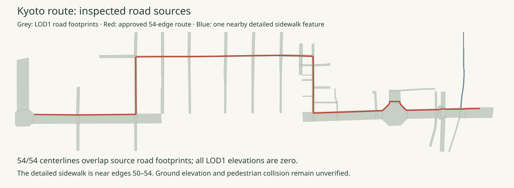

# Road geometry and adjacent ward qualification

6 November 2026 · Original CityGML parsed with GDAL 3.10.3. Source credit:
**Kyoto City / MLIT Project PLATEAU · CC BY 4.0**.



| Source observation | Result | Qualification boundary |
| --- | --- | --- |
| Original road CityGML | Mesh 52354600: 415 roads; mesh 52354601: 680 roads | Original HTTPS bytes and SHA-256 preserved in [download receipts](download-receipts.json) |
| Road footprints within 25 m | 110 LOD1 Road features | Planar road polygons; none establishes pedestrian access or collision |
| Route centerline overlap | All 54 edges overlap the LOD1 footprints completely at calculation precision | Horizontal overlay only; projected length 1,353.331 m differs from the route's authored local-frame length 1,353.444 m |
| LOD1 road heights | All source Z values are 0 | Terrain elevation remains unverified |
| Detailed geometry within 25 m | One LOD3 TrafficArea, source function `2000` / `歩道部` (sidewalk section), near edges 50–54 | Source classification; current access and complete pedestrian volume remain unverified |
| Detailed source height | 37.579875–38.377167 m across the entire nearby source feature | JGD2011 gravity-related height; no conversion to WGS84 ellipsoid height or runtime zero |
| Shimogyo building content candidates | Seven, including content near the start; subsequently decoded in the geometry review | Exact Mitsui source ID matched; current appearance and entrance remain unverified |
| Higashiyama building content candidates | One, near the bridge end; subsequently decoded | Included in browser review; bridge approach still fails visible-content check |

[The audit](road-ground-audit.json) retains every edge ID, nearby source object ID,
function code/label and distance. [The GeoJSON](near-route-roads.geojson) preserves
the 111 reviewed nearby features with original source heights. TrafficArea source
labels come from the original Kyoto code-list ZIP; the selected dictionaries are
retained in the audit. A road boundary alone supplies no curb, pavement material,
crossing safety, covered-passage floor or bridge-deck height validation.

Both original CityGML files declare **EPSG:6697**, JGD2011 plus JGD2011 vertical
height. GDAL exposes the LOD1 `lod1MultiSurface` geometry field with horizontal
EPSG:6668. Distances use JGD2011 Japan Plane Rectangular CS VI (EPSG:6674).
The route has a WGS84-derived local frame with authored zero heights. Final
registration requires horizontal control checks and an explicit reviewed vertical
tie. This audit applies no geoid conversion and changes no runtime ground.

The retained metadata resource table lists FY2021 aerial photographs for building
LOD2 and road LOD1 geometry, and FY2023 vehicle photo/laser survey for LOD3.
Its 2026 publication date does not establish current appearance. Individual source
features still need correspondence and currency review.

## Acquire and reproduce

[Manifest](manifest.json) hashes all seven retained evidence files and the three
processing scripts. Raw road GML and the full code-list ZIP remain ignored. The
original adjacent-ward indexes and whole-file CityGML inventory are retained here
for portable review. Their bounds use `content.boundingVolume.region` when present,
otherwise the containing node region; each candidate records that choice.

The [pinned requirements](requirements.txt) record the actual Requests 2.34.2 and
GDAL 3.10.3 versions. GDAL's Python bindings require the matching native library.
The current environment exposes those bindings
through `/usr/bin/python3`:

```sh
PYTHONPATH=artifacts/realism-01/site-test-tools python experience/evidence/realism-01/qualification/ground/acquire.py --output artifacts/realism-01/downloads/ground-qualification
/usr/bin/python3 experience/evidence/realism-01/qualification/ground/qualify.py --root . --downloads artifacts/realism-01/downloads/ground-qualification --output artifacts/realism-01/runs/ground-qualification-review
cmp experience/evidence/realism-01/qualification/ground/road-ground-audit.json artifacts/realism-01/runs/ground-qualification-review/road-ground-audit.json
cmp experience/evidence/realism-01/qualification/ground/near-route-roads.geojson artifacts/realism-01/runs/ground-qualification-review/near-route-roads.geojson
cmp experience/evidence/realism-01/qualification/ground/road-coverage-board.svg artifacts/realism-01/runs/ground-qualification-review/road-coverage-board.svg
```

Reusing the retained downloads/receipts reproduces the audit exactly. A new HTTPS
acquisition has new receipt timestamps; compare the original byte hashes before
reviewing changes. No file replacement is assumed safe merely because its URL is
unchanged. `retain.py` promotes a reviewed completed run and records the source
and processing identities.

The [ground acquisition decision](../../../../sprints/realism-01/research/ground-qualification.md)
records the next inputs and their limits. No imagery, ground geometry or rendering
representation is accepted for production by this inspection.

The [DEM envelope review](../dem/README.md) preserves the bounded source prefixes.
The subsequent [full-source terrain experiment](../terrain/README.md) retains
6,019 actual triangles and a complete sampled route profile. Explicit
[datum diagnostics](../datum/README.md) preserve both tested models. Pedestrian
floors, bridge deck, independent control and source epoch/model remain unqualified.
