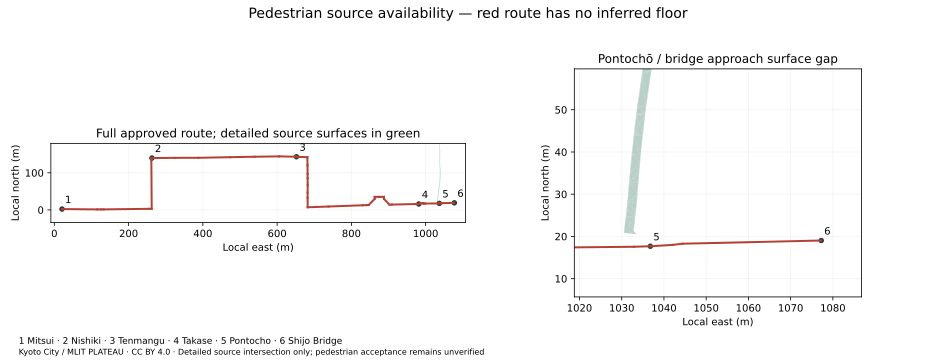
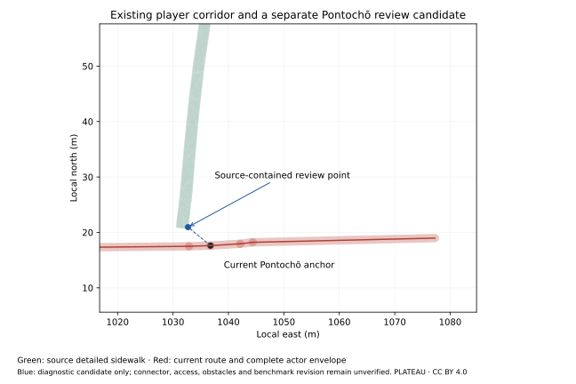

# Detailed pedestrian-surface availability

6 November 2026 · Kyoto City / MLIT Project PLATEAU · CC BY 4.0.



| Actual source observation | Result |
| --- | ---: |
| Selected decoded road triangles | 1,986 across 18 source objects |
| Exact classified sidewalk | 1,024 triangles, source `tfa_620a6a21-743f-4ba9-b0e2-cbc2f63e88b3` |
| Approved route edges with detailed centerline geometry | **0 / 54** |
| Detailed-road centerline overlap | **0 m** |
| Detailed-road overlap with the existing 0.32 m actor footprint | **0 m²** |
| Sight anchors with a detailed road surface | **0 / 6** |
| Closest route-to-detailed-surface distance | **2.903634 m**, edge 51 |
| Pontochō entrance anchor distance | **4.097107 m** |
| Shijō Bridge anchor distance | **43.464160 m** |

[Every edge and sight observation](pedestrian-surface-audit.json) ·
[Complete selected triangle records](detailed-road-triangles.json.gz) ·
[File/producer identities](manifest.json)

The geometry comes from the two original road B3DM files acquired in the
[source qualification](../geometry/README.md). The recorded per-batch selection
excludes replacement ancestors. Original Draco vertex positions are placed by
the bound GLTF/RTC matrix; the union of their projected triangles is intersected
with every oriented route edge. The actor-footprint check uses the route's actual
`navigation.playerRadius` of 0.32 m. Source coverage is evaluated in the same local
east/up/south frame as the renderer.

The classified sidewalk is also present in the original GDAL-parsed CityGML.
Its 1,024 source triangles were converted using explicit **GSIGEO2011**, then ECEF
and the local frame. Bidirectional nearest-vertex comparison with the decoded
3D Tiles gives a maximum difference of **0.000007111 m**. This confirms consistency
of the two representations of the same source; it provides no independent survey
accuracy or source-epoch acceptance. The source geometry gap persists under this
consistent registration.

Terrain covers the route in the [terrain experiment](../terrain/README.md), and
flat LOD1 road polygons also overlap its centerline. Those inputs have separate
meanings. This audit excludes both from the detailed pedestrian-surface coverage
calculation. Nearest off-route height samples are explicitly labeled and never
assigned to a route anchor. All floor, collision and current-access gates remain
unverified; no connecting floor is inferred and no runtime geometry changes.

## Current player path and a possible local correction



The [actual navigation-module probes](navigation-surface-check.json) execute all
54 edges and inspect the renderer's actor transform. There is no implicit sidewalk
offset. The current 1.5 m corridor allows player centers up to 0.43 m from the
line; its complete actor envelope extends 0.75 m. **That entire envelope also has
zero detailed-source overlap.** The relevant OSM paths are already tagged as
sidewalks, rather than vehicle centerlines.

The source-geographic route uses the reviewed ECEF tangent frame. The current
renderer uses its authored equirectangular x/north values directly. The largest
vertex difference between these placements is 0.066640 m; the literal runtime
route's closest detailed-source distance is 2.961621 m. Both placements remain
outside the source surface. This distinction is retained explicitly in the report.

The classified sidewalk runs north of the Pontochō entrance. A point
**5.250406 m northwest** of the current anchor has its full 0.32 m actor footprint
inside actual source geometry, with an additional 0.02 m boundary allowance.
This is a candidate for a separately reviewed approach revision. It still needs
source-epoch/access checks, obstacle control, confirmation that it serves the
intended entrance, and a measured connection to the route. The frozen benchmark
route and cameras would need an explicit common revision before either candidate
uses it. No route correction has been applied. One revised approach would leave
the market, connecting streets and bridge surface gaps unresolved.

## Acquisition boundary

The inspected collections provide no usable detailed floor at any approved
route centerline or sight anchor. A reviewed local approach correction is worth
evaluating at Pontochō; the complete route still requires additional licensed
measured sources or capture before common benchmark walking-volume acceptance:

| Route zone | Edges | Required measured source |
| --- | ---: | --- |
| Mitsui / Shijō / Takakura | 1–8 | Sidewalk and crossing floor, curb/threshold levels and source control |
| Market / shrine zone | 9–24 | Floor and entrances through covered and adjoining public passages; pillars/clearance and changes in level |
| Shijō east / Takase connection | 25–51 | Sidewalk, crossings, river transition, barriers and continuous surface control |
| Pontochō / bridge approach | 52–54 | Entrance-to-deck join, actual pedestrian bridge deck, grade and parapet/obstacle positions |

The [bounded official-source lookup](source-access-findings.json), with
[retrieval receipts](source-access-receipts.json), establishes acquisition access
requirements. No additional reusable measured deck or passage-floor geometry was
obtained. This lookup cannot establish that no survey exists. Kyoto City's road
information describes plan dimensions and survey-control-point positions; an
actual site-specific elevation/surface package and its reuse rights require review.

Nishiki Market Union requests filming/reporting applications **at least one month
ahead**. Its individual/YouTube filming guidance prohibits installed lighting and
large equipment, discourages tripods/selfie sticks, and requires maintaining
circulation and visitor privacy. A commercial metric survey and public 3D model
need an explicitly agreed scope and reuse rights. These conditions do not grant
automatic commercial reconstruction permission. No contact, booking or purchase
occurred. Original downloaded HTML/DOCX bodies remain in the ignored research cache.

## Reproduce

Install the [pinned dependencies](../../../../tools/pedestrian-qualification/requirements.txt)
in an ignored tool environment. Reuse hash-matched original road tiles and the
GSIGEO2011 grid from the prior source/datum acquisition, then run:

```sh
mkdir -p artifacts/realism-01/pedestrian/mpl artifacts/realism-01/pedestrian/tmp
MPLCONFIGDIR=artifacts/realism-01/pedestrian/mpl TMPDIR=artifacts/realism-01/pedestrian/tmp PYTHONPATH=artifacts/realism-01/geometry-tools:artifacts/realism-01/inspection-tools python experience/tools/pedestrian-qualification/audit.py --root . --output artifacts/realism-01/pedestrian/run-repeat
MPLCONFIGDIR=artifacts/realism-01/pedestrian/mpl TMPDIR=artifacts/realism-01/pedestrian/tmp PYTHONPATH=artifacts/realism-01/geometry-tools:artifacts/realism-01/inspection-tools python experience/tools/pedestrian-qualification/navigation_audit.py --root . --run artifacts/realism-01/pedestrian/run-repeat
python experience/tools/pedestrian-qualification/verify.py --root . --repeated artifacts/realism-01/pedestrian/run-repeat
```

Repeated audit observations match after excluding the run timestamp. Selected
triangle records and the SVG reproduce byte for byte. The verifier also works
without ignored caches when checking retained integrity and source bindings.
