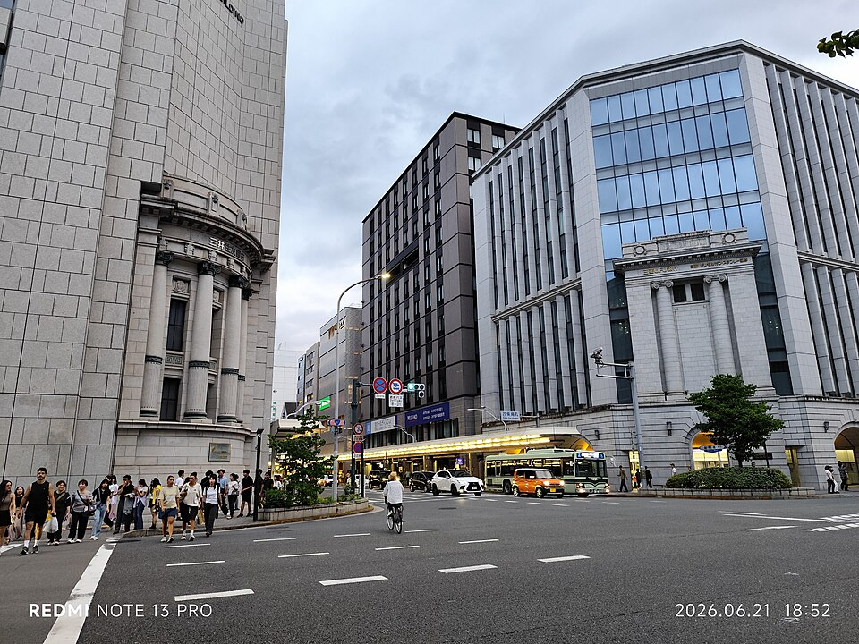
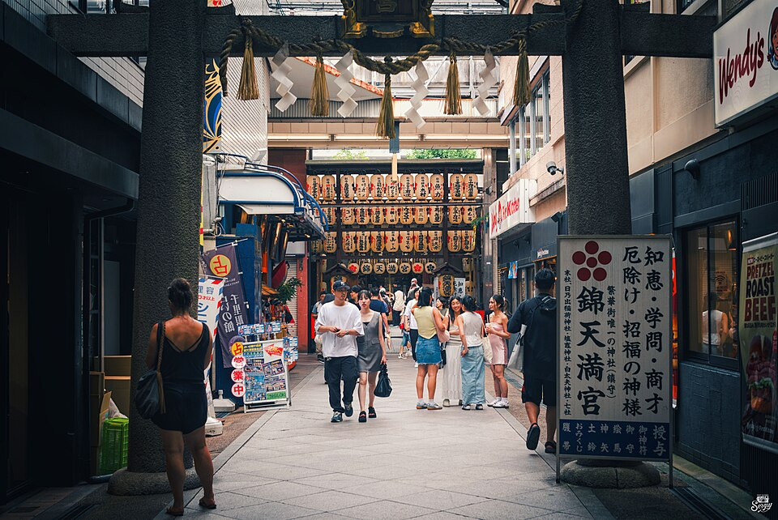
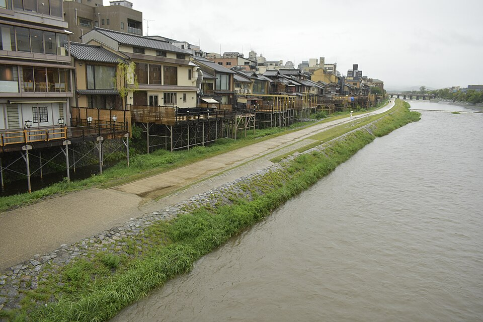

# Reserved reference views and acquisition receipts

Reviewed 6 November 2026. Three licensed Commons thumbnails are retained unchanged
for evaluation preparation. Their source records include photographer, capture
date, location, license, published revision and explicit visual limitations in
[sources.json](sources.json). Retrieval times, dimensions, byte counts and SHA-256
are in [downloads.json](downloads.json).

| Reserved photograph | Scope of the actual view | Attribution and rights |
| --- | --- | --- |
|  | Partial Mitsui corner and crossing, 21 June 2026. Evening daylight; no complete frontage or calibrated camera pose. | HAGAT hOMSZE, CC0 1.0; publisher-generated 960 × 720 thumbnail. [Source](https://commons.wikimedia.org/wiki/File:JP_%E6%97%A5%E6%9C%AC_Japan_%E4%BA%AC%E9%83%BD_Kyoto_%E5%9B%9B%E6%9D%A1%E9%80%9A_Shijo_Dori_walk_evening_1835pm_June_2026_N13P_28.jpg) |
|  | Outer Tenmangu approach, 9 July 2024. Visible torii, shrine sign and lantern approach identify the subject; published geotag requires reconciliation. | Sergiy Galyonkin, CC BY-SA 2.0; publisher-generated 960 × 642 thumbnail. [Source](https://commons.wikimedia.org/wiki/File:Market_street_in_Kyoto_(53908881071).jpg) |
|  | River and west-bank buildings, 17 July 2025. The bridge deck and parapet are outside this frame. | 武田信徳, CC BY 4.0; publisher-generated 960 × 640 thumbnail. [Source](https://commons.wikimedia.org/wiki/File:Kamo_River_from_Shijo_Bridge_20250717.jpg) |

No additional edits, crops or color adjustments were applied to these downloaded
thumbnails. Original-resolution source links and license links are recorded in the
manifest. The retained pixels remain under each photograph's stated license.

These three files have no matching source filename or SHA-256 in the two existing
photographic authoring registries. This check establishes repository separation.
Maintain that separation: keep them out of training, texture selection and
appearance authoring. Viewing them to confirm identity is recorded above. Existing
photographs that informed the production façades remain authoring references.
Fresh calibrated held-out captures are still required for the matched rendering
trial, including every sight, reverse views and both lighting conditions.

## Verify a clean checkout

Use Python 3 with Pillow, the same image decoder used for the existing source
inspection tools:

```sh
PYTHONPATH=artifacts/realism-01/inspection-tools python experience/evidence/realism-01/qualification/references/verify.py
```

The script verifies retained JPEG bytes, dimensions, metadata completeness and
overlap with the existing authoring registries. With Pillow installed globally,
the `PYTHONPATH` assignment is unnecessary. Provider HTML caches are optional in a
clean checkout; when present, their hashes are checked. All three retained photos
and the receipt records are required. Reacquisition uses `acquire.py`, downloads
the published thumbnail bytes and refreshes receipts. Review any changed digest
before committing a reacquisition.

## Public pricing evidence

The [exAgent receipt](exagent-pricing-receipt.json) and
[Advalay receipt](advalay-pricing-receipt.json) identify official source URLs,
retrieval times, byte counts and source-response hashes. HTML copies are held in
ignored `artifacts/realism-01/reference-qualification/`. The attributed public
line items are recorded in [sources.json](sources.json). No contact, route quote,
booking or payment occurred.

The [research qualification](../../../../sprints/realism-01/research/reference-qualification.md)
maps these references and prices to the six-sight capture requirements.
