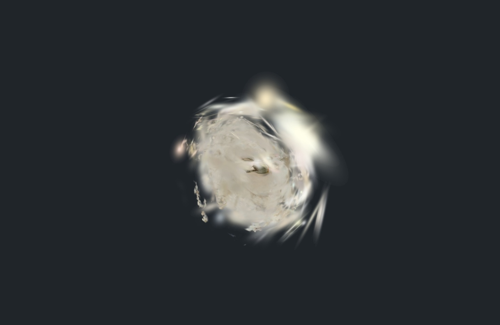
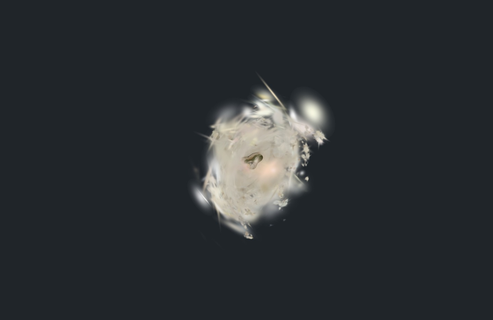

# Splat loader and interaction diagnostic

6 November 2026 · **Engineering compatibility only.** Spark 2.4.0 and the
application's existing Three 0.186.1 rendered an original publisher sample in a
local Chromium 151 / SwiftShader browser. No application dependency changed.

| Initial submitted view | After native mouse orbit |
| --- | --- |
|  |  |

The unchanged images have diffuse/fragmentary appearance. They establish neither
source fidelity nor acceptable art quality. The sample is a non-Kyoto shoe object,
with unverified original capture location/date. This run cannot admit a candidate
to the matched Kyoto benchmark or establish a mesh/splat winner.

| Actual observation | Result / boundary |
| --- | --- |
| Source | `rcmt/splat-samples`, revision `9a68bdb08cb22d7dd329d8f2218424ea09f79530`, `shoe.splat`, 3,364,608 original bytes; LFS SHA-256 verified |
| Source rights | Publisher [dataset card](sample-license-card.txt) explicitly declares MIT; original capture ownership and history remain unverified. Credit: rcmt |
| Software | Spark 2.4.0, revision `ffe210dc0a45d0515a06c9235878108112827d61`, MIT / World Labs; npm SHA-512 verified. Peer requirement `three >=0.180.0`; local Three 0.186.1 used |
| Download limit | 100,000,000 bytes aggregate; actual 8,432,484 downloaded bytes across sample, software and receipts |
| Decoding/rendering | 105,144 source splats initialized; awaited sort and subsequent draw recorded; original sample transform is identity |
| Native interaction | Trusted mouse input changes submitted camera matrix and captured image; draws increase from 3 to 15 |
| Disposal | Scene sample removed and dispose calls complete; remaining renderer counters include one geometry and three textures. Complete reclamation is unverified |
| Errors/checks | Six engineering checks pass; zero page errors. One earlier browser-launch failure is retained separately |
| Resource observation | 2,588,672 bytes across three exposed CPU buffer fields; worker heaps, GPU textures, transient/LOD overlap and peaks unmeasured |
| Readiness | Source initialization and awaited-sort/submitted-frame timestamps recorded. Local unthrottled software rendering supplies no Benchmark V1 timing acceptance |

[Complete original browser report](result.json) · [Acquisition receipts](download-receipts.json) ·
[File/producer identities](manifest.json) · [Startup failure report](startup-failure.json) ·
[Original startup log](startup-failure.txt)

The source camera uses the complete decoded bounding box and an explicitly
recorded inspection position. Original colors, scales, opacity and positions are
unchanged. The viewer uses the upstream-recommended `antialias: false`, disables
LOD for this bounded sample and awaits Spark's documented update/sort call.
These are engineering settings; matched production quality settings remain open.

The startup failure occurred before source-page execution. The successful driver
sets Node and Chromium temporary/config paths under ignored `artifacts/splat-tmp/`
with a path length compatible with Chromium sockets. Its original report and log
preserve that attempt; its historical driver hash differs from the successful
driver. Both completed images and all original reports are retained unchanged.

## Reproduce

From the repository root with existing application dependencies installed:

```sh
python experience/tools/splat-qualification/acquire.py --output artifacts/realism-01/splat-qualification/downloads
node experience/tools/splat-qualification/capture.mjs artifacts/realism-01/splat-qualification/run-new
python experience/tools/splat-qualification/verify.py --root .
```

Acquisition uses pinned software/dataset revisions, TLS verification and the
inherited proxy. The local browser service serves only source assets, the viewer
and installed Three modules. Original downloads, package archive and reruns remain
ignored. The completed run binds each served resource by SHA-256.

The pinned upstream [renderer documentation](spark-renderer.txt),
[SplatMesh documentation](splat-mesh.txt), [software license](spark-license.txt),
[package metadata](spark-package.json) and [sample inventory](sample-tree.json)
are retained as unchanged reference bytes. Software rights and sample-license
declarations remain separate from Kyoto capture qualification.

Next compatibility evidence requires a qualified street sample, LOD streaming,
hidden/resume/cancel behavior, shared collision, depth/character integration,
day/night references and complete resource accounting. Physical-device and fresh
participant gates remain open.
