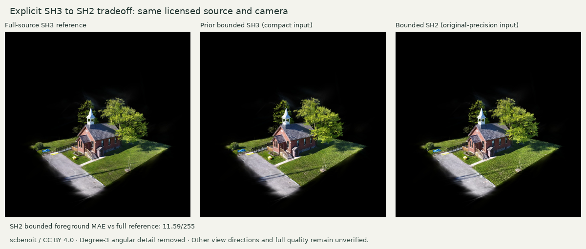

# Explicit SH3 to SH2 quality / size tradeoff

6 November 2026 · Knock Community Hall by [scbenoit](https://superspl.at/scene/0ff2e6dc),
CC BY 4.0 · Original source retained unchanged · Spark 2.4.0.

| Measurement | Recorded result | Implication |
| --- | ---: | --- |
| Original source | 1,935,275 splats, SH3, 29,781,498 bytes | Same source as the preceding streaming trials |
| Derived source | 2,541,177 LoD nodes, **SH2** | Degree-3 angular coefficients are explicitly removed |
| Header + root page | 2,288,768 bytes | Actual minimum source payload, before runtime |
| First-visible encoded responses | **3,898,536 bytes / 3.72 MiB** | Fits the 4 MiB first-visible boundary in this run |
| Included in-flight response | 184,096 bytes | Next-page headers and transferred body remain counted |
| Complete RAD data | 84,115,304 bytes / 39 chunks | Full converted output remains separate from startup |
| Chunks above 2 MiB | **37 / 39** | Section transfer budget still fails |
| First-visible vs full SH3 reference | Foreground MAE **17.78/255**, 57,443 selected splats | Partial detail; no quality acceptance inferred |
| Bounded initial vs full SH3 reference | Foreground MAE **11.59/255**, 262,137 selected splats | Same camera and eight-page cap; other viewing directions untested |
| Pool, fetcher and cancellation | Eight-page cap, one fetcher, timestamp-bound source abort observed | Browser mechanics checks pass |

[Conversion command and exact hashes](conversion/execution.json) ·
[Raw browser observations](focused/result.json) · [Recomputed measurements](comparison.json)

The official converter ran once with `--quality --rad-chunked --max-sh=2` against the
original SH3 SOG. It used the existing pinned CPU binary, with no new downloads. Source,
binary and output hashes are retained; conversion artifacts occupy 113,924,677 bytes
within the 200 MB limit. The original source and the previous SH3 runs remain intact.

The existing browser harness was reused byte-for-byte. Gzip runtime delivery, 10 Mbps /
80 ms network settings, viewport, camera, focal adjustment, eight-page pool and display
target are unchanged. Both new screenshots pause the submitted frame; camera error is
below `3e-9`, and the projection matches exactly. The source-to-image comparison uses
the [full-source SH3 reference](../splat-streaming/reference/full-source-spark-focal2.jpg).
The previous bounded compact-input SH3 view has foreground MAE 9.65/255. It also uses a
different intermediate quantization, so that historical comparison cannot isolate the
effect of reducing SH degree.

SH3 to SH2 removes seven degree-3 basis terms per color, or 21 directional coefficients
per Gaussian.
View-dependent highlights and angular color changes can degrade. The measured image
difference at the initial viewpoint does not qualify reflective surfaces, other viewing
directions, realism, immersion or independent place discovery.

The passing byte boundary applies to the first visible partial representation. The
benchmark's full-quality starting view remains **unverified**, and section transfer
still fails. CDP counts encoded response bodies and response headers; request headers
and lower network overhead are excluded. SwiftShader, shared CPU activity, unmeasured
worker/WASM heaps and driver allocations prevent physical-device or complete-resource
qualification. This result records one bounded quality/size tradeoff and supports no
production release decision by itself.

[Reproduction and verification](../../../../tools/splat-encoding/README.md) ·
[Retained file, reference and producer hashes](manifest.json)
