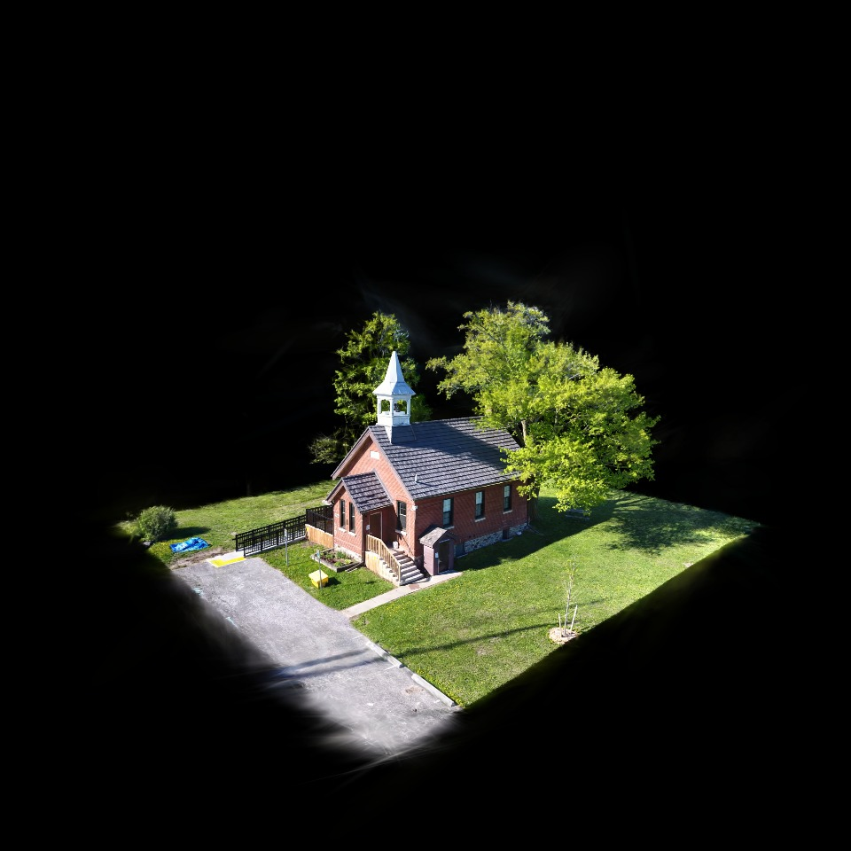
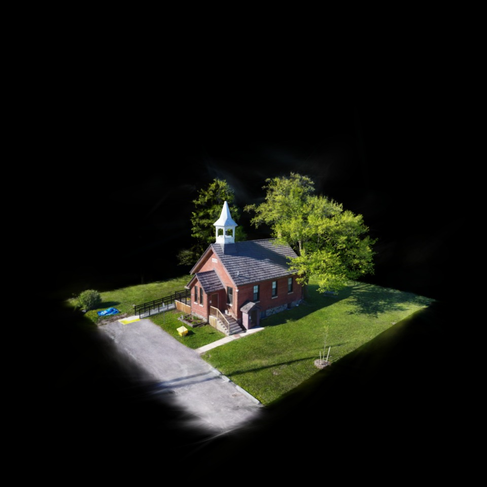

# R06: architectural source fidelity

**A real captured building now renders recognizably with native interaction. The Kyoto route remains unqualified.** These are actual browser frames from the same licensed source and measured camera. Click an image for its original pixels.

| Publisher PlayCanvas reference | Spark default focal adjustment 1 | Spark documented PlayCanvas adjustment 2 |
|---|---|---|
|  |  |  |
| Original publisher runtime, paused through its supported `noanim` option; UI disabled | Building form, entrance, ramp, roof, trees and shadows align; softer rendering | Roof and foliage detail improve; residual brightness/filtering differences remain |
| Reference | Common-mask foreground RGB MAE **22.52/255** | Common-mask foreground RGB MAE **20.59/255**, an **8.57%** reduction |

The [controlled calibration](hall/calibration-comparison.json) uses the same 201,167 foreground pixels for both settings. The residual error is material. These scores diagnose renderer differences and establish no retrospective acceptance threshold. The input is a drone reconstruction with an isolated boundary and black surroundings; it does not supply a walkable avenue.

## Findings and preserved mistakes

| Question | Observed result | Evidence |
|---|---|---|
| Was the earlier diffuse shoe a Spark-only failure? | Two established renderers produce nearly identical diffuse images using exactly the original bytes and camera. Foreground MAE is 1.94/255 initially, 2.09/255 after native orbit. Source orientation/capture quality remains unknown. | [Shoe images and measurements](shoe/comparison.json), [native test](shoe/result.json) |
| Do source decoders preserve index order? | No index identity can be assumed. Initial index-wise statistics are invalid. Corrected matching finds 13,277 unique quantized position/RGBA identities; 91,862 unmatched and 5 ambiguous remain excluded. This is a partial diagnostic. | [Preserved invalid assumption](failures/shoe-index-assumption/result.json), [corrected report](shoe/result.json) |
| Is the hall reference actually comparable? | Original 1,935,275-splat components; asset Z rotation 180°; camera world-matrix difference ≤2.56e-8 and projection difference 0; camera stable throughout capture. | [Default comparison](hall/default/comparison.json), [source receipt](knock-source-receipt.json) |
| Could the official repository asset use the publisher camera? | Its count, bounds and codebooks differ. That pairing was rejected. | [Source receipt](knock-source-receipt.json) |
| Could an animated publisher screenshot be used as reference? | The first capture moved after its matrix was sampled. It is retained as an invalid reference. The later capture uses supported `noanim`, `noui`, `webgl` options and checks camera stability. | [Rejected capture/report](failures/hall-animated-reference/result.json) |
| Did the portable package include every import? | The first package omitted Three's `Pass.js` dependency and timed out before scene loading. The dependency was added and the corrected package was checked in a fresh attempt. | [Preserved failure](failures/preview-missing-transitive-import/result.json), [corrected package check](preview/result.json) |
| Native orbit, wheel dolly, disposal? | Observed on all 1,935,275 splats. Final package also checks native input with focal adjustment 2. | [Hall native test](hall/default/result.json), [packaged preview test](preview/result.json) |
| Hidden/resume and full resource reclamation? | **Unqualified.** Headless tab switching never produced `hidden`. Spark disposal reduced exposed Three counters from 2 geometries/10 textures to 1/1; complete CPU/GPU/worker accounting remains absent. | [Hall native test](hall/default/result.json) |

The recorded `net::ERR_FAILED` console entry in publisher runs is its intentionally blocked Sentry script. Publisher telemetry was suppressed locally. No page exception was recorded. These network observations remain in the reports.

## Budget and next task

| Benchmark V1 requirement | Measured input / implication | Status |
|---|---|---|
| Initial ≤4 MiB | Eight original components **29,780,678 bytes**; original-byte ZIP **29,781,498 bytes = 28.40 MiB** | Full asset is **7.10×** the initial asset budget |
| Ready ≤8 seconds at 10 Mbps | ZIP alone requires **23.83 seconds** at an ideal 10,000,000 bits/s, before latency/decode/GPU work | This full-load pipeline cannot meet the gate |
| Real device performance | Actual Chromium renderer reports SwiftShader | No physical GPU/mobile performance claim |
| Source consistency | Eight component hashes match the deterministic ZIP entries; same-source renderer frames retained | Engineering comparison available; photographic truth and residual radiance remain unresolved |

The exact hall source is suitable for the next bounded streaming/resource experiment: create a coarse first-visible representation through a mature source transformer, retain original-source attribution, measure actual initial bytes, verify camera/reference degradation, then exercise cancellation, unload/reload and eviction. Enforce a 4 MiB first-visible envelope before scaling the asset. Measure actual allocation/disposal counters and worker cleanup across repeated cycles; use a visible desktop session for genuine hidden/resume. SwiftShader can check mechanics and byte budgets, while physical-device timing remains a separate gate. The single drone capture cannot prove pedestrian continuity, six-sight discovery or Kyoto coverage.

## Source and reproduction

**Knock Community Hall by scbenoit**, [original scene](https://superspl.at/scene/0ff2e6dc), [CC BY 4.0](https://creativecommons.org/licenses/by/4.0/). Publisher identifies Innisfil, Ontario and describes 185 Phantom 4 photos processed with Metashape, Brush and SuperSplat. Exact coordinates and capture date remain unverified. Original components were repackaged unchanged. The published poster has no verified camera and is excluded from the pixel comparison and redistributable preview.

The local package is generated under `artifacts/realism-01/splat-fidelity/local-preview/`; it contains the licensed model, Spark/Three, attribution, hashes and launch instructions. Its approximately 35 MB full load is an engineering preview. No production runtime/API or public site was changed. The cached publisher wrapper is used only for research replay and is excluded from the preview package because complete wrapper redistribution rights were not established.

Fresh-checkout model acquisition now has an explicit `--mode model-preview` path that requires no publisher HTML. A separate empty-cache test fetched the eight original pinned components (29,780,678 bytes), recreated the exact original ZIP, and produced all 16 preview files byte-identical to the browser-tested package. The tracked public configuration, CC BY attribution and source receipt are copied with identity checks. [Portability evidence](portability/check.json) records this test; strict historical research replay remains available separately.

[Tool instructions](../../../../tools/splat-fidelity/README.md) · [Source acquisition identities](source-files.json) · [Archive layout](archive-layout.json) · [Source component receipts](knock-original-acquisition.json) · [Retained manifest](manifest.json). Historical source snapshots accompany earlier reports so changing diagnostic tools does not erase their producer bytes.
