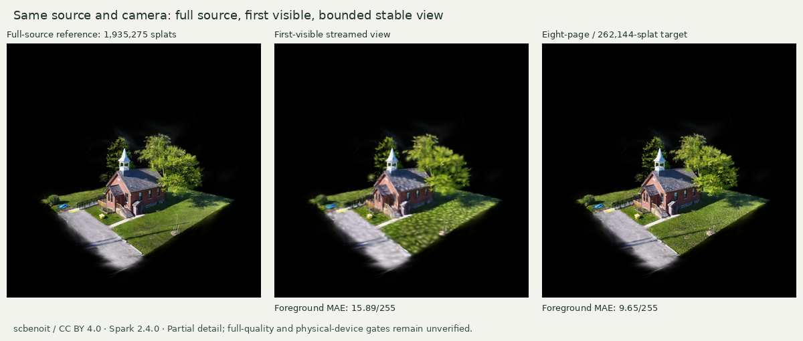

# Same-source paging and resource experiment

6 November 2026 · Knock Community Hall by [scbenoit](https://superspl.at/scene/0ff2e6dc),
CC BY 4.0 · Spark 2.4.0 · Three 0.186.1.

| Measured observation | Result | Evidence |
| --- | --- | --- |
| Free source identity | Original 29,781,498-byte SOG; 1,935,275 splats; SH3 retained | [Original and conversion identities](conversion/execution.json) |
| Original-precision RAD | 116,110,408 bytes; 39 chunks; 3,123,072-byte header/root minimum | [Conversion record](conversion/execution.json) |
| Compact-input RAD | 114,482,032 bytes; 39 chunks; 3,115,648-byte header/root minimum | [Compact conversion](conversion/compact-execution.json) |
| Initial total response transfer | **4,737,856 bytes**, including runtime, headers and partial next-chunk transfer; **fails 4 MiB** | [Frozen-frame focused run](compact-focused-02/result.json) |
| Section transfer | 39/39 original chunks and 38/39 compact chunks exceed **2 MiB** | [Measured sizes](comparison.json) |
| Resident pool / requests | At most eight 65,536-splat pages, one source fetcher | [Lifecycle run](compact-run-01/result.json) |
| Movement / eviction | Native orbit/dolly observed; five page-replacement events | [Lifecycle run](compact-run-01/result.json) |
| Unload and cancellation | Three cycles reach zero resident pages / renderer LoD records; focused cancellation binds the aborted header request to the removal timestamp | [Lifecycle run](compact-run-01/result.json), [focused action](compact-focused-02/result.json) |
| First-visible image difference | 57,888 selected splats; foreground MAE **15.89/255** against full-source reference | [Same-camera comparison](comparison.json) |
| Bounded initial image difference | 262,140 selected splats across eight pages; foreground MAE **9.65/255** | [Same-camera comparison](comparison.json) |
| Partial allocation observations | Peak observed CPU arrays 36,274,176 bytes; logical GPU textures 42,008,576 bytes; complete allocation remains **unverified** | [Focused observations](compact-focused-02/result.json) |
| Worker / object cleanup | Three workers constructed, two termination calls, one shared decoder worker remains; Three reports one geometry / one texture after disposal | [Focused disposal](compact-focused-02/result.json) |

The official `build-lod` converter was compiled from Spark commit
`ffe210dc0a45d0515a06c9235878108112827d61` using Rust 1.91.0, CPU only. The
[acquisition receipts](conversion/acquisition.json) and
[dependency checks](conversion/dependency-verification.json) bind official component
checksums, 42 upstream Git blobs and 62 Cargo archives. Recorded tooling storage peaked
at 1,105,560,466 bytes within a 1.5 GB limit. No additional scene, paid service or vendor
inquiry was used.

The comparison uses the previously reviewed full-source Spark frame with focal
adjustment 2. Both new images have camera world-matrix error below `3e-9` and identical
projection matrices. Their frame counters remain unchanged during capture. Pixel
differences include LoD and encoding changes; no retrospective realism threshold or
human acceptance pass is inferred. The first-visible frame and the bounded display
remain separate from the benchmark's full-quality view.

The [original-precision browser attempt](full-run-01/result.json) retains its startup
failure and camera mismatch. The first compact mechanics run retains transient views
while streaming was still pending after some camera changes, and partial array
observations that omitted some pager paths. Its native-input, eviction and three-cycle
cleanup observations are retained. The focused run binds camera/settling/frame state,
visits pager arrays directly and scopes cancellation to the recorded action.

CDP totals cover encoded response bytes including response headers. Request headers,
TLS/TCP/DNS overhead, worker/WASM heaps, driver allocations and transient decode buffers
remain outside these measurements. The renderer is Chromium SwiftShader on a shared
CPU host; recorded load varies during runs. Physical Windows / macOS performance,
hidden-tab behavior, complete memory accounting and all Kyoto route experience gates
remain unverified.
The `lodTrees` observation counts the renderer's LoD registry; it supplies no direct
worker-heap measurement. Removing scene pages leaves the bounded shared GPU pool
allocated until renderer disposal.

This increment establishes working bounded paging, actual lifecycle observations and
the cost of the two documented encodings. The current outputs exceed startup and
section transfer budgets. Production selection still requires a source-processing
result that meets those budgets while preserving the same-camera quality evidence,
followed by physical-device and route-specific acceptance.

[Tool and reproduction instructions](../../../../tools/splat-streaming/README.md) ·
[File and producer hashes](manifest.json) · [Measurements](comparison.json)
