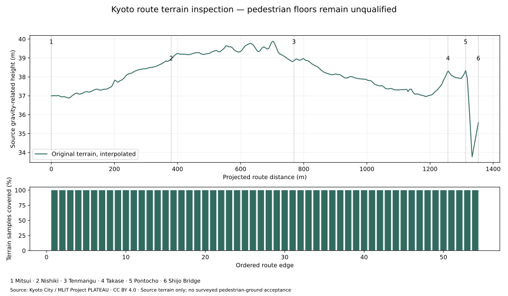

# Full-source terrain experiment

6 November 2026 · Source: Kyoto City / MLIT Project PLATEAU · CC BY 4.0.



| Actual observation | Result | Qualification boundary |
| --- | --- | --- |
| Complete original source | 33,281,694 gzip bytes / 793,602,405 decoded bytes | Both byte counts and SHA-256 retained; decoded bytes streamed |
| Source triangles parsed | 2,042,977 | ElementTree XML parser and GDAL GML geometry parser |
| Route-near triangles retained | 6,019 within/intersecting the 25 m route corridor | Original vertices and gravity-related heights preserved |
| Extraction resources | 83.59 s; process peak RSS 98,193,408 bytes | Local processing observation; no browser-performance inference |
| Profile coverage | 1,434 / 1,434 positions across all 54 ordered edges | 1 m sampling within each edge plus endpoints; projected length 1,353.331 m |
| Height reference | EPSG:6697; JGD2011 horizontal plus gravity-related height | Vertical model and pedestrian-floor acceptance remain unverified |
| Bridge terrain | 35.592232 m at the final approach anchor | Approximately 2.74 m below the Pontochō anchor's terrain; bridge deck requires separate geometry |

[Complete extraction receipt](terrain-extraction.json) · [All retained triangles](terrain-triangles.geojson.gz) · [Every profile sample](terrain-profile.json) · [File/producer identities](manifest.json)

The experiment budgets **64 MiB encoded transfer and 900 MiB decoded source**.
Only the encoded original is saved to the ignored download cache. The XML parser
streams decoded bytes, checks the complete source size/hash, and removes processed
triangles from memory. GDAL parses three-dimensional GML geometry, handles explicit
axis order, and converts triangle geometry to a GeoJSON-supported polygon while
preserving its vertices. Horizontal corridor selection uses EPSG:6674.

The profile interpolates each original triangle plane at the oriented route
positions. It records every contributing triangle and any overlapping-height
spread; an unresolved spread above 0.05 m would leave the sample height unavailable.
This run has no unavailable samples. Terrain coverage supplies no evidence about
bridge deck, curb, staircase, covered-passage floor, collision or current public
access. It is separate from the benchmark's 0.1 m reviewed walking trajectory.

[Two explicit geoid-model experiments](../datum/README.md) convert the same 1,434
samples into the existing Three local frame. Both mathematical conversions pass
independent frame checks. GSIGEO2011 is consistent with inspected PLATEAU height
conversion, while source epoch/model choice and physical floor checks remain open.
No terrain or camera transformation was applied to the public experience.

## Reproduce

Source extraction uses native GDAL 3.10.3 on Python 3.13.5; profiling uses Python
3.12.14 and the [pinned profile dependencies](../../../../tools/source-qualification/terrain-profile-requirements.txt).
The [source requirements](../../../../tools/source-qualification/terrain-source-requirements.txt)
require matching native GDAL bindings. Commands run from the repository root:

```sh
/usr/bin/python3 experience/tools/source-qualification/terrain-source.py acquire --root . --cache artifacts/realism-01/downloads/terrain-qualification
/usr/bin/python3 experience/tools/source-qualification/terrain-source.py extract --root . --cache artifacts/realism-01/downloads/terrain-qualification --output artifacts/realism-01/runs/terrain-qualification
mkdir -p artifacts/realism-01/terrain-mpl artifacts/realism-01/terrain-tmp
MPLCONFIGDIR=artifacts/realism-01/terrain-mpl TMPDIR=artifacts/realism-01/terrain-tmp PYTHONPATH=artifacts/realism-01/site-test-tools python experience/tools/source-qualification/terrain-profile.py --root . --source experience/evidence/realism-01/qualification/terrain/terrain-triangles.geojson.gz --output artifacts/realism-01/runs/terrain-profile-bound
```

Existing cache bytes must match the receipt before reuse. A second extraction
from the same source reproduces all retained triangle bytes; processing time and
peak-memory fields describe each actual run separately. Original compressed source,
generated runs, preparation logs and dependency directories stay under ignored
`artifacts/realism-01/`. The tracked triangle archive, profile and source receipts
support checkout-independent evidence review.
