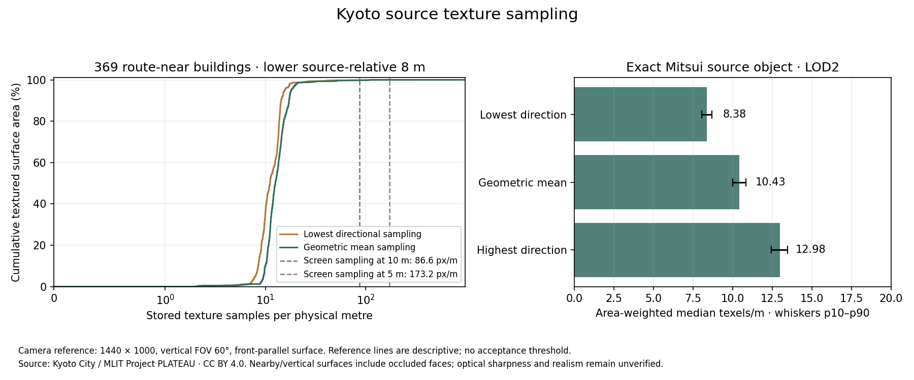

# Original façade texture sampling

6 November 2026 · Kyoto City / MLIT Project PLATEAU · CC BY 4.0.



| Measured original source | Route-near buildings | Exact Mitsui occurrence |
| --- | ---: | ---: |
| Selected building occurrences | 369 | 1 |
| Original triangles, including roofs and other surfaces | 25,792 | 44 |
| Vertical-surface triangles | 15,240 | 24 |
| Textured area in the lowest source-relative 8 m band | 96.30% | 100% |
| Area-weighted median geometric-mean sampling | 12.56 texels/m | 10.43 texels/m |
| Geometric-mean sampling, area-weighted p10–p90 | 10.01–17.25 texels/m | 10.01–10.83 texels/m |
| Area-weighted median lowest-direction sampling | 11.12 texels/m | 8.38 texels/m |

The [measurements](texture-density.json) decode 33 original B3DM sources and retain
every selected object identity, associated route edge and per-object distribution.
The [triangle table](triangle-measurements.json.gz) preserves physical area, clipped
band area, UV pixel area, directional singular values and anisotropy for every
vertical triangle. The [manifest](manifest.json) binds the evidence and producers.
The reviewed source selection remains 1,965 occurrences; the 369 buildings are
the selected subset appearing within 25 m of an audited route edge. The
[original geometry evidence](../geometry/README.md) records source refinement and
the excluded ancestor occurrences.

A hypothetical front-parallel surface at a 1440 × 1000 viewport and vertical
FOV 60° occupies 86.60 screen pixels/m at 10 m and 173.21 pixels/m at 5 m. At the
Mitsui median sampling density, one stored texel spans approximately 8.3 screen
pixels at 10 m or 16.6 at 5 m. These figures explain the enlargement of stored
imagery during close walking. They provide a geometric reference without a new
acceptance threshold. Optical blur, image resampling, compression and baked
lighting can reduce recoverable information further.

## Method and limitations

DracoPy decodes original positions and UVs through py3dtiles/pygltflib; Pillow
reads the original embedded atlas dimensions. The retained rigid placement
matrices preserve physical metres. For each triangle, an orthonormal basis
maps physical plane coordinates to UV pixels. Singular values give highest
and lowest directional samples/m; their geometric mean equals the square root
of UV pixel area divided by physical surface area. The calculation checks that
independent determinant identity for every textured surface.

Vertical surfaces satisfy `abs(normal.up) ≤ 0.5`. Shapely clips their physical
triangles to the object's lowest source-relative 8 m. The origin is the minimum
source vertex height. This origin does not establish pedestrian ground or a
ground-floor entrance. Quantiles are weighted by physical area, with clipped
band area used for the band results. Nearby objects include concealed and rear
faces; the audit does not qualify visible street frontage. Texture presence
does not establish photographic sharpness or current appearance.

The exact Mitsui ID is `bldg_d4824084-63c9-4d60-8320-30b3f2e440b9`, selected
batch 354 from the retained Shimogyo `data5.b3dm` occurrence. It is LOD2 with
44 total source triangles and 24 vertical-surface triangles. These counts
characterize the source representation; they do not establish accurate doors,
cornices, recesses, signage, materials or independent landmark discovery.

## Capture implications

The source geometry and atlas measurements support using the municipal data
for route context and source comparison. Close-walking acceptance still needs
actual street-level evidence: approach and oblique views of each sight;
entrances, signage, window/recess geometry, arcade transitions and road edges;
surveyed ground/control ties; and diffuse daylight plus independent night
lighting references. Each delivery needs dated rights and location records.
Use the same route cameras and source identity for the mesh and splat trials.
Inspect the delivered imagery at the agreed walking distances before accepting
additional texture or geometry detail. The source-relative band and its
sampling statistics cannot substitute for those captures.

## Reproduction and validation

Install the [pinned packages](../../../../tools/texture-qualification/requirements.txt)
inside ignored `artifacts/realism-01/`. Reuse the original B3DM files specified
by the geometry receipts; no new source acquisition is required for this run.
From the repository root:

```sh
PYTHONPATH=artifacts/realism-01/geometry-tools:artifacts/realism-01/inspection-tools python experience/tools/texture-qualification/measure.py --root . --output artifacts/realism-01/texture/run
MPLCONFIGDIR=artifacts/realism-01/texture/mpl TMPDIR=artifacts/realism-01/texture/tmp PYTHONPATH=artifacts/realism-01/geometry-tools:artifacts/realism-01/inspection-tools python experience/tools/texture-qualification/plot.py --source artifacts/realism-01/texture/run --output artifacts/realism-01/texture/run
python experience/tools/texture-qualification/retain.py --root . --run artifacts/realism-01/texture/run
python experience/tools/texture-qualification/verify.py --root .
```

Two completed measurements from identical cached sources reproduced both JSON
and compressed triangle-table bytes. The verifier checks retained and producer
hashes, original selection, per-object counts, triangle identity, clipped area,
pixel/physical-area identities, anisotropy, per-object and aggregate weighted
distributions, exact Mitsui identity and camera arithmetic. Original cached
B3DM bytes are rechecked when present. A clean checkout validates the retained
records independently of those ignored raw files.
