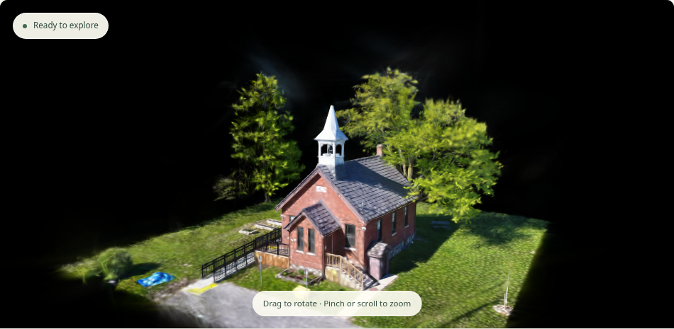
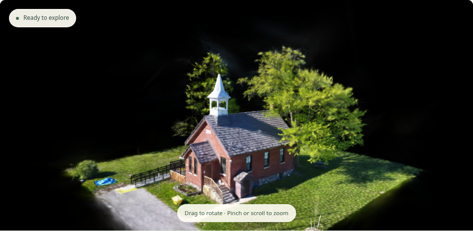
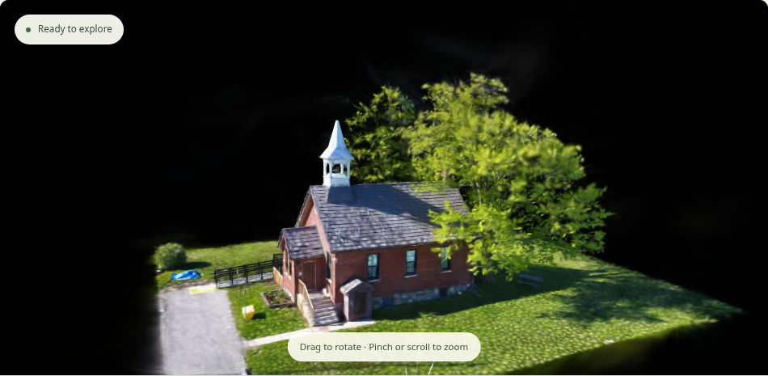

# Native camera and loading profile · 14 November 2026

The current architectural package was measured at the source view, two manual
inspection views and the returned source view. Runtime, assets and display settings
remain those of release `b4b140d2c48b7e185e296272f9fb141588caca95`, package manifest
`6673bc5de654b71ba9e0fc5a799d72cb24af3654264aa1b3841c1236ae8223b5`.
The package base commit is recorded separately in the retained manifest.

| Left inspection · approximately −0.3 radians | Source view | Right inspection · approximately +0.3 radians |
| --- | --- | --- |
|  |  |  |

The [completed report](runs/2026-11-14T15-42-38-145Z/result.json) retains **17 checks:
15 pass and two fail**. The category totals are 14 functional passes / one
functional failure, one budget pass, and one failed exact-pixel diagnostic.
The returned source camera and 261,359 drawn splats match the initial source view.
Exact repeatability fails: **15 RGB channels differ by 1/255**, p95 difference is
zero, and alpha matches. Independent Pillow decoding reproduces the browser
comparison. Those values are within D25's numerical bounds; the stricter
same-build repeatability failure remains open. No new candidate or runtime release
is qualified by this profile.

| Observation | Actual result | Boundary |
| --- | --- | --- |
| First visible view | 3.659 s; 3,384,512 encoded response bytes | First positive submitted capture draw; 4 MiB transfer gate passes |
| Source detail settled | 97.329 s; 18,608,055 bytes | Three actual draws qualified by subsequent idle observations |
| Left inspection settled | 152.256 s; 261,355 drawn splats | Native buttons, same readiness proof |
| Right inspection settled | 276.586 s; 261,369 drawn splats | Native buttons, same readiness proof |
| Returned source settled | 304.441 s; 261,359 drawn splats | Actual Reset and a distinct submitted frame |
| Seven event-to-submitted-response observations | 3.6–15.7 ms | Original trusted event timestamp to earliest retained matching submitted frame |
| Event queue within those observations | 0.3–4.2 ms | Event timestamp to capture-listener receipt |
| Submitted response to its animation-frame observation | 2,268.2–3,556.5 ms | Actual delay before the observer records the corresponding frame |
| Frame inventory | 107 distinct draws; zero observed counter gaps | Per-animation-frame diagnostic observer |
| Main-thread long tasks | 104; maximum 4,263 ms | Browser Long Tasks API |

The seven response observations leave physical display latency and the full-route
p95 gate unverified. A quickly submitted draw can have a delayed subsequent
observation. The recorded main-thread stalls remain part of the result. The
observer itself adds overhead. These values cannot establish a speedup against
earlier drivers with different observation cadence and journeys.

Conditions: Chromium **151.0.7922.173**, SwiftShader, 1000 × 800 viewport, DPR 1,
950 × 465 canvas, 10 Mbps / 80 ms, cold browser cache. The manual poses remain
inside the existing guided arc; they do not traverse its full path. Existing
full-path, locale, touch, cancellation and native-tab evidence remains in the
[unchanged release record](../review-loading/README.md).

## Reproduction and integrity

The [manifest](manifest.json) hashes **29 files**, including **15 producer
snapshots**, all three browser attempts and four captured PNGs. The two setup
attempts retain the original localhost permission and Chromium socket-path
failures. The complete attempt retains its repeatability failure. Browser
profiles and caches remain under ignored artifacts.

Use Node 24, Playwright 1.62.1 and the source restoration procedure in the
[review transport instructions](../../../tools/review-transport/README.md).
The existing published package is `artifacts/realism-01/review-loading/package-03/`.
The browser uses a short ignored temporary directory under `artifacts/`.

```sh
node experience/tests/browser-review-chunks.mjs artifacts/realism-01/review-loading/package-03 artifacts/realism-01/review-chunks/qa/baseline
PYTHONPATH=artifacts/realism-01/tooling node experience/tools/review-chunks/profiling.mjs --verify
```

The offline verifier uses the retained Python comparator with Pillow 12.3.0.
It accepts an optional clean-checkout root after `--verify`; that checkout needs
no source downloads or browser profile. It independently checks file/provenance
hashes, package producers, three-draw readiness, final CDP transfer accounting,
the earliest retained matching response, event queue and observation delays,
counter gaps and decoded PNG differences. **Integrity passes; observed acceptance
contains the declared failure.** `--retain` regenerates this fixed profile bundle
from its actual artifact inputs and preserves every finished attempt.

Capture: **Knock Community Hall, Innisfil, Ontario, Canada**, by **scbenoit**,
<https://superspl.at/scene/0ff2e6dc>, **CC BY 4.0**. Images adapt camera and
interface behavior. This capture supplies no qualified Kyoto walking connector.
