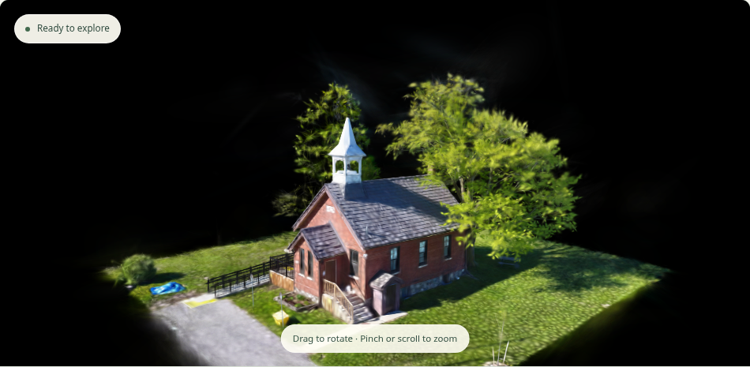
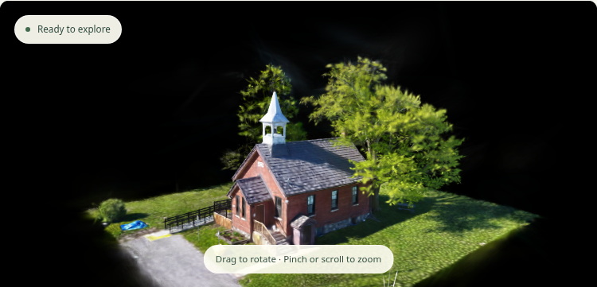
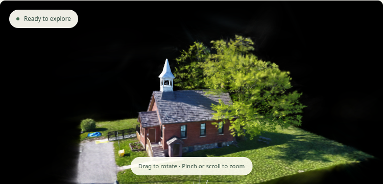

# Architectural loading and demand rendering · 14 November 2026

The viewer draws when the camera moves or capture detail changes. It presents
the initial root capture before starting other chunk requests. Original capture
bytes, captured lighting, resolution, SH settings and splat limits are preserved.
The guided tour wakes an idle renderer, and source switching remains cancellable.

## Matched appearance

| Approved guided release | Current candidate |
| --- | --- |
|  |  |

The matched 950 × 465 canvas draws 261,359 splats. The final local candidate and
baseline have exactly equal RGBA pixels; the candidate's repeat capture follows
an actual Reset and a distinct submitted frame and is also exactly equal.
D25's numerical appearance gate remains unchanged.

## Verification

| Check | Observed result |
| --- | --- |
| Source identity | All 41 SOG/RAD/RADC files unchanged |
| Local ordinary controls, EN/ZH, recovery and phone input | 48/48 checks pass on package-02 |
| Final package-03 scope | Same JavaScript, CSS and capture files; adds the favicon and its HTML link |
| Final native controls and real tab visibility | 17/17 checks pass |
| Full guided path, endpoint, reverse, manual interruption and reset | 12/12 checks pass |
| Stationary rendering | No new frames during the measured three-second idle interval; Start look-around wakes rendering |
| Final local loading and appearance | 15/15 checks pass |
| Final hosted loading and appearance | 15/15 checks pass; exact public-baseline pixels; no page or HTTP errors |
| Local first submitted 3D view | Baseline 3.777 s / 3,541,883 bytes; final 3.790 s / 3,380,606 bytes |
| Public first submitted 3D view | Baseline 3.9634 s / 4,239,665 bytes; final 3.9783 s / 3,405,633 bytes |
| Public first-view transfer target | Passes 4 MiB; 19.7% fewer bytes, with essentially unchanged timing |
| Actual HTTPS package identity | All 58 files match; canonical folder entry also matches |

Public verification is complete for Pages commit
`3f1d3e6f578877f8d7fdd908e3f19a9b3eb658f3`, runtime
`b4b140d2c48b7e185e296272f9fb141588caca95`. The final package manifest is
`6673bc5de654b71ba9e0fc5a799d72cb24af3654264aa1b3841c1236ae8223b5`.
The [hosted result](runs/loading/public-final/2026-11-14T09-44-41-692Z/result.json)
compares the exact retained public baseline. The baseline's missing-favicon 404
and startup-budget failure remain recorded; the final entry serves its icon.

The current bounded view was observed settled after input at 57.044 seconds /
18,917,354 encoded response bytes. Full-detail startup acceptance remains open.
This readiness observation has a different boundary from the previous submitted-
frame measurement and does not establish faster full-detail loading.

| Guided midpoint | Actual endpoint |
| --- | --- |
|  |  |

The full-path run uses an 800 × 600 viewport and a 900-second functional deadline.
The path, nominal duration and 0.1-second maximum movement step per submitted
frame are unchanged. This slow software-renderer traversal validates behavior;
it does not establish physical walking fluency.

Measurements use Chromium with SwiftShader, a 1000 × 800 viewport, DPR 1,
10 Mbps throughput, 80 ms latency and a cold browser cache. Native controls use
the retained separate authenticated display setup. These observations leave
physical-device fluency, memory and screen-presentation timing unverified.

The driver retains the frame observed after each trusted click. This may be later
than the first response frame. For one final local probe it records 3,739.5 ms;
an earlier periodic sample already contains the matching camera frame submitted
1.3 ms after the input handler. Both records and the real main-thread long tasks
remain retained. Periodic sampling is incomplete; neither value establishes
physical presentation latency or a general interaction speedup.
The four public observed click-to-draw delays are 9.9, 601.2, 16.0 and 18.6 ms;
the same observation limits apply. All samples and CPU pauses are retained.

Demand-rendered settling records three actual frames with unchanged camera and
content identity before submission and at the next idle observation. Immediate
submission queue flags remain separate. This later observation boundary and the
extra Reset used for repeat capture prevent a direct comparison of whole-run CPU
totals or settling speed with the previous driver.

[Reproduction and offline verification](../../../tools/review-loading/README.md)
describe the pinned dependencies, exact drivers, retained failures and byte checks.
The [manifest](manifest.json) binds 90 retained files, 18 producer snapshots and
12 browser attempts. Offline verification independently recomputes nine PNG
comparisons, transfer boundaries, source identities and frame observations.
The first scheduling trial and setup failures remain in their original reports.
Ordinary chunk sizes, full-detail startup, physical-device and full Kyoto route
acceptance remain open.

Capture: **Knock Community Hall, Innisfil, Ontario, Canada**, by **scbenoit**,
<https://superspl.at/scene/0ff2e6dc>, **CC BY 4.0**. The preview adapts camera and
interface behavior. This source has no qualified continuous Kyoto walking floor.
