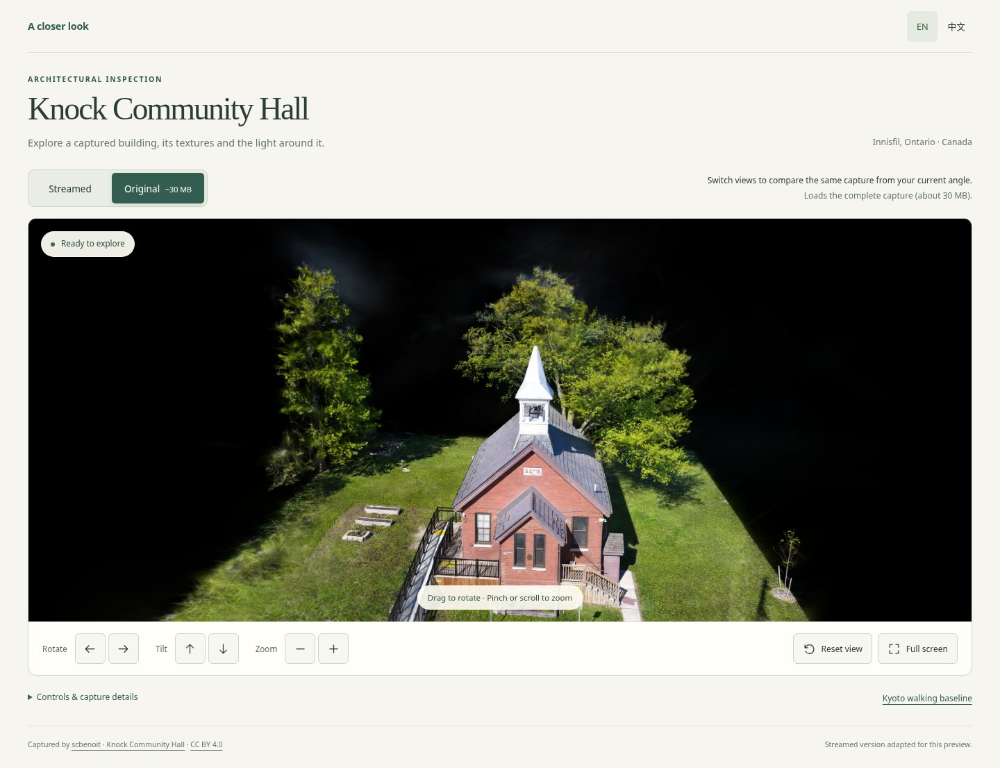
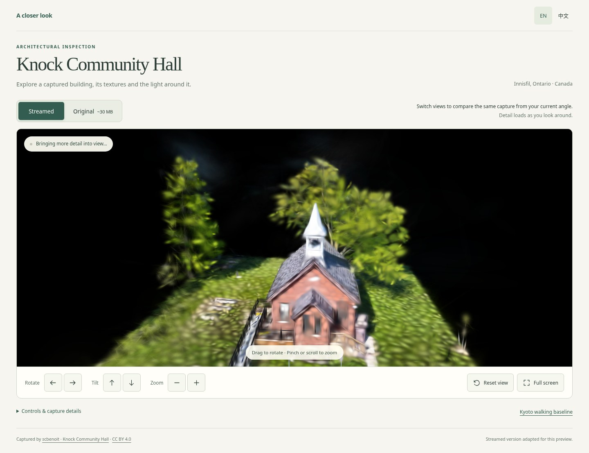

# Public architectural review

[Open the interactive review](https://paperstrange.github.io/TourGuideAI/previews/realism-01/).
The page opens Knock Community Hall in Innisfil, Canada, with visible camera
controls and English/Chinese guidance. Select **Original · ~30 MB** or **Streamed**
to compare the same capture while retaining the current camera. Only the selected
representation loads. Drag to rotate, pinch/scroll to zoom, or use the camera
buttons. Reset restores the initial viewpoint; fullscreen keeps the controls visible.

| Delivery check | Observed result |
| --- | --- |
| Final local package | 39/39 checks pass: submitted camera frames, native pointer/wheel/touch/pinch, EN/ZH, resize/fullscreen, both cancellation paths and HTTP 503/retry |
| Published bytes | 51/51 files match over actual HTTPS, including original data, all 39 streamed chunks, runtime, metadata and attribution |
| Public browser walkthrough | 39/39 checks pass against the actual HTTPS entry, including both sources, same-camera switching, rendered controls, native touch/pinch and connection-reset/retry |
| Existing Kyoto walk | One labelled baseline link; the full-route realism milestone remains open |

| Original source after loading | Streamed version at initial visibility |
| --- | --- |
|  |  |

These actual public screenshots retain the same camera. The streamed image still
shows **Bringing more detail into view**; this pair demonstrates the review UI and
initial loading behavior. It provides no settled-fidelity score.
[Chinese phone viewport](runs/hosted/2026-11-06T09-33-08-390Z/phone-zh.jpg) ·
[Final public results](runs/hosted/2026-11-06T09-33-08-390Z/result.json) ·
[Final local results](runs/final-local/2026-11-06T09-17-31-962Z/result.json) ·
[Public byte verification](published-bytes.json).

Application source is committed at `fe6f07ab02149d2754a15c90937b114b0ec13471`.
Pages release: `1a938ebd48e2606b52e54cc1d57cc8a4e2f28a96`.
The package manifest SHA-256 is
`ad7ee268bd7108a3f281ee7276818d343eb978e829a887e88877ae6716cebb13`.
It identifies 50 content files; the manifest itself is the 51st hosted file.
`implementationBase` records the source parent used during packaging; generated
file hashes and the retained producer hashes identify the delivered implementation.

Knock Community Hall was captured by **scbenoit**, published at
<https://superspl.at/scene/0ff2e6dc> under **CC BY 4.0**. Its original source is
29,781,498 bytes with SHA-256
`81d061bad6ba255689939847482836f7d70bf2e222abce04e6d81c2c976c6a71`.
The original SH3 source components are repackaged unchanged. The streamed derivative
uses Spark 2.4.0 quality LoD with SH2 and a bounded detail target; directional colour
and detail can differ. The complete streamed library is 84,115,304 bytes and loads
on demand. Both versions preserve captured lighting.

This is architectural inspection. The capture contains incomplete surfaces when
approached closely, and no qualified pedestrian floor or independent night capture.
Kyoto coverage, six-sight discovery, walking, multiplayer and full-route performance
acceptance remain under the [sprint gates](../../../sprints/realism-01/acceptance.md).

The browser checks use Chromium 151 with SwiftShader. Phone checks use a 390 px
emulated viewport and native Chromium touch events; physical phone, Iris Xe and
M1/Safari performance remain unverified. Browser response-body capture can be
unavailable for canceled requests or evicted large responses. The independent
51-file HTTPS check verifies served bytes separately. Each attempt keeps its exact
driver, outcomes, request observations and screenshots. A public attempt that
stopped at certificate validation before application execution is retained.
The successful public runner uses the existing managed proxy CA in an isolated,
task-local NSS database with TLS verification enabled and unchanged shared trust.

See [reproduction instructions](../../../tools/review-page/README.md) for packaging,
browser checks, retention and a clean-checkout evidence verifier.

A clean staged checkout passed the review verifier (31 evidence files and 14
producer hashes) and the sprint integrity check (45 Markdown documents, 543
relative link targets and 128 JSON documents). Browser profiles, source downloads
and generated packages remain excluded from the implementation branch.
