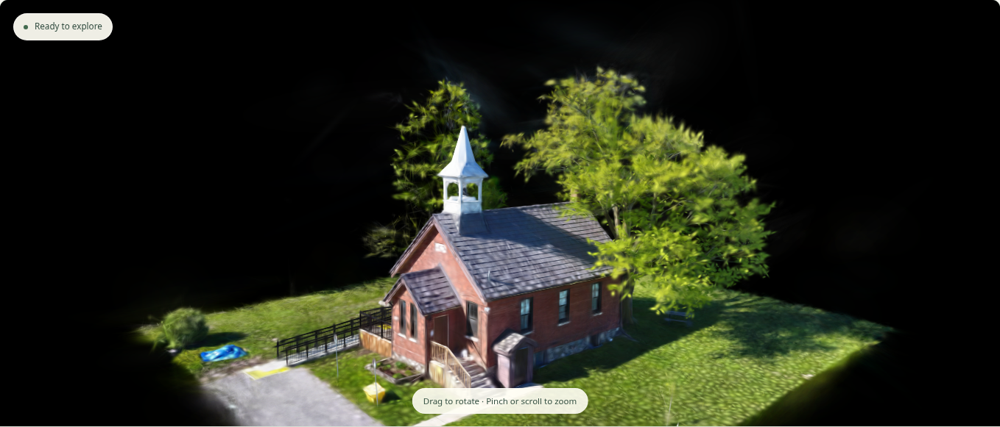
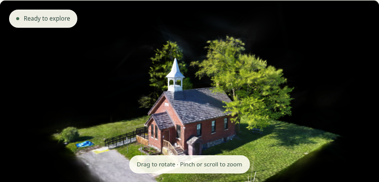
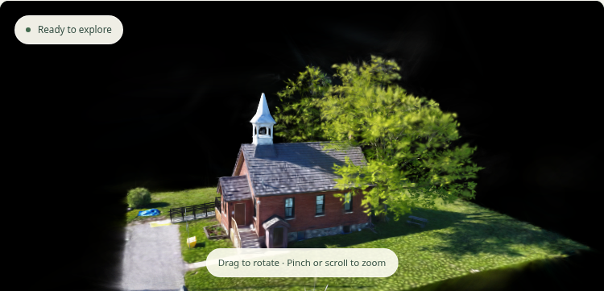

# Continuous architectural exploration · 14 November 2026

[Live review](https://paperstrange.github.io/TourGuideAI/previews/realism-01/) ·
[Reproduction](../../../tools/review-transport/README.md)

The reviewed Knock Community Hall capture gains visible start, pause/resume and
reverse controls for a bounded look-around. Initial English/Chinese controls load
before the renderer. Original SH3, streamed SH2, source camera, captured lighting
and native source bytes remain the approved reference.

## Measurements

| Check | Observed result | Meaning |
| --- | --- | --- |
| Original and streamed source identity | All 41 source files unchanged | Preserves the captured appearance inputs |
| Lossless gzip trial | Saves 9,176 of 84,115,304 bytes: 0.0109% | Native source delivery retained |
| Ordinary streamed sections | 37/39 exceed 2 MiB | Section budget remains open |
| Initial interface ready | Local 197 ms; public 280 ms | Controls can respond while renderer modules load |
| First visible 3D · first matched local run | 3.74 s; 3,449,611 encoded response bytes | This local partial-view measurement is within 4 MiB |
| Bounded current view settled · local | 45.40 s; 18,836,402 encoded response bytes | Finer detail takes additional time and transfer |
| First visible 3D · public HTTPS | 4.18 s; 5,630,795 encoded response bytes | **Fails the 4 MiB startup target**; includes 2,221,012 in-flight bytes |
| Bounded current view settled · public HTTPS | 49.28 s; 18,921,574 encoded response bytes | Full-quality startup acceptance remains open |

Timing comes from actual local and public Chromium runs with 10 Mbps throughput,
80 ms latency, cold browser cache and SwiftShader. Transfer counts use each
response's initial encoded prefix plus later encoded-body deltas, including
in-flight responses. All 17 completed public resources reconcile exactly with
their final encoded-response totals. Request headers and TLS/TCP overhead are
outside the measurement. The initial image and settled current view have separate
boundaries; neither establishes physical-device fluency or complete source detail.
Public HTTP compression is recorded separately from the unchanged native files.

The settled measurement uses the state recorded when a frame was submitted. Live
worker/sort telemetry is retained separately. Every ended attempt, including the
initial observation timeout, remains in the evidence bundle with its exact driver.

## Matched camera

| Approved release | Updated view |
| --- | --- |
|  |  |

Both captures are 1,358 × 581 pixels and draw 261,359 splats at matching cameras.
Independent PNG decoding finds 15 differing RGB channels out of 2,366,994, each
by one 8-bit intensity step; p95 difference is zero and alpha is identical. The
strict exact-pixel check remains a failed diagnostic. The bounded regression
decision uses unchanged source/settings, matched camera/count, maximum RGB
difference of one intensity step, p95 zero and identical alpha, with same-build
repeated captures required. This leaves the route's human realism gates open.
Both builds' consecutive captures are exactly equal within their respective runs.
The tiny cross-build difference remains measured without an assigned cause.

## Guided view

| Settled midpoint | Settled endpoint |
| --- | --- |
|  |  |

The local full-path run passes 12 checks, including approach pause/resume, actual
submitted endpoint, reversal, manual wheel interruption and reset. It uses an
800 × 600 browser viewport and a 900-second functional deadline. The software
renderer advances approximately one frame per second; the application retains
its 0.1-second maximum movement step per submitted frame. Earlier shorter runs
and their timeouts remain recorded. This validates behavior and leaves physical
smoothness unverified.

The new public release is `794ab33f14415b27d3687f651902bc4aecd098e9`, using runtime
`9084531851b9bc5332f8a772971ef48ad7424579`. All 57 actual HTTPS files match the
validated package. Seven public ordinary sections record 44 passing checks; their
worker interruption during the following measurement is retained separately.
The fresh public transfer report preserves the startup-budget failure above.
Public native controls pass 15 checks, including actual same-window hidden/return
events and explicit resume. The full endpoint sweep is verified locally against
byte-identical public files and was not independently repeated over HTTPS.

| Retained record | Result |
| --- | --- |
| [Full local path](runs/local-endpoints/2026-11-14T02-52-50-079Z/result.json) | 12 checks pass |
| [Local native controls](runs/local-native/2026-11-14T03-09-51-265Z/result.json) | 16 checks pass |
| [Public ordinary sections](runs/public-functional/2026-11-14T03-20-44-133Z/result.json) | Seven sections complete; 44 recorded passes; later interrupted measurement retained |
| [Public native controls](runs/public-native/2026-11-14T03-40-03-982Z/result.json) | 15 checks pass |
| [Repeated image comparison](runs/local-repeatability/2026-11-14T03-13-49-504Z/result.json) | D25 tolerance satisfied; exact cross-build equality remains false |
| [Public transfer](runs/public-transfer/2026-11-14T03-35-29-719Z/result.json) | Actual boundaries retained; startup budget fails |
| [Independent public bytes](published-bytes.json) | All 57 files match |

The [manifest](manifest.json) identifies 135 retained files, 15 immutable producer
snapshots and 13 browser attempts. Offline verification recomputes image metrics,
transfer boundaries and declared coverage; it preserves failures and interruptions.

## Source and scope

Knock Community Hall, Innisfil, Ontario, Canada. Capture by **scbenoit**, from
<https://superspl.at/scene/0ff2e6dc>, **CC BY 4.0**. The preview adapts the camera and
interface. The source receipt and license travel with the public package.

This capture supports architectural exploration. The complete 1,353.444 m Kyoto
route retains its licensed ground-level coverage, measured floor/scale, six-sight
recognition, daylight/night, physical-device and participant acceptance gates.
Raw sources, browser profiles and display authentication remain ignored artifacts.
