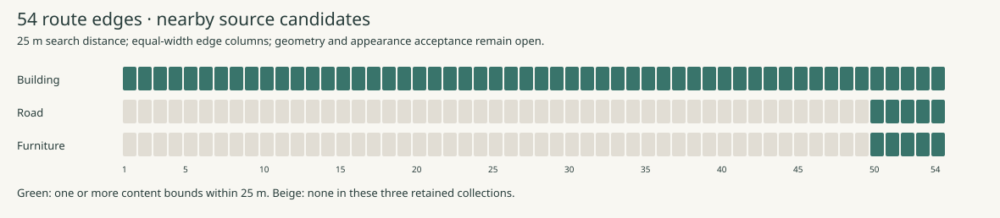

# Kyoto source inspection · 5 November 2026

Five original PLATEAU tile samples have verified byte receipts, object IDs and
triangle counts. Four unchanged embedded WebP atlases and three original tileset
indexes are retained here. [The manifest](manifest.json) binds all eleven evidence
files to their dates, rights, methods, limitations and SHA-256 hashes.

Source credit: **Kyoto City / MLIT Project PLATEAU · CC BY 4.0**. Atlas bytes and
tileset JSON are unchanged. The inspection, spatial index and visualization were
prepared for TourGuideAI. Acquisition of LOD3 inputs was FY2023 according to the
[retained metadata](../../neighborhood-20261027/world/source-receipts.json);
metadata publication in 2026 does not establish current street conditions.
Individual LOD2 photographic capture dates remain unverified.

## Inspected samples

| Source tile / area | Actual rendered building LOD | Triangles | Original texture | Qualification still required |
| --- | --- | ---: | --- | --- |
| data804 · Nishiki west, south side | 20 × LOD2 | 732 | [2048 × 2048 WebP](data804-texture.webp), 119,808 bytes | Façade correspondence, walking-height detail and under-roof surfaces |
| data802 · Nishiki west, north side | 16 × LOD2 | 640 | [2048 × 2048 WebP](data802-texture.webp), 124,938 bytes | Shop entrances, current signs, rear/side views and passage continuity |
| data765 · Pontochō south approach | 2 × LOD2, 3 × LOD3 | 11,794 | [4096 × 4096 WebP](data765-texture.webp), 543,508 bytes | Exact entrance correspondence, occlusions, ground and evening appearance |
| data840 · Shijō–Karasuma search area | 14 × LOD2 | 551 | [1024 × 512 WebP](data840-texture.webp), 60,598 bytes | Mitsui identity remains unconfirmed; this tile contains non-leaf content |
| Pontochō road data1 | Seven road/surface features | 1,163 | No images; one material | Pavement material, surveyed ground, collision and continuous coverage |

The [original inspection](source-inspection.json) preserves every object ID,
sample URL, byte hash and actual LOD count. Atlas resolution alone supplies no
per-façade texel-density measurement. No walking-height render, realistic lighting
assessment or physical-device performance result is implied by these samples.

## Every-edge acquisition index



| Collection | Candidate tiles within 25 m | Route edges with candidate bounds | Accepted appearance / ground / lighting |
| --- | ---: | --- | --- |
| Nakagyo buildings | 51 | 54 of 54 | Unverified |
| Detailed road collection | 2 | 50–54 only | Unverified |
| Detailed furniture collection | 12 | 50–54 only | Unverified |

[The route index](route-source-audit.json) records all 54 ordered edge IDs,
candidate URLs, content bounds, leaf status and distances. It includes non-leaf
content because large objects can occur there. Twenty edges have a sampled
building attribute point within 25 m; such a point does not identify the visible
façade. All 54 edges retain explicit `unverified` appearance, ground and lighting
statuses. The Nakagyo building collection also leaves opposite street sides in
other wards to be inspected. Farther sightlines and occluded faces need review
beyond this fixed acquisition search distance.

## Reproduce the checks

Install the pinned spatial dependencies into the ignored workspace. Run the
audit to an ignored output directory, then compare the generated JSON and SVG
with their retained counterparts:

```sh
TMPDIR=artifacts/realism-01/intermediates python -m pip install --target artifacts/realism-01/inspection-tools -r experience/evidence/realism-01/sources/requirements.txt
PYTHONPATH=artifacts/realism-01/inspection-tools python experience/evidence/realism-01/sources/audit_sources.py --root . --output artifacts/realism-01/runs/source-audit
cmp experience/evidence/realism-01/sources/route-source-audit.json artifacts/realism-01/runs/source-audit/route-source-audit.json
cmp experience/evidence/realism-01/sources/route-source-board.svg artifacts/realism-01/runs/source-audit/route-source-board.svg
```

The separate [original-byte validation](original-byte-validation.json) passed
for all five downloaded B3DM files. Reproduction needs those original downloads
with their retained hashes; raw downloads remain ignored. Install
[inspection requirements](inspection-requirements.txt), then run:

```sh
PYTHONPATH=artifacts/realism-01/inspection-tools python experience/evidence/realism-01/sources/verify_originals.py --sources experience/evidence/realism-01/sources --downloads artifacts/realism-01/downloads --output artifacts/realism-01/runs/original-byte-validation.json
```

The sprint [validator](../../../sprints/realism-01/verify.py) checks the portable
evidence hashes without raw downloads. `build_manifest.py` regenerates the
receipt manifest from these inspected inputs. Its output must be reviewed before
updating the licensing receipt. Source qualification continues through the
[coverage audit](../../../sprints/realism-01/research/source-coverage.md) and
[acquisition requirements](../../../sprints/realism-01/research/capture-requirements.md).
