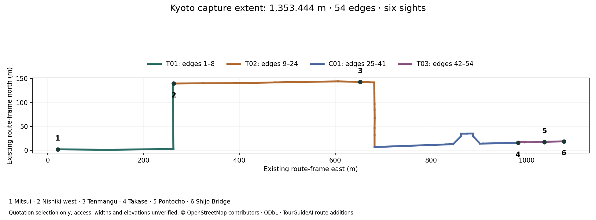

# Kyoto capture quotation package

Prepared 6 November 2026. **Ready for review; inquiries unsent; complete-route price unquoted.**
Owner: capture / technical art. R05 source acquisition supports both matched reconstruction
trials and the approved six-sight route. No supplier has confirmed availability, exports or rights.



| Capture package | Ordered edges, inclusive | Length | Required scene coverage |
| --- | --- | ---: | --- |
| T01 | 1–8 | 379.848 m | Mitsui frontage, Shijō–Takakura connection, Nishiki west; entrances, corners, windows, canopy undersides and ground contacts |
| T02 | 9–24 | 553.564 m | Nishiki arcade, Tenmangū approach and Shinkyōgoku; individual shop fronts, pillars, roof undersides, floors and light transitions |
| C01 | 25–41 | 323.625 m | Every Shijō connecting street through Takase; both visible frontages, pavement, curbs, crossing details and river interface |
| T03 | 42–54 | 96.408 m | Takase, southern Pontochō entrance and Shijō Bridge approach; rails, deck, entrances, river edges and distant context |
| Complete route / T04 | 1–54 | **1,353.444 m** | Six sights, both walking directions, daylight and night |

C01 supplies the connecting streets between the existing T02 and T03 trials. All four
packages are included in the quotation. The [GeoJSON](route-scope.geojson) contains the
54 oriented edge polylines and six approach points; the [scope data](route-scope.json)
records exact lengths, original edge IDs and input hashes. Coordinates describe the
approved route selection. Access, pedestrian boundaries and floor elevations require
current verification; the bridge endpoint is an authored representative point.

| Sight | Longitude | Latitude |
| --- | ---: | ---: |
| Mitsui frontage | 135.7599457 | 35.0037600 |
| Nishiki west | 135.7625989 | 35.0049985 |
| Tenmangū approach | 135.7668613 | 35.0050292 |
| Takase at Shijō | 135.7704716 | 35.0038821 |
| Pontochō entrance | 135.7710767 | 35.0038978 |
| Shijō Bridge | 135.7715200 | 35.0039100 |

## Acquisition and evaluation requirements

The [handover checklist](handover-checklist.md) defines shared originals, camera data,
survey control, independent evaluation images, rights and measurable receipt checks.
The [supplier response matrix](supplier-response.md) separates confirmed capabilities,
coverage exceptions, itemized prices and recurring charges. The [Japanese RFQ](rfq-ja.md)
is ready to transfer into a provider's public contact form after outreach authorization.
It also requests comparable prices for extending the route and refreshing 20% of its
length, with the same day/night coverage, rights, controls and quality conditions.

The [pedestrian audit](../../../../evidence/realism-01/qualification/pedestrian/README.md)
found zero intersections between the acquired detailed road triangles and the 54 route
centerlines or their 0.32 m actor footprints. All six sight anchors remain uncovered.
Its verified registration makes measured floors, covered passages and bridge deck
control an explicit acquisition requirement. Each supplier must identify the current
walkable envelope and elevation uncertainty throughout the route.
Licensed existing measured sources may satisfy individual items after the same rights,
coverage and accuracy checks. The audit identifies a possible revised Pontochō approach
5.250 m northwest of its current anchor; access, obstacles and its route connection
still require review. Quote the frozen route above, and identify any proposed route
revision separately for common benchmark approval.

For Nishiki, the operator's [contact policy](https://www.kyoto-nishiki.or.jp/contact/)
requests applications at least **one month ahead**. Its
[filming guidance](https://www.kyoto-nishiki.or.jp/wp-content/themes/kyoto-nishiki/assets/pdf/attent_Recording.docx)
prohibits installed lighting and large equipment, discourages selfie sticks and tripods,
and requires clear circulation and appropriate consent for identifiable visitors.
That document addresses individual / YouTube filming. The supplier must confirm the
applicable commercial reconstruction category, shop/operator permissions and feasible
handheld equipment. Website publication and filming permission supply no blanket
permission to distribute 3D assets. The retained
[source findings](../../../../evidence/realism-01/qualification/pedestrian/source-access-findings.json)
and [receipts](../../../../evidence/realism-01/qualification/pedestrian/source-access-receipts.json)
record dates, rights and hashes.

## Quotation recipients

| Recipient | Verified public contact, read 6 November | Published reference prices, excluding tax | Items requiring a written answer |
| --- | --- | --- | --- |
| exAgent, Kyoto / Mukō; preferred first inquiry | [Contact form](https://ex-agent.com/contact/); name and email required, subject and message available | JPY 300,000 includes one capture day and one dataset; L2 Pro 32/300 option +JPY 100,000/day; additional dataset creation from JPY 50,000; travel/accommodation separate | Full route and day/night schedule; original RGB, calibration and pose export; shared-source mesh and splat rights; measured floor/control deliverables; all additional charges |
| Advalay; optional second quote for the same scope | [Contact form](https://advalay.jp/contact/), estimate inquiry category; name/email required; public email `info@advalay.jp` | Exterior photographs JPY 15,000–50,000; outdoor handling approximately JPY 30,000; equipment JPY 20,000–60,000; after-hours +20% or more; weather reserve day JPY 40,000; travel outside Kantō separate | Kyoto access and travel; same raw-source/export/rights requirements; exact treatment of processing and recurring hosting |

These are provider-published line items. No capture-day count, total, budget or booking
is inferred. exAgent's base already includes one dataset. Contact-page access was
read-only; [contact receipts](contact-receipts.json) preserve the URLs, retrieval times,
page hashes and observed form fields. The existing
[pricing review](../reference-qualification.md) and its
[exAgent receipt](../../../../evidence/realism-01/qualification/references/exagent-pricing-receipt.json)
and [Advalay receipt](../../../../evidence/realism-01/qualification/references/advalay-pricing-receipt.json)
retain the pricing provenance. Raw pages remain in ignored research storage.

## Release dependencies and next decision

1. Authorize sending the prepared quotation inquiry and approve the sender name / reply
   email. This is the remaining user decision before external contact; it commits no
   spending or capture date.
2. Obtain completed capability, permission and price answers. Present the actual quote,
   source coverage and rights to the user for purchasing approval.
3. Receive and verify the capture against the checklist; register the shared capture
   frame and reviewed floor/collision surface.
4. Run the existing [matched trials](../../experiments/trial-definitions.json) with
   source-isolated holdouts, and complete physical-device and participant gates before
   choosing production representation. Capture receipt alone grants no release pass.

[File hashes and provenance](manifest.json) cover the route map, exact scope and contact
receipts. This is an authored quotation scope with reproducible verification by the
hash-bound [acquisition validator](../../acquisition.py). It checks both source hashes,
all 54 ordered edges and intermediate coordinates, package partition and lengths,
endpoint continuity, six sights and retained evidence hashes. It reads retained files
from a clean checkout. The authored map is preserved by its file hash.

Run from the repository root with the sprint's installed dependencies:

```bash
python experience/sprints/realism-01/verify.py --root .
```
