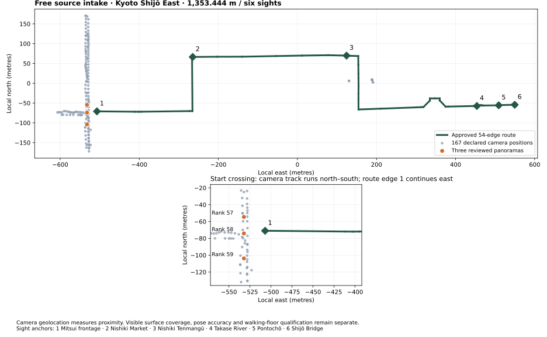

# Free Kyoto connector intake

14 November 2026 · R19 · Source / scene

The [snapshot board](../../../evidence/realism-01/free-connector-next/board.html)
now contains three actual native 360° photographs of Shijō–Karasuma crossing.
Irvin Chen published these February 2026 captures through Panoramax Taiwan under
CC BY-SA 4.0. Full-resolution acquisition, exact source metadata, provider rights
and independent route-distance checks are retained in
[the evidence bundle](../../../evidence/realism-01/free-connector-next/README.md).

| Work item | Result | Next acceptance evidence |
| --- | --- | --- |
| Public federated catalogue query | 14 records inside the route rectangle; 167 in its 100 m surroundings | Queries are bounded and unsaturated. Whole collections and service completeness remain unverified |
| Source intake for reconstruction | Three native 6,080 × 3,040 panoramas, consecutive ranks 57–59, one capture session | Recover stable façade correspondence while excluding the vehicle roof and dynamic occlusion |
| Geographic correspondence | Cameras lie 25.36–41.37 m from edge 1 start, following Karasuma north–south | Demonstrate actual visible support for the eastward sidewalk before declaring a route connector |
| Dimensional admission | Declared 4 m horizontal accuracy and 180° heading recorded | Independent scale/control, full camera poses, measured continuous pedestrian floor and sight identity |
| Lighting admission | Daylight surfaces and shadows visibly present | Separate licensed night capture and matched rendering validation |

The largest retained nearby perspective run contains thirteen ranks at the
crossing; those records declare Mapillary-derived EXIF provenance. The trial uses
the separately documented native Insta360 panoramas. Central-route records have
three repeated coordinate positions and no 360° capture. Their geotags do not
establish a continuous walking sequence.

Use this source for the bounded crossing reconstruction experiment. Admission to
the production city pack depends on the existing geometry, appearance, floor,
rights, performance and independent-discovery gates. The approved 54-edge,
1,353.444 m route retains its current geometry and six sights. No account, paid
source, supplier inquiry or production asset substitution occurred.
