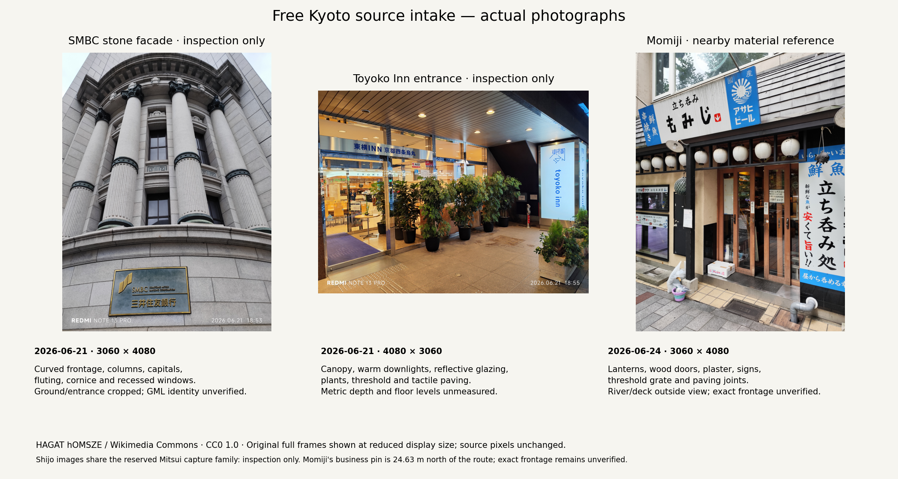

# Free-source feasibility for the approved Kyoto route

6 November 2026 · Free sources only during this period. No supplier inquiry,
purchase, paid account or token request. The scope remains **54 edges, six sights,
1,353.444 m** with the approved experience gates.

| Source work completed | Actual result | Useful next action / qualification limit |
| --- | --- | --- |
| Official PLATEAU query across all feature types in the route rectangle | Same Kyoto 2025 mesh inventory; four bridge features and 18 LOD3 road features in the intersecting mesh file, already examined | Reuse the selected geometry for context and diagnostics. File-level presence supplies no new floor coverage; the [pedestrian audit](../../../evidence/realism-01/qualification/pedestrian/README.md) remains valid |
| Separate official high-detail collection, `uc25-44` | Complete building, road and square nested ZIP entries obtained through bounded HTTP ranges; their declared geographic extents are south of this route | The additional entries supply no declared approved-route coverage. Geometry quality and resource-specific redistribution rights remain unqualified; raw archives stay ignored |
| Commons photographic series and exact-place search | 20 candidate metadata records retained; five unchanged CC0 originals acquired and inspected, totaling 27.14 MB | Actual façade, entrance and street-detail observations are in the [intake](../../../evidence/realism-01/qualification/free-sources/README.md). Exact subject-to-GML/scale registration remains necessary |
| Capture-family review | Shijō frames 30/31/32/37 share the June 21 series of reserved Mitsui frame 28; 30/31 overlap without a proven translation baseline | Preserve the existing holdout. All four related images remain inspection-only pending explicit evaluation redesign |
| Business identity | Momiji listing pin is 24.63 m north of route edge 50; Toyoko Inn's official pin is 23.00 m north of edge 1 | Named businesses established. Pins and phone GPS supply no surveyed doorway/GML association; Momiji is a nearby material reference |
| KartaView no-key API | Four completed queries; route rectangle covers all 54 full polylines and returns zero camera records; east-radius lookup returns seven off-route cameras | Two nearest thumbnails inspected; neither establishes a route feature. Five images remain unreviewed. Off-route cameras may still view route features |

The separate official archive was discovered in the retained Kyoto catalog as
“モデル地区における高精細３Ｄ都市データ作成”. RemoteZip 0.12.3 and Python ZipFile inspected
its central directory and selected nested files. The final extraction transferred
**52,491,674 bytes**; the entire outer archive was not downloaded. Building bounds
are 135.753297–135.762575 E / 34.985539–34.989172 N. Road/square bounds are nearby.
All three declared extents have zero intersection with the approved route bounds.
The [receipts](../../../evidence/realism-01/qualification/free-sources/research-receipts.json)
retain original range hashes, nested ZIP identities and extracted tileset hashes.
Archive timestamps are not capture dates. The route query and extra collection
remain distinct source identities.

The 47-photo June 21 Shijō series includes 15 declared camera positions within
35 m of this route. These are uncalibrated network locations, and a sequence
title supplies no continuous photogrammetric coverage. Exact-place Commons
results also identify separately licensed Mitsui night, Nishiki, Tenmangū and
bridge photographs; their metadata records remain potential references until
their actual frames, subjects and source roles are reviewed. A bounded public
downloadable-model search established no exact-route captured 3D package.

Mapillary's public terms were read and hash-recorded. They specify user-content
licenses, registered developer access, and restrictions on real-time
sensor-synchronized route guidance and unapproved extraction. This investigation
acquired no qualifying exact-route Mapillary sequence and requested no token.
It cannot presently supply the website's walking/location journey.

KartaView's terms license street imagery and 3D spatial data under CC BY-SA 4.0
with Grab/contributor attribution. Its documented rectangle parameters establish
the full-route search extent; the radius parameter's unit is unspecified. PyProj
and Shapely verify every intermediate route point. The two inspected **200 × 113**
thumbnails show a storefront-door crop and a roadside-box crop, from cameras
196 m and 332 m away. The [visual intake](../../../evidence/realism-01/qualification/free-sources/README.md)
retains the unchanged previews, source receipts and limits. No camera records
inside the rectangle establishes no blanket absence of visible route coverage.

The practical free-only scope is **annotated material/feature review and renderer
engineering using the existing qualified source identities**. Momiji provides
nearby wood, plaster, lantern and threshold observations; its business association
does not qualify an exact route-frontage replacement. The Shijō photos remain
inspection-only. This intake has no permitted calibrated multiview/scale package
for source-faithful dimensional detail and no matched mesh/splat capture pair.
The next geometry admission requires those specific source inputs; the current
work cannot claim a completed realistic route. Measured pedestrian surfaces,
independent day/night evidence and all complete-route quality gates remain open.
