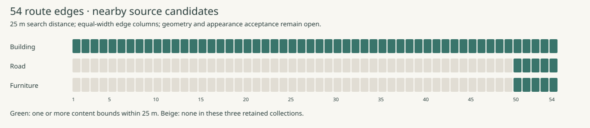

# Full-route source coverage

Reviewed 5 November 2026. Method: retained route/licensing review, original byte and content inspection of four building tiles and one road tile, and a reproducible candidate-bounds index for all 54 edges. Walking-height appearance acceptance and a photographic survey remain outstanding.

The [current route](../../../src/neighborhoods/shijo-east/geography.json) contains **1,353.444 m, 54 ordered edges and six sights**. Coordinates below are longitude, latitude. The [licensing receipts](licensing-receipts.json) bind the inspected files by SHA-256. All appearance qualification remains **open**.

The [portable inspection and source board](../../../evidence/realism-01/sources/README.md)
retains four original texture atlases, five original tile receipts and three
original tileset indexes. A 25 m search around each route edge finds 51 building
content candidates across all 54 edges. Detailed road and furniture candidates
occur only beside edges 50–54 in the retained collections. Bounds provide an
acquisition index; all appearance, ground and lighting acceptance remains open.
The [every-edge index](../../../evidence/realism-01/sources/route-source-audit.json)
includes non-leaf content, candidate URLs and nearby inspected object IDs.

## Sight coverage

| Sight / approach coordinate | Evidence already retained | Appearance and lighting gaps to resolve |
| --- | --- | --- |
| Mitsui frontage · 135.7599457, 35.0037600 | Mapped building and public approach; [facade registry](../../../public/content-evidence/facade-references.json): 2021 night exterior and 2026 frontage close-up | Continuous side/corner/reverse façades, door-to-map correspondence, canopy underside and dimensions; present day/night material response and fixture positions |
| Nishiki Market · 135.7625989, 35.0049985 | Mapped route/roof; [photo registry](../../../public/assets/neighborhoods/shijo-east/references.json): 2026 west portal and 2025 arcade reference | Shop-by-shop elevations, changing signs, paving, soffits, entrances and roof structure across the whole passage; controlled day/night exposure. Arcade image date conflicts between metadata and description |
| Nishiki Tenmangū approach · 135.7668613, 35.0050292 | Mapped torii and public approach; 2007 street photograph in photo registry | Current gate, adjacent façades, roof interfaces, storefront edges and under-roof visibility; measured dimensions and current lighting. Keep movement on reviewed public street |
| Takase River · 135.7704716, 35.0038821 | Mapped river and Shijō sidewalk; 2026 river photograph approximately 80 m north | Actual selected river mouth, barriers, road soffit, neighboring fronts, water/ground elevations and lighting; northern reference cannot establish this location's appearance |
| Pontochō south entrance · 135.7710767, 35.0038978 | 2026 entrance/board photographs; municipal description; PLATEAU file/tileset metadata | Exact mouth and adjoining façades, ground continuity, eaves and evening fixtures. Detailed northern alley coverage does not prove coverage at this anchor |
| Shijō Bridge · 135.7715200, 35.0039100 | Mapped pedestrian area; representative viewing point; 2026 north parapet reference | Deck grade, rail spacing, piers, joints, banks, distant context and night lighting. Previously inspected four LOD3 bridges exclude Shijō Bridge |

## Connecting-street coverage

Edge ranges are inclusive, one-based positions in `selectedRoute.edgeIds`; together they account for every edge exactly once. Existing mapped connectivity establishes a route reference. Appearance and surveyed elevation require separate inspection.

| Connection | Edges | Existing basis | Required source review |
| --- | ---: | --- | --- |
| Mitsui → Nishiki west approach, via Shijō and Takakura | 1–8 | OSM path, Kyoto LOD1 solids; dated Daimaru façade reference | Both visible street sides, corners, pavement transitions, canopy continuity and daytime/nighttime frontage coverage |
| Nishiki passage → Tenmangū approach | 9–15 | OSM market alignment/roof, isolated arcade photos | Continuous shop-by-shop and ceiling coverage, floor clearances, pillars, doors and lighting throughout the passage |
| Tenmangū → Takase, via Shinkyōgoku and Shijō | 16–41 | OSM street alignment and LOD1 context; prior authored connection reviews | Complete frontages at arcade exit, intersection approaches and eastbound street; under-eave gaps, pavement/crossing detail and fixture consistency |
| Takase → Pontochō entrance | 42–51 | Shijō sidewalk and river geometry; entrance references | Selected river mouth, street furniture, corner façades, actual ground levels and coherent lighting across the transition |
| Pontochō → Shijō Bridge viewing point | 52–54 | Mapped deck area plus authored final approach; parapet photo | Street/deck join, bridge slope and railing geometry, close and distant river context, lighting continuity |

## Source qualification rules

| Source | What the retained evidence establishes | Required qualification |
| --- | --- | --- |
| Kyoto LOD1 2025 | Selected solids and source Z values retained; current presentation derives footprints and height ranges | Original appearance is absent from this preparation; replace authored level-zero placement only after reconciling horizontal/vertical datums |
| Kyoto textured PLATEAU | Four original building samples contain 52 LOD2 and three LOD3 objects; original IDs, triangles and four texture atlases verified. Metadata declares CC BY 4.0; LOD3 acquisition FY2023, metadata publication 2026-03-31 | Match actual visible surfaces to route edges, including adjacent wards. Inspect walking-height textures, occlusions and current conditions; bounding candidates remain unqualified |
| Pontochō metadata inventory | Containing mesh has 4,444 LOD2 buildings, including 138 with LOD3; mixed LOD1–3 tileset identified | Record per-object LOD, surfaces, texture resolution and occlusions. The small research rectangle covers only the eastern area |
| Licensed still photographs | Particular dated features, authors and licenses recorded in the two photo registries | Match each façade/viewpoint before use; retain attribution and applicable ShareAlike obligations; current conditions and reconstruction suitability remain unverified |
| Operator descriptions | Paraphrased location/access facts | Descriptions confer no license to redistribute operator photos or reconstruct their imagery |

The [source ledger](../../../src/neighborhoods/shijo-east/source-ledger.json) explicitly records authored navigation height 0, water height −2.5 m and canopy dimensions. None is a measured terrain claim. The [provider review](../../../evidence/neighborhood-20261027/world/provider-research.md) supplies historical provider terms and fees; procurement must recheck them before use.

**Next evidence:** extend the five sampled content inspections across the 51 building
candidates and the road/furniture candidates, identify every sight by source object,
and assess assembled surfaces from walking height. Mitsui correspondence is
unconfirmed in non-leaf `data840`; Nishiki samples are LOD2; the sampled Pontochō
road has no image texture. Ground datum, opposite street sides, passages and night
fixtures require independent qualification. Assign unresolved requirements to the
[capture proposal](capture-requirements.md). Renderer selection remains open until
the matched full-route builds and benchmark acceptance have actual evidence.
